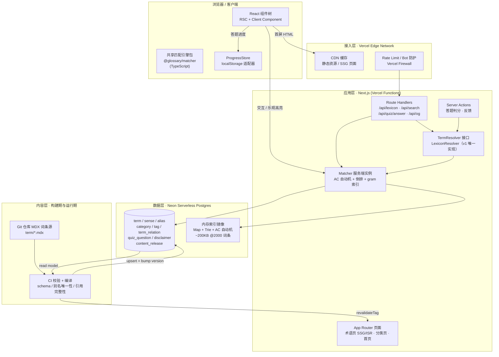
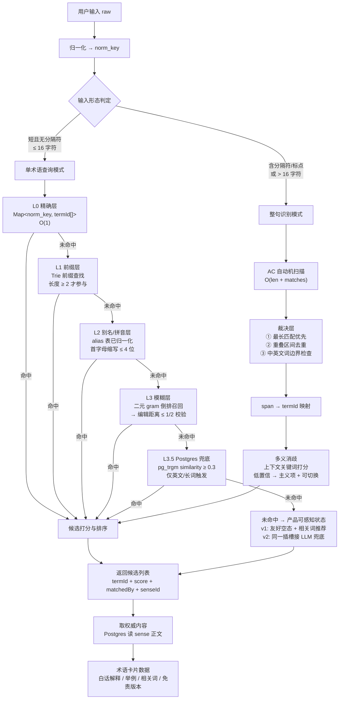
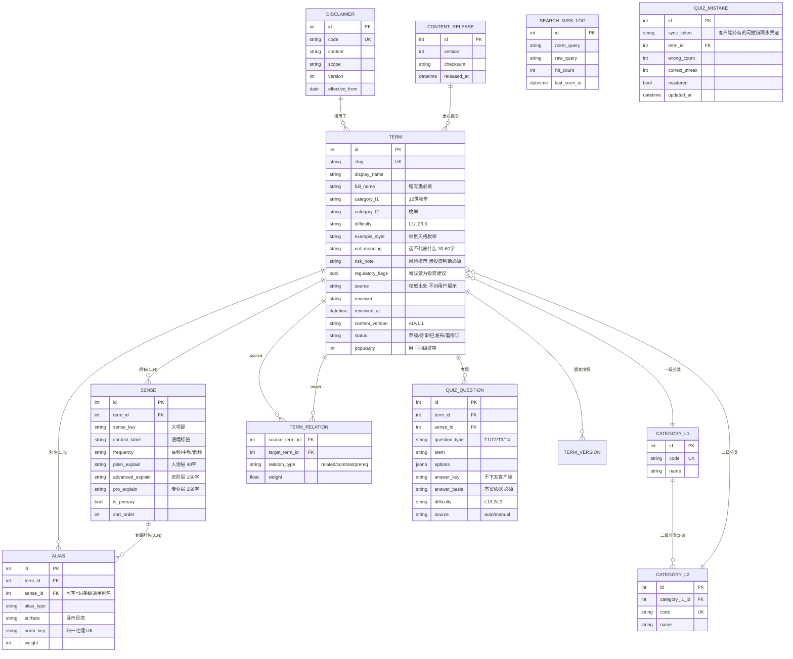
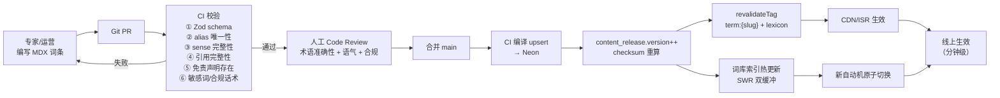

# 股票黑话解释器 · 总体架构与技术选型方案

> 作者：梁承宇（系统架构师）｜版本：**v1.1（已对齐产品需求定稿 v1.0）**｜日期：2026-10-20
> 本文档是《股票黑话解释器》Web 工具的架构基线。已锁定的产品决策（结构化词库 + 规则匹配、不接行情、Next.js 前后端一体 + BaaS、MVP 做术语查询 + 小测验、不做账号体系）作为**不可更改的输入约束**，本文只在其之上做技术决策。
>
> **v1.1 修订说明**：产品需求文档已定稿，本文按其定稿逐条校准，修订了 7 处实质冲突（详见 §0.1 变更记录）。核心变更：① **整句识别从 MVP 降为 V2**（产品 S-1 列为 Should，理由为误报损伤信任）；② 词库规模按 **120 条 / 145 义项**重算成本；③ 分类改**两级枚举**、释义改**三层**、新增 `not_meaning`/`risk_note` 词条级字段；④ 测验改用产品 T1–T4 四题型、**取消积分与连击倍率**（产品 W7 明确不做）；⑤ 补齐产品硬性验收项——**离线可读、弱网闯关不丢进度、字号三档、词库缺口池**；⑥ 出题比例与审核口径按产品重定。

---

## 0. 架构决策摘要（TL;DR）

| 维度 | 结论 | 一句话理由 |
|---|---|---|
| 架构风格 | Next.js 全栈单体（App Router）+ BaaS | 读多写少、团队 2~4 人、单机即可承载目标流量，微服务是负债 |
| 检索引擎 | **应用层内存词典 + Aho-Corasick 自动机**，Postgres 只做权威内容存储 | 词库规模小（120 条）本质是「词典查找」不是「信息检索」；托管 BaaS 上中文分词扩展不可用 |
| 词库真源 | **Git 仓库内 MDX/结构化 Markdown**，Postgres 为编译产物（读模型） | 嵌套内容需要 review/版本/回滚，Git 免费送这些 |
| 数据库 | **Neon**（Serverless Postgres） | 纯 Postgres 不锁死扩展路径；branching 直接映射内容审核发布流；scale-to-zero 契合突发流量 |
| ORM / 校验 | **Drizzle + Zod** | 需要 GIN 索引/相似度函数/部分索引等裸 SQL 能力；Serverless 友好无引擎进程 |
| 部署 | **Vercel Pro** | Next.js 一体化 + ISR + 预览环境，零运维；Hobby 禁商用必须上 Pro |
| 缓存 | CDN + ISR + 进程内内存；**v1 不引入 Redis** | 无账号即无 session 存储需求，引入即多一个服务/一份钱/一个故障点 |
| 现在就要做对的预留点 | `TermResolver` 抽象、`ProgressStore` 抽象、匹配引擎同构共享包、sense/alias 分离、免责声明入库 | 这 5 处在 v2（LLM 兜底 + 账号 + 行情）会被迫重构 |

### 0.1 v1.1 变更记录（对齐产品需求定稿）

产品需求文档定稿后，逐条比对发现 7 处实质冲突。本节记录**冲突内容与架构处置**，便于产品与开发共同确认。

| # | 冲突点 | 产品定稿 | 架构 v1.0 原假设 | v1.1 处置 |
|---|---|---|---|---|
| 1 | **整句黑话识别的优先级** | S-1 列为 **Should（V2）**，MVP 不做；理由「误报直接损伤信任」 | 列为 MVP 核心能力，含 AC 自动机完整实现 | **降级为 V2**，MVP 只做单术语查询；AC 自动机与裁决层设计**保留但标注为 V2 实现**，匹配引擎同构包仍提前建（见 §3.1.4、§6.1） |
| 2 | **词库规模** | 首版 **120 条 / 145 义项** | 100~500 条起步、2000 条长期 | 全文性能与成本估算改为按 120 条（保守仍按 2000 条给扩展上限），**成本重算**（见 §8） |
| 3 | **分类与释义层级** | `category_l1` + `category_l2` **两级枚举**；释义分**三层**（人话 ≤40 字 / 进阶 / 专业） | 单层主分类 + 标签；释义单层 | 数据模型改**两级分类**（`category_l1`/`category_l2` 枚举）+ **`sense` 承载三层释义**（见 §3.2.1） |
| 4 | **词条级风险字段** | `not_meaning`（这不代表什么，30~60 字，**必填**）、`risk_note`（风险提示，涉投资判断词条**必填**）、`regulatory_flags` | 仅全局 `disclaimer` 表 | 新增**词条级** `not_meaning` / `risk_note` 字段与 `regulatory_flags` 标记；与全局免责**分层共存**（见 §3.2.2、§4.6） |
| 5 | **激励体系** | W7 明确**不做积分/连击倍率/连续打卡**；徽章纯本地无积分 | 连击倍率最高 1.5×，分数累计 | **删除连击倍率与分数累计**，改为产品原文的「连对 N 题」纯荣誉徽标 + 进度可视化（见 §3.3.3） |
| 6 | **题型与出题比例** | 4 种题型 **T1 正向识词 / T2 反向识词 / T3 语境应用 / T4 一词多义辨析**；每词条 ≥1 道 T1 + 1 道 T2（派生，不手写）；总量 ≥360 题 | 自定义 4 型（choice_def / choice_term / judge / manual） | 改用产品 T1–T4 原名与语义；**取消 judge 判断题**（产品 4 型全为选择题）；出题比例按「T1/T2 派生 + T3/T4 人工」重定（见 §3.3.1） |
| 7 | **审核口径** | 词条审核 **100% 全检，不允许抽样** | 词条抽检 ≥20% | 词条审核改 **100% 全检**（产品明示）；「抽样」仅适用于**自动派生题**的题干质量抽检（见 §3.3.1） |

**另有两项产品新增的硬性验收要求，架构 v1.0 未覆盖，本次补齐**：

| 需求 | 产品条款 | 架构补齐 |
|---|---|---|
| **离线可读** | P5：断网后打开已访问词条 → 展示缓存内容 + 明确「当前离线」提示，不白屏 | Service Worker + 缓存策略（见 §4.1.3） |
| **弱网闯关不丢进度** | P7：3G 限速下完成 8 题闯关全流程可完成、无中断丢失进度 | 闯关状态机本地持久化 + 判分请求幂等重试队列（见 §3.3.2） |
| **字号三档** | A3：100% / 115% / 130% 可切换，默认档不小于 16px | 排版基准从 18px 调为 **16px**，改用 rem 相对单位以支持三档切换（见 §4.4） |
| **词库缺口池** | R4：无结果词按频次记录排期补词 | 新增 `search_miss_log` 表与服务端上报端点（见 §3.4.4） |

---

## 1. 架构总览

### 1.1 整体架构图



**图例**：`MDX → CI → DB` 是内容发布（写）链路；`DB → IDX` 是词库索引加载链路；`RES` 是 v2 接 LLM 的插槽点；`MATCH` 的**整句扫描分支（AC 自动机）在 MVP 不启用**（产品 S-1 列为 Should），MVP 只跑 L0~L3 单术语匹配链路。

### 1.2 架构风格选择

**结论：Next.js 全栈单体（App Router）+ BaaS，不做前后端分离，也不做 Serverless 函数拼装。**

| 风格 | 结论 | 理由 |
|---|---|---|
| **Next.js 全栈单体** | ✅ 采纳 | ① 部署单元 = 1，减少跨服务调用与分布式事务；② 团队 2~4 人，单体的心智负担最低；③ 内容型读多写少，垂直扩容只需扩 Vercel 实例；④ Route Handlers 天然对外暴露 HTTP，将来拆服务时 API 契约已成型 |
| 前后端分离（独立 Node API + 前端） | ❌ 否决 | 本项目**没有外部 API 消费方**、没有多团队并行、没有需要独立扩缩容的重负载模块。分离后要额外承担：CORS、鉴权、版本化、跨域部署、监控两套、CI 两套。收益为零，成本翻倍 |
| 纯 Serverless（Edge Functions + API Gateway + 独立 DB） | ❌ 否决 | 词库索引需要常驻内存 + 跨请求复用，Edge Function 的 isolate 模型反而增加冷启动与状态管理复杂度；纯 SSR 页面用不上 Edge 的低延迟优势（静态内容 CDN 就够） |
| 微服务 | ❌ 否决 | 当前只有一个业务域（术语库）。此时拆微服务 = 把分布式系统的复杂度提前引入，换不到任何可观测的收益。演进触发条件见第 6 节 |

### 1.3 模块清单与职责

| 模块 | 职责 | 依赖 | 技术栈 |
|---|---|---|---|
| `apps/web` | 页面渲染、路由、SEO 元数据、API 端点 | `@glossary/matcher`、`@glossary/db` | Next.js 16 (App Router) + React 19 + TypeScript |
| `packages/matcher` | **同构**匹配引擎：归一化、精确/别名/前缀/模糊、多义词候选、整句 AC 扫描与区间裁决 | 无（零依赖或仅轻量依赖） | TypeScript（可跑在浏览器 / Node / Edge） |
| `packages/db` | 数据访问层、schema 定义、迁移、索引加载与热更新 | Neon serverless driver | Drizzle ORM + Postgres |
| `packages/content` | MDX 词条 schema、front-matter 解析、内容编译与校验规则 | `packages/db` | Zod + gray-matter / MDX 编译 |
| `packages/quiz` | 出题策略、判分、连击与计分规则、关卡定义 | `@glossary/db` | TypeScript |
| `packages/ui` | 设计 token 与基础组件（卡片、标记、弹层） | shadcn/ui + Radix | Tailwind CSS v4 + Radix Primitives |
| `apps/admin`（v2 可选） | 非技术人员改内容的后台 | — | 待定（见 3.4） |

**依赖方向铁律**：`ui → matcher/db` 单向；`matcher` **不依赖任何后端**（保证能同时跑在浏览器与 Node，这是同构高亮的前提）；`db` 不依赖 `web`。禁止反向依赖与循环依赖。

### 1.4 核心链路说明

**链路 A：术语精确查询（主力路径，预期占绝大多数流量）**

1. 用户输入 `市盈率` → 浏览器调用共享 `matcher` 走本地 L0 精确层（内存 Map）→ 命中别名 `市盈率 → PE`
2. 客户端立即渲染卡片骨架 + 乐观高亮（不等网络）
3. 同时发起 `/api/search?q=市盈率` → 服务端 `TermResolver` → 同一份 `matcher` 逻辑 → 命中后读 Postgres 取 sense 完整内容
4. 返回卡片数据（白话解释 / 举例 / 相关词 / 免责声明版本号）
5. 若为新 URL 形态（`/term/pe`），服务端做一次 302 → 规范 URL，保证 SEO 单一权威地址

**链路 B：整句黑话识别（⚠️ V2 能力，MVP 不做）**

> 产品 S-1 将整句识别列为 Should，理由是「误报会直接损伤信任」，R5 进一步指出「识别不准则整体信任崩塌」。**架构决策：MVP 不实现此链路**，但匹配引擎的同构共享包与 AC 自动机设计提前建成（约 0.5 人日成本），确保 V2 接入时不重写前端。详见 §3.1.4。

1. 输入归一化（NFKC 全半角、大小写折叠、空白压缩、长度截断至 200 字符）
2. 判定为「句子模式」（含分隔符/标点/长度 > 阈值）→ 进入 AC 自动机扫描
3. AC 自动机一次遍历输出全部候选 span → 裁决层做「最长匹配优先 + 重叠区间去重 + 词边界检查」
4. 每个 span 映射到 termId；一词多义时用上下文关键词打分选 sense，低置信则返回主义项 + 可切换义项
5. 客户端高亮渲染（React 文本节点，**不使用 dangerouslySetInnerHTML**）
6. 服务端返回同样的 spans 作为权威结果，客户端以服务端结果覆盖乐观值

**链路 B′（V2 补充要求）**：产品 R5 要求「识别结果必须可逐个关闭/忽略」→ 识别态支持逐项 dismiss 且状态本地留存，**且不进入错题本**（避免误报污染学习数据）。

**链路 C：小测验答题**

1. 客户端从 `ProgressStore`（localStorage）读取当前关卡与薄弱词集合 → 请求 `/api/quiz/next?level=...`
2. 服务端按关卡策略出题（题目与干扰项来自 DB，**答案不在下发 payload 中**）
3. 用户作答 → 提交 `/api/quiz/answer {questionId, optionId}` → 服务端查 `answer_key` 判分并返回 `correct + explanation`
4. 客户端本地更新连击徽章计数、错题本（localStorage）；`ProgressStore` 接口隔离存储实现，v2 换账号后端时只换实现
5. **弱网保障（产品 P7）**：判分请求失败时进入本地重试队列，题目与作答记录本地留存；恢复网络后按 `clientRequestId` 幂等补交，**进度不丢**

**链路 D：内容发布（写路径，低频）**

1. 运营/专家在仓库内新增或修改 `content/terms/*.mdx`（含 front-matter + 结构化 body）
2. 提 PR → Code Review（术语准确性 + 合规话术）
3. CI 跑校验：Zod schema、**别名全局唯一**、sense 完整性、相关词引用存在性、disclaimer 存在性 → 编译成 upsert 脚本
4. 合并后 CI 同步到 Neon，`content_release.version` 自增，触发 `revalidateTag('term:{slug}')` 与 `revalidateTag('lexicon')`
5. 词库索引以 SWR 双缓冲方式热更新：构建新自动机 → 原子切换 → 释放旧实例

---

## 2. 关键技术决策与选型对比

### 2.1 前端框架：Next.js App Router（不是 Pages Router）

**结论：Next.js 16 + App Router。术语详情页走 SSG/ISR，搜索/测验走 Client Component + Route Handler。**

**SSR 对 SEO 的价值有多大？** 在本项目里 **非常高**，理由与一般内容站不同：

- 术语是**长尾搜索词**（「市盈率是什么意思」「死猫反弹 是什么意思」「MACD 金叉」），用户在 Google/Baidu 的搜索意图就是「查定义」，搜索落地页必须能被抓取到**完整正文**（白话解释 + 举例 + 相关词）。纯 CSR（SPA）在这个场景几乎等于放弃自然流量。
- 术语页的**结构化内容适合 SSR 直出**：首屏 HTML 里就有释义文本，无需等 JS 执行，LCP 与收录质量都更好。
- 但 SSR ≠ 每次都动态渲染。词条是**静态内容**，无用户态 → 用 **SSG（`generateStaticParams`）** 最优：构建期生成全部术语页，CDN 直出，TTFB 接近 0，成本 0。

| 项 | App Router（✅ 采纳） | Pages Router（❌ 否决） | Astro（❌ 否决） |
|---|---|---|---|
| 官方定位 | 当前推荐，Next.js 16 默认 | 已被官方定位为 legacy | 另一生态 |
| 静态生成 | `generateStaticParams` + ISR，原生 | `getStaticProps` 也支持 | 更强（内容优先） |
| 数据获取 | RSC 直连 DB，无客户端瀑布流 | 需手写 SWR/SSR 双份逻辑 | 需另接 React 集成 |
| 服务端交互 | Server Actions 内置（答题判分天然适配） | 需自建 API 层 | 需自建 |
| 生态与招聘 | 最大 | 收缩中 | 小 |
| 迁移成本 | — | — | 从零搭 React 集成 + 部署适配 |

**结论理由**：本项目在「首屏 SEO」和「答题交互」之间需要双向兼顾，App Router 同时给出 RSC（SEO）与 Server Actions（交互表单）两件套，是唯一低成本同时满足的方案。Next.js 16 关键变化（`middleware.ts` → `proxy.ts`、`params`/`searchParams` 变为 Promise、`revalidateTag` 需带 `cacheLife` profile、`'use cache'` 显式缓存指令、Turbopack 默认）需在实现时对齐最新文档。

**不用 `getStaticProps` 时代的老写法**，统一用 App Router + `generateStaticParams` + `revalidate` / `revalidateTag`。

### 2.2 样式方案：Tailwind CSS v4 + CSS Variables 设计 Token

**结论：Tailwind CSS v4（+ CSS 变量做主题 token），少量特例用 CSS Modules。**

| 项 | Tailwind v4（✅） | CSS Modules（❌） | UI 组件库自带样式（❌） |
|---|---|---|---|
| 主题一致性 | token 化，卡片/文字/间距全站统一 | 散落在各 `.module.css`，改主题要逐文件改 | 与组件库深度绑定，改主题=改组件库 |
| 交付速度 | 原子类，组件开发快 | 慢，且需自建体系 | 快但被绑死 |
| 儿童友好/大字号/高对比 | 可用 CSS 变量 + `clamp()` 一处调全站 | 需逐组件改 | 需覆盖组件库样式，成本高 |
| 产物体积 | 按需产出，无运行时 | 无运行时 | 组件库通常带全量样式 |

**否决 CSS Modules 作为主方案**：本项目视觉诉求是「卡片式、友好、可读性强」，需要一套**能一处调全站**的 token（字号阶梯、圆角、阴影、语义色）。CSS Modules 天然与「统一 token」对立，会在调大字号/高对比时付出成倍成本。仅在 Tailwind 无法表达的特殊效果（复杂伪元素动画、渐变遮罩）局部使用 CSS Modules。

**不用 Ant Design 做样式底座**（理由见 2.3）。

### 2.3 UI 组件库：shadcn/ui（基于 Radix Primitives）

**结论：采用 shadcn/ui + Radix Primitives + Tailwind，自建业务组件（术语卡片、高亮标记、测验卡片）。**

| 项 | shadcn/ui（✅） | 纯 Radix（❌） | Ant Design（❌） |
|---|---|---|---|
| 形态 | 源码拷贝进仓库，**零运行时依赖膨胀** | 无样式基元 | 完整 npm 包 |
| 包体积 | 按需引入，实际只带用到的 | 最小 | 较大（含完整主题与图标，数十 KB ~ 数百 KB gzip） |
| 可定制性 | 完全可控（就是我们的源码） | 需自己写全部样式与封装 | 需大量 `override`/主题定制，深坑 |
| 视觉语言 | 中性、干净、圆角克制 → 适合「友好卡片」 | 同上但工作量全在我们 | 典型 B 端后台（表格、表单密集、方正、蓝色主色），与「面向金融小白的亲和卡片」气质不符 |
| 中文生态 | 社区中文示例多 | 少 | **最好**（这是 AntD 唯一优势） |
| 无障碍 | Radix 基元自带键盘导航/焦点管理/ARIA，**AA 合规成本最低** | 同样好 | 好但定制后易破 |

**否决 Ant Design 的决定性理由**三条叠加：① 视觉语言与产品定位冲突（我们卖「白话、友好、不吓唬人」，AntD 卖「企业级、效率、密度」，改造成本 > 重写成本）；② 定制主题时 CSS-in-JS/样式覆盖的坑与我们要做的「大字号 + 高对比 + 儿童友好」强冲突；③ 包体积与「首屏 LCP ≤ 1.5s」目标相悖。

**保留 Radix 底座的价值**：shadcn/ui 只是 Radix 的一层皮肤，直接用 Radix 能拿到「无样式 + 完整无障碍语义」，我们用 Tailwind 写皮。关键在 **Radix 的焦点管理、键盘导航、`aria-*` 语义是 WCAG AA 的免费底座**，这决定了我们不需要自研无障碍组件。

**自建业务组件清单**（不依赖任何 UI 库）：`TermCard`（术语卡片）、`HighlightedText`（高亮文本）、`ExampleBlock`（生活化举例块）、`RelatedTerms`（相关词 chips）、`QuizOption`（选项）、`LevelProgress`（闯关进度）、`DisclaimerBanner`。

### 2.4 搜索能力：**纯 Postgres 方案不可行，应用层内存词典是正解**

这是本方案最关键也最反直觉的一节。**先厘清一个事实：我们要做的不是「信息检索」，是「词典查找（dictionary lookup）」。** 两者最优解完全不同。

- 信息检索：文档集合巨大、查询模糊、需要相关性排序 → 需要倒排索引 + 分词 + 相关性模型（Meilisearch/ES 的战场）
- 词典查找：词条有限（2000 条）、查询短、要求**精确命中**、需要**可解释的匹配逻辑**（用户输入「市盈率」必须命中 PE，不是「市盈率相关的文档」）

**规模推演（两个口径）**：**MVP 实际规模 120 条**（产品 7.7 覆盖度规划）→ 120 条 × 平均 3 个别名 ≈ 360 个 key ≈ **11KB**，索引体积可忽略不计；**扩展上限 2000 条** → 2000 条 × 平均 3 个别名 ≈ 6000 个 key，每个 key 平均 30 字节 ≈ **180KB**。**两个口径的索引都能完全常驻在单个 Node 进程内存里**。任何为「百万文档」设计的搜索引擎在这个规模上都是杀鸡用牛刀，却要付出真金白银的月费与真实的运维复杂度。

#### 2.4.1 四方案横向对比

| 维度 | A. 纯 Postgres（无分词扩展） | B. Postgres + zhparser/pg_jieba | C. Meilisearch / Typesense | D. **应用层内存词典 + AC 自动机** |
|---|---|---|---|---|
| 中文分词 | ❌ 默认 `simple` 按单字切，「市盈率」被切碎，召回噪声大、排序失真 | ✅ 质量好 | ✅ 支持中文 | ✅ 词典驱动，无需通用分词器（词表封闭，最长匹配即可） |
| 托管 BaaS 可用性 | ✅ | ❌ **需编译 C 扩展，Neon/Supabase 均不提供**（Neon 支持 `pg_trgm`/`pgvector`/`unaccent`，不支持 zhparser） | N/A | ✅ 不依赖 DB 扩展 |
| 缩写/别名/拼音映射 | ✅ 靠 alias 表（**但这是数据问题，不是检索问题**） | ✅ | ✅ | ✅ 同一张 alias 表，内存镜像 |
| 模糊容错 | ⚠️ `pg_trgm` 对中文短词差（2 字词 trgm 退化），英文可用 | ⚠️ 同上 | ✅ 内建 typo tolerance | ✅ 自己实现，语义可精确控制（编辑距离 + gram 索引） |
| 整句多术语高亮 | ❌ 做不到（需在应用层做） | ❌ 做不到 | ❌ 做不到（引擎只返回文档 id + 分数，不返回 span 偏移） | ✅ **AC 自动机原生产出 span 区间** |
| 性能 | 每次查询一次网络往返 + SQL 解析 | 同左 | 网络往返 + 索引同步延迟 | ✅ **0 网络往返，1KB 文本扫描 < 1ms** |
| 运维成本 | 0 | 高（自建 PG + 编译扩展） | 高（额外服务 + 索引同步管线 + 单写节点 + 中文分词词典质量不可控） | ✅ 0 |
| 月费 | 0 | ~$19+（自建） | Meilisearch Cloud ~$30 起 / Typesense Cloud ~$7 起 + 机器 | ¥0 |
| 结论 | ❌ 中文不可用 | ❌ 托管环境装不上 | ❌ 规模与能力严重错配 | ✅ **主选** |

**关于 Meilisearch 被否决的深层理由**（不只是「贵」）：

1. **能力错配**：Meilisearch 的核心价值是「对海量文档做 typo-tolerant 全文检索并给出相关性排序」。我们只有 2000 个精心策展的术语，**每一条都必须精确命中**——用户搜「市盈率」如果返回一堆「市净率、息率、股息率」，那是失败而非成功。引擎的模糊能力在这里是**负资产**。
2. **它解决不了我们的核心难题**：整句高亮需要 **字符级 span 偏移**，Meilisearch 的 API 不返回偏移，只返回文档 id + 分数。用它还得额外把文本拉回来在应用层重匹配——等于付了钱还多写一套。
3. **同步管线是新的故障源**：词库改一次 → 需触发索引更新 → 有延迟 → 线上出现「新词搜不到」的不一致窗口。而我们的词库是编译进 DB 的，**版本号 + 快照天然一致**。
4. **中文分词质量不可控**：Meilisearch 的中文分词依赖内置词典，对金融术语（尤其「市盈率」这类多义复合词、「阴跌」这类行业黑话）分词质量不可控，反而需要我们做大量 synonym 配置工作——而我们的 synonym 就是 alias 表，本来就在 Postgres 里。

**关于 Fuse.js 客户端方案**（唯一有吸引力的备选）：

| 优点 | 缺点（决定性） |
|---|---|
| 零后端、零延迟、离线可用 | 需把**全量词库下发到客户端**：2000 词条 ≈ 400KB 原始 / ~150KB gzip，直接冲击「首屏 LCP ≤ 1.5s」预算 |
| 无需索引构建 | 搜索结果页无法服务端渲染 → 搜索落地页（长尾 SEO 流量入口）拿不到收录 |
| | 模糊匹配结果不可控、不可解释，命中逻辑与服务端不一致 |
| | 用户查一个词要等下载完整词库 |

**裁决**：客户端 Fuse.js **不作为主检索**，但保留为**可选增强**——在 `matcher` 包内作为 fuzzy 层的一个实现，词库规模 ≫ 5 万或需要离线时再启用。

#### 2.4.2 Postgres 在本架构中的真实定位

不是「搜索引擎」，而是**权威内容存储 + 词库版本化 + 约束保证**：

| Postgres 承担 | 实现 |
|---|---|
| 权威内容（释义、举例、相关词、题目） | 常规表 + 索引 |
| **别名全局唯一性** | `alias.norm_key` 上的 UNIQUE 约束 + CI 校验（数据一致性的最终防线） |
| 模糊匹配兜底（英文侧） | `pg_trgm` GIN 索引（Neon 原生支持），仅在内存层未命中时作为二级召回 |
| 词库版本与快照 | `content_release` 表（version + checksum + released_at） |
| 向量检索（v2 LLM 兜底） | `pgvector`（Neon 原生支持）预留 |

**结论一句话**：**匹配逻辑放应用层内存（快、准、可解释），内容权威放 Postgres（一致、可审计、可扩展）。这不是「用 Postgres 做搜索」，是「不做搜索引擎，因为词库规模不需要」。**

### 2.5 后端形态：Route Handlers + Server Actions，不引入独立 Node 服务

**结论：`app/api/**/route.ts` 提供对外 API（读为主 + 判分写），`app/**/actions.ts` 提供内部交互变更（答题判分、反馈）。不部署独立 Node 服务。**

| 项 | Route Handler + Server Action（✅） | 独立 Node 服务（❌） | tRPC / GraphQL（❌） |
|---|---|---|---|
| 部署 | 与前端同一个产物，一次部署 | 多一套构建/部署/健康检查/扩缩容/监控 | 同上 + 还要维护 schema 与网关 |
| 类型共享 | 直接共享 TS 类型 | 要单独维护 API SDK | 强类型但引入网关与客户端复杂度 |
| 公开 API 能力 | 天然有（`/api/search` 可被外部调用） | 天然有 | 需额外暴露 REST 网关 |
| 缓存能力 | 内置 ISR / `unstable_cache` / `revalidateTag` | 需自建 | 需自建 |
| 何时需要独立服务 | 见第 6 节触发条件 | | |

Server Actions 用于**纯内部的表单型交互**（答题提交），Route Handlers 用于**可被外部消费或需缓存语义的读接口**。注意：Server Actions 不是公开 API（无稳定契约、无版本化），因此 `/api/quiz/answer` 若要记录防作弊日志，走 Route Handler 更好——**这里我倾向用 Route Handler，因为需要幂等键与可观测的调用记录**。

### 2.6 数据库托管：Neon（主选） vs Supabase vs Cloudflare D0

**结论：Neon Serverless Postgres。**

| 维度 | **Neon（✅ 主选）** | Supabase（备选） | Cloudflare D0（❌ 否决） |
|---|---|---|---|
| 数据库内核 | 原生 Postgres | 原生 Postgres | **SQLite 兼容** |
| `pg_trgm` / `pgvector` | ✅ 原生支持 | ✅ 原生支持 | ❌ 不支持 |
| JSONB / 高级 SQL | ✅ 完整 | ✅ 完整 | ⚠️ JSON1 函数受限，无 `jsonb_path_*` 等新特性 |
| 中文分词扩展 | ❌ 装不了 zhparser（但我们不需要，见 2.4） | ❌ 同 | ❌ |
| 冷启动 | scale-to-zero，唤醒 ~300-500ms | Pro 常驻；**Free 1 周不活跃自动暂停，恢复慢** | 极快（边缘） |
| **内容审核分支** | ✅ **branching 一等公民**：编辑 → 分支验证 → 合并 → 发布，天然匹配内容发布流 | ⚠️ 分支是 Pro 附加付费项 | ❌ 无 |
| 数据编辑 UI（给运营） | ⚠️ 需自建或用 SQL 客户端 | ✅ **Studio 面板开箱即用** | ⚠️ 需自建 |
| 连接管理 | serverless driver / pooler，无连接数焦虑 | Supavisor | 天然无连接概念 |
| 月费 | Launch ~$19（10GB 存储 + 300 CU-hrs） | Pro $25（固定） | Workers 计费，极低 |
| 锁定风险 | 低（纯 PG，随时可迁） | 中（Auth/Storage/RLS 生态绑定） | **高**（SQLite 方言 + D1 特有特性） |

**否决 Supabase 的三条理由**（需诚实面对其唯一强项 Studio 面板）：

1. **我们明确不做账号体系** → Supabase 最有价值的 Auth / Storage / Realtime 全部闲置，纯负担。固定 $25/月买不到我们用得上的东西。
2. **Free 档 1 周不活跃自动暂停**、恢复缓慢，对「低频但要稳定可用」的内容站是隐患；Neon Free 5 分钟缩容、唤醒 ~300ms，且我们用 ISR 把绝大多数请求挡在 DB 之外，冷启动几乎不暴露。
3. **Studio 面板的价值可以用别的方式拿到**——我们的内容真源是 Git（见 3.4），运营改词条走 PR 流程，本来就不需要数据库后台。真要给非技术运营用，v2 做一个「Admin UI 写 MD → 自动提 PR」的小工具，比迁移到 Supabase 更契合我们的内容管线。

**否决 Cloudflare D0 的决定性理由**：D0 是 SQLite，虽然便宜到几乎为零，但 ① 无 `pg_trgm`/`pgvector`，v2 的模糊召回与 LLM 向量兜底都要另找方案；② SQLite 方言 + D1 特有特性（`wrangler` 绑定、边缘副本最终一致读写分离）会在数据量与查询复杂度上升时成为迁移债；③ 我们选 Postgres 的核心理由是「保留全部未来可能性（JSONB、CTE、向量、分区、trigram）」，选 SQLite 等于在最没成本的时候把路走窄。**「便宜」在这里不是决定性因素，因为 DB 月费只占我们总成本 3~5%。**

**触发重新评估的条件**：需要账号体系（→ Supabase 一等公民）/ 需要实时协作编辑内容（→ Supabase Realtime）/ 词库内容需要超大规模全文段落检索。

### 2.7 ORM 与数据校验：Drizzle + Zod

**结论：Drizzle ORM 做数据访问，Zod 做所有边界校验（API 入参、Server Action 入参、MDX front-matter）。**

| 项 | **Drizzle（✅）** | Prisma（备选） | 无 ORM（❌） |
|---|---|---|---|
| 裸 SQL 能力 | ✅ SQL 就是 API，`similarity()`、`?` GIN 索引、部分索引、CTE 都能写 | ⚠️ 需 `$queryRaw` 逃逸，索引/函数支持落后 | ✅ 自由 |
| 类型推导 | ✅ 端到端，选表即得类型 | ✅ 优秀 | ❌ 手写类型 |
| Serverless | ✅ 纯 TS，无引擎进程，冷启动友好 | ✅ 已有 driver adapters + 无 Rust 引擎路线 | ✅ |
| 多对多/嵌套写 | ✅ 显式可控 SQL，无隐藏 N+1 写 | ⚠️ nested write 会产生额外 SQL | ✅ |
| 事务 | ✅ 支持 | ✅ 支持 | ✅ 手写 |
| 团队上手成本 | 中（需懂 SQL） | **低（可视化 Studio + 大量教程）** | 高 |
| 多对多 alias 表性能 | ✅ 更好 | ⚠️ 可用但冗余写 | ✅ |

**为何不用 Prisma 作为主选**：本项目检索能力依赖 `pg_trgm` 的 `similarity()`、自定义 `tsvector` 生成、**部分唯一索引（只对 primary 别名做唯一，允许多个别名指向同词条）**——这些在 Prisma 里都要 `$queryRaw` 逃逸，Prisma 的优势（schema DSL + Studio）就用不上了；而它带来的额外抽象层在 Serverless 冷启动上还有历史包袱。

**何时选 Prisma**：若团队成员 Prisma 熟练度显著高于 Drizzle，且愿意接受检索层用 `$queryRaw`。迁移成本被限制在 `packages/db` 单包内（对外只暴露仓储函数），**不影响其他模块**——这正是我们把数据访问收敛到一层的价值。

**Zod 的不可替代性**：① API/Action 边界校验（防注入、防越权、防脏数据）；② **MDX front-matter 校验**——保证「词条作者漏填 `disclaimer_code`」这种问题在 CI 就炸掉，不是在生产；③ Zod 与 Drizzle schema 可用 `drizzle-zod` 同源生成，避免两套定义漂移。

**不用 Prisma 之外的其他 ORM**（TypeORM / Sequelize）：TypeORM 装饰器 + 隐式 SQL 难以满足本项目的索引与查询形态；Sequelize 维护活跃度与类型体验均落后。

### 2.8 部署托管：Vercel Pro

**结论：Vercel Pro（$20/席位/月）部署 Next.js 应用；CDN 与 DNS 用 Cloudflare 免费层。**

| 项 | **Vercel（✅）** | Cloudflare Pages/Workers（❌） | 自建（❌） |
|---|---|---|---|
| Next.js 支持 | 一等公民（官方同源） | 需 `@opennextjs/cloudflare` 适配层，调试链条长 | 自己配 Node 进程 + 负载均衡 + 证书 |
| ISR / SSG | ✅ 原生（含 ISR Reads 计量） | 需适配 | 需自己实现 |
| Preview 环境 | ✅ 每 PR 一个 URL → **内容审核流程受益** | 也有，但 Next 适配不稳 | ❌ 需自建 |
| Server Actions / RSC | ✅ 官方支持 | ⚠️ 适配层需跟进 React 19 变化 | ✅ 需自己保证 |
| 成本 | $20/席位（Pro） | Workers 极低，但适配成本 = 人力成本 | 机器 + 人力运维，最贵 |
| 商业使用 | ⚠️ **Hobby 明确禁止商用，必须 Pro** | 免费层可商用 | 随基础设施 |

**否决 Cloudflare 的诚实评估**：它的成本优势（Workers 免费额度、无限带宽）对本项目**边际收益很小**——我们的流量几乎全是静态页 + 小 JSON，被 CDN 缓存后本来就便宜；而 Next.js 16 + React 19 + Turbopack + Server Actions 在 Workers 上的适配层是持续性的维护成本，且**出问题时排查路径长**。真正值得重新评估的时机：需要 Worker 原生能力（如在边缘做 IP 限流/地理路由）且团队已有 Next-on-Workers 经验。

**否决自建**：与「BaaS 免运维」的产品决策直接冲突，团队 2~4 人无法承担运维。

**关键合规提醒**：Vercel Hobby 计划**不允许商业用途**，正式上线必须 Pro。

### 2.9 缓存：分层，各自适用场景

| 层 | 适用场景 | 本项目用法 | 失效策略 |
|---|---|---|---|
| **CDN**（Vercel Edge） | 静态资源、SSG 术语页、词库索引 JSON | 术语页 HTML、`/api/lexicon` 响应 | 内容发布后 `revalidateTag` 精准失效 |
| **Next.js ISR / `'use cache'`** | 半动态的读接口（分类页、相关词聚合） | 分类页、标签页、`/api/search` 的热门查询 | TTL + `revalidateTag`；词条更新时按 tag 精准打掉 |
| **进程内内存** | 词库索引（AC 自动机 + 倒排）、热词缓存 | `packages/matcher` 的 `Matcher` 实例 | 词库版本变更 → SWR 双缓冲原子切换 |
| **Postgres 自身 buffer** | 兜底 | — | — |
| **Redis** | 跨实例共享状态：session、排行榜、跨设备进度、分布式限流计数 | **v1 不引入** | 见下方理由 |

**为什么 v1 不引入 Redis**：

1. **无账号体系 → 无 session 需要服务端存储**（这是最大的账号/账号态 Redis 需求来源，直接消失）
2. 词库索引快照 ~200KB，**每实例各持一份完全可接受**（无状态横向扩容，不追求单份全局唯一）
3. 闯关进度在 localStorage，服务端不需要保存（见 3.3）
4. 引入 Redis = 多一个外部服务（部署/监控/备份/故障域）+ 一份月费 + 一个连接池管理，**当前换不到任何可观测的收益**

**Redis 的重新引入触发条件**（写进演进路线）：① v2 接入账号，答题进度需跨设备同步；② 引入排行榜/连击榜（需要原子自增）；③ 分布式限流与防爬计数共享；④ 词库索引大到单实例内存吃紧（> 50MB）。

**限流的实现选择**：v1 用 **Vercel Firewall 的 Rate Limit 规则**（托管、无需自己起 Redis），单机进程内计数仅作兜底。

---

## 3. 核心机制设计

### 3.1 术语检索与匹配引擎

#### 3.1.1 输入归一化管线

```
raw input
  → ① NFKC 规范化（全角→半角，兼容字符归一）      例：「ＰＥ」→「PE」
  → ② 去除零宽字符 / 方向控制符（防同形字绕过）
  → ③ 大小写折叠（仅 ASCII 字母）                  例：「macd」→「macd」
  → ④ 空白折叠 + 中英间空格规整                    例：「PE  市盈率」→「pe 市盈率」
  → ⑤ 装饰标点处理（保留术语内部的 . - 等）        例：「PE（市盈率）」→「pe 市盈率」
  → ⑥ 长度截断（≤ 200 字符，超出截断并标记）        防滥用 + 避免超长 AC 扫描
  → norm_key（检索用）  +  display（展示用，原样保留）
```

**关键设计点**：归一化产生**两个产物**——`norm_key`（用于匹配/索引）与 `display`（用于展示与高亮）。永远不要用 `norm_key` 渲染给用户看（用户输入「ＰＥ」应回显「PE」这个词条名，而不是自己的怪字符）。

#### 3.1.2 五级匹配流水线



#### 3.1.3 匹配优先级算法（伪代码）

```ts
// 优先级：得分高者在前；同分时按 term 更新时间和热度
const WEIGHTS = {
  EXACT_PRIMARY: 100,   // 精确命中词条主名
  EXACT_ALIAS_CN: 95,   // 精确命中中文别名（如 市盈率 → PE）
  EXACT_ALIAS_EN: 92,   // 精确命中英文别名（如 市盈比 / PE ratio）
  EXACT_PINYIN_ABBR: 90, // 精确命中拼音首字母（如 plr）
  PREFIX: 78,           // 前缀匹配（长度 ≥ 2）
  SUBSTRING_IN_ALIAS: 66,
  FUZZY_GRAM: 45,       // gram 召回 + 编辑距离校验
  PG_TRGM: 35,          // Postgres 兜底
} as const;

function resolve(input: string, ctx: MatchContext): MatchResult {
  const norm = normalize(input);
  const candidates = new Map<TermId, Candidate>();

  // ---- 句子模式：AC 扫描 ----
  if (looksLikeSentence(norm.text)) {
    const spans = matchEngine.scan(norm.text);      // 最长匹配 + 去重 + 词边界
    for (const span of spans) {
      const term = index.termByAlias.get(span.key);
      if (!term) continue;
      const sense = disambiguate(term, norm.text, span.range);
      upsert(candidates, term, {
        score: WEIGHTS.EXACT_ALIAS_EN,
        matchedBy: 'sentence',
        span,
        senseId: sense.senseId,
        confidence: sense.confidence,
      });
    }
    // 句子模式下即使有命中也允许补充「不在句中的整体查询」
  }

  // ---- 单词模式：逐级降级 ----
  if (candidates.size === 0 || !looksLikeSentence(norm.text)) {
    // L0 精确
    for (const term of index.termByAlias.get(norm.key) ?? []) {
      upsert(candidates, term, {
        score: scoreByAliasType(index.aliasTypeOf(term, norm.key)),
        matchedBy: 'exact',
      });
    }
    // L1 前缀
    if (candidates.size === 0) {
      for (const term of index.prefixLookup(norm.key, { minLength: 2 })) {
        upsert(candidates, term, { score: WEIGHTS.PREFIX, matchedBy: 'prefix' });
      }
    }
    // L2 别名/拼音（与 L0 同表，此处是别名类型特化 + 首字母前缀）
    if (candidates.size === 0) {
      for (const term of index.pinyinAbbrLookup(norm.key, { maxAbbr: 4 })) {
        upsert(candidates, term, { score: WEIGHTS.EXACT_PINYIN_ABBR, matchedBy: 'pinyin' });
      }
    }
    // L3 模糊：先用 gram 倒排召回 Top-K，再做编辑距离校验
    if (candidates.size === 0) {
      const k = 20;
      const maxDist = norm.key.length <= 4 ? 1 : 2;
      for (const term of index.gramCandidates(norm.key, k)) {
        const d = editDistance(norm.key, index.bestAliasOf(term));
        if (d <= maxDist) {
          upsert(candidates, term, {
            score: WEIGHTS.FUZZY_GRAM - d * 8,
            matchedBy: 'fuzzy',
          });
        }
      }
    }
  }

  // ---- L3.5 Postgres 兜底（仅英文长词触发，避免中文 trgm 噪声）----
  if (candidates.size === 0 && /^[a-z0-9 .\-']{4,}$/.test(norm.key)) {
    for (const row of await db.pgTrgmFallback(norm.key, 5)) {
      upsert(candidates, row.termId, { score: WEIGHTS.PG_TRGM, matchedBy: 'trigram' });
    }
  }

  // ---- 排序与裁剪 ----
  const ranked = [...candidates.values()]
    .sort((a, b) => b.score - a.score || b.term.popularity - a.term.popularity)
    .slice(0, ctx.limit ?? 8);

  return { query: norm, matched: ranked, isMiss: ranked.length === 0 };
}
```

#### 3.1.4 整句黑话识别：三种算法评估（⚠️ V2 实现，MVP 不做）

> **主理人裁决一（已确认）**：整句识别从 MVP 降级为 V2。**V1 必做** = 索引结构（二元 gram 倒排、Trie 前缀、别名表、拼音首字母命中）；**V2 预留但结构先建** = AC 自动机 + 裁决层 + span 偏移。下表为 V2 的实现选型，**V1 不落地 AC 扫描分支**，但 §3.1.2 流程图中的 `S → AC` 路径要在代码结构上留位（`mode` 参数保留，V1 仅实现 `term`）。

| 方案 | 时间复杂度 | 性能实况 | 实现成本 | 中文适配 | 结论 |
|---|---|---|---|---|---|
| **合并正则** `/(A\|B\|C)/` | O(n·m)，m=模式总数 | 1000 词条正则扫描 **2.5s**（FlashText benchmark 口径），10000 词条 **41s**，完全不可用 | 最低 | 需处理转义与多选分支 | ❌ **否决**（词条一多就崩，且回溯风险） |
| **分词 + 词典最长匹配** | O(n·L) | 好 | 中（需引入中文分词器） | 需处理分词歧义 | ⚠️ **部分采用**：作为 AC 的补充校验（词边界判定），不作为主引擎 |
| **Trie 前缀树逐起点扫描** | O(n·L) | 良好 | 中 | 良好 | ⚠️ 保留为**前缀匹配层**（L1）与 gram 倒排的基础结构；**V1 即建** |
| **Aho-Corasick 自动机** | **O(n + m + z)**，与词条数无关 | 1000 词条 **2.5ms**，10000 词条 **2.7ms**（同 benchmark），比编译后正则快 800~13000 倍 | 中（需构建 fail 指针与输出链） | 需自建「最长匹配优先」裁决 | ✅ **V2 主选**（V1 只建索引结构，不启用扫描） |

**为什么 Aho-Corasick 是正解**（不只是快）：

1. **复杂度与词条数解耦**——词条从 500 涨到 2000 再涨到 20000，扫描耗时几乎不变。这直接解除了「词库增长导致功能退化」的架构风险，而这是正则方案的根本缺陷。
2. **原生产出 span 区间**——高亮需要的正是 `[start, end)` 偏移，AC 天然提供；搜索引擎给不了。
3. **构建一次、常驻复用**——2000 词条的自动机构建耗时毫秒级，构建产物可随应用启动加载或通过 `/api/lexicon` 下发。

**但 Aho-Corasick 有一个必须自己解决的坑**：标准 AC 找到的是**所有**匹配（包括被更长匹配包含的短匹配）。例如「MACD」与「MACD背离」同时在词库里，扫描「MACD背离」会同时产出两个候选。我们需要一层**裁决**：

```
裁决层（按序执行）
  ① 收集所有 span
  ② 按 (长度 desc, 起点 asc) 排序
  ③ 贪心取最长：若新 span 与已选 span 重叠 → 丢弃较短的
  ④ 中文边界检查：命中 span 的左右相邻字符若仍是中文字符 → 降权或丢弃
     （防止「市盈率」命中「市」这类单字词条）
  ⑤ 英文边界检查：左右相邻字符若仍是字母数字 → 丢弃
     （防止「PE」命中「OPEN」内部）
  ⑥ 冲突仲裁：同一位置多个等长候选 → 取词频/热度高者
```

**混合策略（最终方案）**：

- **英文/符号类术语**（`MACD`、`dead cat bounce`、`PE`、`T+1`）→ AC 自动机 + 英文词边界检查
- **中文术语**（`市盈率`、`阴跌`、`追高`）→ AC 自动机 + 中文边界检查 + **强制最长匹配优先**（中文术语多为 2~4 字，短词几乎不做独立候选）
- **拼音首字母**（`plr` → `市盈率`）→ **只用于单词查询**，不参与整句扫描（拼音首字母歧义极高，整句场景会产出大量噪声）
- **中文分词器**（jieba 等）→ **不引入**。理由：我们的词表是**封闭集合**（词库即词典），通用分词器的价值在于开放文本的词性/歧义分析，而 AC 的「最长匹配 + 边界检查」在这个封闭集合上效果等价且**零额外依赖、零体积**。这与 2.4 的判断同源：不要为通用性付费。

**技术选型结论**：AC 自动机用轻量 TS 实现（约 200 行）或 `ahocorasick` 类库 + **自写裁决层**（因为「最长优先 + 重叠去重」是产品语义，库的默认输出顺序通常不满足）。裁决层必须自己写——这是不可外包的业务语义。

#### 3.1.5 拼音 / 中文别名支持

**核心认知：别名映射是数据问题，不是算法问题。**

「市盈率 → PE」「死猫反弹 → dead cat bounce」「市盈率 → plr（拼音首字母）」全部落在**同一张 alias 表**里：

| alias_type | 示例 | 归一化后 | 匹配层 | 权重 |
|---|---|---|---|---|
| `primary` | 市盈率 | `市盈率` | L0 | 100 |
| `cn_alias` | 市盈比、PE 市盈率 | `市盈比` | L0 | 95 |
| `en_alias` | PE ratio, P/E | `pe ratio` | L0 | 92 |
| `pinyin_abbr` | plr | `plr` | L0 | 90 |
| `pinyin_full` | pingshouru | `pingshouru` | L0 | 88 |
| `colloquial` | 死猫反弹 | `死猫反弹` | L0 | 90 |
| `misspell` | 弥留反弹 | `弥留反弹` | L0（不入模糊层） | 80 |

**为什么这样设计**：

- 拼音**不做运行时汉字→拼音的转换**。运行时转换需要引入拼音库（体积/成本）、且中文多音字与金融专有读音无法覆盖。**改为词条作者在编写时直接提供拼音别名**（前端可做输入提示），一次性录入、永久准确、零运行时成本。
- **拼音首字母长度上限 4 位**：3~4 个字母的缩写空间已足够表达「市盈率」这类高频词；再长会与英文缩写产生大面积冲突（如 `pe` 既可能是市盈率也可能是 private equity）。
- `misspell` 类型单独隔离：错别字别名只走精确层，**不进模糊层**（否则模糊层会把它和正确的近邻词混淆）。
- 归一化后 `norm_key` 全局唯一（DB UNIQUE 约束），从根上杜绝「同一个 key 指向两个词条」这类线上事故。

**代价**：词条作者多写 2~3 行 front-matter。**收益**：检索逻辑极简、行为完全可预测、运营可自助修复。

### 3.2 术语库数据模型（概念级 + 逻辑级）

> 字段级细节与 DDL 由数据建模工程师负责，本节只定义**实体、关系、约束意图**与**多义表达方式**。

#### 3.2.1 实体清单与关系



#### 3.2.2 实体职责说明

| 实体 | 职责 | 关键约束意图 |
|---|---|---|
| `term` | **术语主体**：一个黑话概念的锚点 | `slug` 唯一且 URL 安全；`status` 生命周期（草稿/待审/已发布/需修订）；`difficulty` 用 **L1/L2/L3 字符串枚举**（与产品一致，不用数字）；`reviewer`/`reviewed_at`/`source` 支撑**100% 全检**的审核留痕 |
| `sense` | **义项**：一个术语的**一种含义**，承载**三层释义** | `term_id + sense_key` 唯一；每个 term 至少一个 `is_primary=true`；**人话层 `plain_explain` 在所有 sense 上必填**（产品硬要求：L1 必须存在于所有词条）；`frequency` 决定默认义项 |
| `alias` | **别名/缩写/拼音/口语/错别字** | `norm_key` **全局唯一**（核心防线）；`sense_id` 可空 → 区分「词条级通用别名」与「义项专属别名」；对应产品 `aliases` + `search_alias` 两个字段 |
| `category_l1` / `category_l2` | **两级分类**（产品定稿：12 个 L1 枚举，每个 L1 下 2~6 个 L2） | 用**枚举表**而非自由标签，保证分类可枚举、可校验、可用于闯关编排；**不做**「单层分类 + 多对多标签」——产品已定稿为两级，标签方案是 v1.0 的错误假设 |
| `term_relation` | **自关联多对多**相关词/易混词/前置知识 | 有向 + 类型化；`source != target`；`(source, target, relation_type)` 唯一。`contrast` 对应产品 `confusion`（易混词），`related` 对应 `related`（0~4 个，按出现频次排序） |
| `quiz_question` | 题目与选项 | `answer_key` **永不下发客户端**；`answer_basis`（答案依据，1 句，答对答错都展示）**必填**；`question_type` 用产品 T1–T4 枚举；`source` 区分自动派生/人工 |
| `term_version` | 词条内容快照 | 支持「回滚到上一版」与「改动 diff 审计」（产品 R1 依赖） |
| `disclaimer` | **全局**免责声明文案（可动态配置） | `code` 唯一；`version` 单调递增；`effective_from` 生效日期 → **法务改文案不发版**；与词条级 `risk_note` 分层共存 |
| `content_release` | 词库发布批次 | `version` 单调递增 + `checksum` → 前端缓存与索引热更新的依据 |
| `search_miss_log` | **词库缺口池**（产品 R4 应对④） | 记录未命中查询的 `norm_query` + 命中次数 + 最近出现时间；供内容排期补词；这是 V2 内容迭代最可靠的输入源 |

**三层释义在模型中的位置（重要决策）**：

产品的 `plain_explain` / `advanced_explain` / `pro_explain` 三层是**「同一个义项的三种表述深度」**，而非三个不同的义项。因此：

- 三层字段**挂在 `sense` 上**（不单独建表），因为它们共享同一套义项语境与举例
- 每层的**字数上限不同**（40 / 150 / 250 字），是内容规范而非结构差异 → 用 Zod 在 CI 校验字数
- `plain_explain` **在所有 sense 上必填**（产品明示：L1 层是所有词条的必检项），另两层可选、`pro_explain` 在 L3 词条必填
- 举例（`example`）同样挂在 `sense` 上，产品要求「一词多义词条：每个义项至少 1 个独立举例」

**术语级 vs 义项级的字段归属判断**：

| 字段 | 归属 | 理由 |
|---|---|---|
| `not_meaning`（这不代表什么） | **term 级** | 产品要求「每条术语必须给出 ≥1 个」，且是**词条整体**的防误读声明（例："P/E 低不等于这只股票便宜"），不是某个义项特有 |
| `risk_note`（风险提示） | **term 级**（按分类模板 + 词条级补充） | 产品按**分类**给模板 → 分类级派生，落在 term 上便于按 `category_l1` 自动套用 |
| `plain/advanced/pro_explain` | **sense 级** | 义项特有，不同义项的通俗解释完全不同 |
| `example` | **sense 级** | 产品要求每个义项至少 1 例 |
| `context_label`（语境标签） | **sense 级** | 义项特有（"技术分析里的均线" / "学历语境"） |

#### 3.2.3 「一词多义」在模型上的表达

**策略：Term（主体）与 Sense（义项）分离，别名可挂在 Term 上也可挂在 Sense 上。**

以「杠杆」为例：

```
term: 杠杆 (slug=leverage, difficulty=2)
├─ sense #1 (primary)  财务杠杆：借钱放大收益，同时放大风险
│    context_keywords: 负债、利率、放大、亏损
│    alias: 财务杠杆, 借钱炒股
├─ sense #2  杠杆基金/Leverage Fund：以借入资金放大敞口的产品
│    context_keywords: 基金、对冲、敞口、衍生品
│    alias: 杠杆基金
└─ sense #3  机械杠杆/杠杆作用：以支点省力的物理比喻
      context_keywords: 支点、省力、机械
      alias: 杠杆作用
```

**消歧策略（三级，逐级降级）**：

1. **别名直连消解**：命中的是 `sense` 级专属别名（如「杠杆基金」）→ 直接定位到该 sense，无需打分。**这是最可靠的一级**。
2. **频率优先 + 上下文加权**：命中词条级别名（如「杠杆」）→ 先按 `sense.frequency`（高频/中频/低频）取最高频义项作为默认；**再用上下文关键词做加权微调**（仅在有输入上下文时启用）。
   ```
   // 先按频率分档，频率内再按上下文得分排序
   candidates = senses.sortBy(frequency DESC)
   if (有上下文) {
     score(sense) = Σ_{k ∈ context_keywords ∩ sentence_tokens} weight(k)
                  + adjacency_bonus(关键词在命中词附近 ±10 字符内) × 1.5
     // 上下文得分仅在同频档内做重排，不跨档覆盖频率优先
   }
   ```
   **关键约束（产品 7.3 第 2 条）**：默认义项 = **最高频场景**，且**必须在首屏显性提示「该词有 N 个意思」，不得静默默认**。因此低置信阈值不是「切换」，而是「**提示 + 提供 Tab 切换**」——UI 层用 Tab 而非「义项 1/2/3」编号，标签用用户能懂的说法。
3. **低置信兜底**：返回默认义项（最高频）+ 卡片顶部显性提示「该词有 N 个意思」+ 提供语境标签页切换（不打断用户，不用弹窗）。

**搜索结果列表也要显性提示（产品 7.3 第 4 条）**：多义词在结果列表项中显示「MA · 3 个意思」，避免用户点进去才发现不对。→ 这要求 `/api/search` 的响应中**必须包含 `senseCount` 字段**，且列表项渲染依赖它（见 §3.5）。

**设计理由**：MVP 阶段不引入 NLU 上下文理解（成本高、收益不确定、且词库仅 120 条时频率优先的命中率本就很高）。三级消歧在当前规模下**准确率足够且完全可解释**（运营能预判用户会看到哪个义项）。上下文模型消歧作为 v2 增强。

**一个必须提前防的坑**：`alias.norm_key` 全局唯一意味着「同一串字符不能既是 A 词的别名又是 B 词的别名」。但多义词的不同义项**常常共享同一个词**（如「背离」在技术分析语境和基本面语境是同一个词的两个义项）。因此：

- **共享词**必须建模为**一个 term 的多个 sense**，而不是两个 term。
- 当内容作者要把一个词拆成两个 term 时，CI 必须报冲突并提示「是否应合并为多义项」。
- 产品 7.3 第 5 条限定 MVP 只做 3 个高价值多义词（`MA`、`Bull/Bear`、`Short`）→ 架构上 `sense` 表支持任意数量，但**CI 应提示「当前多义词数量超过 MVP 约定的 3 个」**，避免范围蔓延。

### 3.3 测验与闯关引擎

#### 3.3.1 题目生成策略

**结论：严格采用产品定稿的 T1–T4 四题型；T1/T2 由词条字段派生（不手写），T3/T4 人工编写；总量 ≥360 题。**

| 题型 | 生成方式 | 题量（120 词条） | 生成方式 | 质量控制 |
|---|---|---|---|---|
| **T1 正向识词** | 「X 在财经语境里指的是？」+ 4 个白话释义 | 120 题（每词条 1 道） | **自动派生**（取 `sense.plain_explain`） | 干扰项须为**易混词**的白话释义，否则送分 |
| **T2 反向识词** | 「<白话描述>，指的是哪个词？」+ 4 个术语 | 120 题（每词条 1 道） | **自动派生**（取 `sense.plain_explain` 反向） | 干扰项须**同分类**；题干不得直接出现术语名 |
| **T3 语境应用** | 「基金经理说'这只票已经 X 了'，他大概在说什么？」 | 24 题 | **人工** | 需真实语境话；每关（第 3 关起）至少 1 道 |
| **T4 一词多义辨析** | 「'MA' 在均线语境和学位语境分别指什么？」 | 20 题 | **人工** | 仅多义词；需覆盖 3 个 MVP 多义词（MA/Bull-Bear/Short） |

**架构对应**：产品的 `question_type` 枚举直接落库（`T1`/`T2`/`T3`/`T4`），**取消 v1.0 设计的 `judge` 判断题**——产品 4 型全为选择题，判断题形式与「4 个选项」的题干设计不兼容。

**派生题与人工题的分工边界（架构实现要点）**：

- T1/T2 的**题干与正确选项可完全从词条字段派生**（`plain_explain`），但**干扰项必须人工挑选**（产品的干扰项优先级：同分类易混词 > 同分类同难度 > 跨分类近音词；且「禁止使用明显荒谬选项」）。→ 架构上：`quiz_question` 的 `options` 与 `answer_key` **不自动生成**，只有 `stem` 可派生；**干扰项选取是一个需要人工确认的字段**。
- 实现方式：CI 提供一个 **`/api/admin/derive-questions` 预览工具**（或本地脚本），为词条生成 T1/T2 的**候选干扰项集合**（按优先级自动取样），由内容作者在后台点选确认 → 写入 `quiz_question`。这样「派生」不等于「自动上线」。
- `answer_basis`（答案依据，1 句）**必填**，直接复用词条释义/举例，不另写长解析（产品 8.1 明示）。

**审核口径（v1.1 修正）**：

| 对象 | 审核方式 | 依据 |
|---|---|---|
| **词条内容** | **100% 全检，不允许抽样** | 产品 7.6 明示；M1 验收要求「审核完成率 = 100%」 |
| 派生题（T1/T2）的题干与正确选项 | 由已全检的词条内容派生，**随词条审核一并通过** | 内容无新增风险 |
| 派生题的**干扰项** | **人工逐题确认**（这是唯一需要单独审的字段） | 干扰项质量决定题目有效性 |
| 人工题（T3/T4） | 100% 人工编写 + 人工审校 | — |

> v1.0 曾写「词条抽检 ≥20%」，与产品定稿冲突，已修正为全检。全检的工时影响已计入 §8 成本重算。

**为什么 T3/T4 必须人工**：这两型考的不是「记住定义」而是「在语境中判断」和「区分多义」，需要人对语义的理解。自动派生会产生「题干里暗示答案」或「干扰项无区分度」的题目，直接损害产品唯一的质量指标（首次答题正确率须落在 55%~70% 区间——题目太浅或太难都是失败）。

**难度自适应的出题约束（产品 7.5 第 1 条）**：某题涉及的术语难度必须 ≤ 用户当前档位，L1 用户不应遇到 L3 题。→ 架构上 `/api/quiz/next` 需接收当前档位参数（见 §3.5），服务端按档位过滤题库。产品 8.3 编排规则给出每关难度构成（如第 3 关 = 5×L1 + 2×L2 + 1×L3），而 8.2 又有连续 2 题错降档 / 连续 3 题对升档的**动态调整** → **两套机制并存**：关卡有「基准难度构成」，档位自适应在关卡内动态偏移。架构需在出题 API 中同时支持这两个维度。

**干扰项选取策略（题目质量的关键）**：
1. 优先取 `term_relation.relation_type='contrast'` 的易混词 → 干扰项「看起来最像」但答案不同，区分度最高
2. 不足则从**同 `category_l1` + 同 `difficulty`** 的词条中采样
3. 不足则跨分类取**近音词**（产品第三优先级）
4. 排除与正确答案 `plain_explain` 语义距离过近的（用词库自身的 `related` 关系判断）
5. 干扰项文本长度与正确答案相当（避免"最长的一定对"这种答题技巧）
6. **禁止使用明显荒谬选项**（产品明示）

#### 3.3.2 会话状态管理（无账号体系下）

**结论：进度与错题本全在客户端（localStorage），服务端只做「出题」和「判分」，不存任何用户进度。**

| 数据 | 存放位置 | 理由 |
|---|---|---|
| 当前关卡、已答题目、答题记录 | `localStorage`（key 按 `glossary` 前缀 + schema 版本） | 无账号 → 无服务端身份；localStorage 免请求、离线可用、零成本 |
| **连对徽章计数**（连对 N 题，**无积分**） | `localStorage` | 纯荣誉展示，丢失无影响（产品 8.5 明确不做积分/排行榜） |
| **错题本**（`term_id` 列表 + 错误次数 + 掌握状态） | `localStorage` | 内容是「哪些词错了」，不是「谁错了」 |
| **当前难度档位**（入门/进阶/挑战） | `localStorage` | 驱动自适应出题；服务端不存 |
| 题目内容 | 服务端下发（`/api/quiz/next`） | 答案不在 payload |
| 正确答案 `answer_key` | **仅服务端** | 天然防作弊 |
| 关卡定义（10 关编排：关卡名、主题分类、难度构成、覆盖词条、题数） | **服务端**（`quiz_level` 配置表或配置化 JSON） | 避免客户端被篡改后出现「不存在的关卡」；关卡可运营调整而不发版 |

**匿名设备标识（产品 8.6）**：产品要求「使用匿名设备标识承载学习数据」「不采集任何直接身份信息」「匿名标识不可回溯个人」。→ 架构实现：首次访问生成一个随机 UUID（`deviceId`）**仅存于 localStorage**，用于 localStorage 的 key 命名空间隔离与「清空我的学习记录」入口定位。**该标识不上报服务端**（不上报即不可回溯，天然满足 L6 合规验收）。

**存储抽象（v2 预留点，现在就做）**：

```ts
// packages/quiz/src/progress-store.ts —— 客户端唯一依赖的接口
export interface ProgressStore {
  getLevelState(levelId: string): LevelState | null;
  saveLevelState(levelId: string, state: LevelState): void;
  recordAnswer(termId: string, correct: boolean): void;
  getMistakes(): MistakeEntry[];
  clearMistakes(termId: string): void;
  getCombo(): ComboState;          // 连对计数（无积分）
  getDifficultyBand(): Band;       // 当前难度档位
  setDifficultyBand(b: Band): void;
  clearAll(): void;                // 「清空我的学习记录」入口（L7）
  // ...
}

// v1 实现：LocalStorageProgressStore
// v2 实现：ApiProgressStore（需账号）—— 只需替换注入的实例，调用方零改动
```

**匿名设备标识与错题本同步（ADR-16 的实现细节，v1.1 补齐）**：

主理人裁决三要求「错题本为 MVP Must，存储以 localStorage 为主 + 服务端轻量 `quiz_mistake` 表」。这引入一个**必须解决的隐私张力**：

> 产品 L7 要求「清空我的学习记录 → 本地学习数据全部清除且不可恢复」，而 L6 要求「匿名标识不可回溯个人」。若错题本同步到服务端，「清空」必须**同时清掉服务端那份**，否则用户清空后数据仍在，违反 L7。

**架构处置：用「可撤销同步凭证」而非「匿名设备标识」做服务端主键。**

| 环节 | 设计 |
|---|---|
| 凭证生成 | 首次触发同步时，客户端生成一个**高熵随机串 `syncToken`**（如 32 字节 base64url），存 localStorage |
| 服务端主键 | `quiz_mistake.sync_token`（服务端**不知道**它对应谁，也无法反推——因为它不是 `deviceId` 的哈希，而是独立随机值） |
| 同步内容 | **只同步错题的 term_id + 错次 + 掌握状态**，**不上传**任何答题明细、原始 query、时间序列 |
| 「清空我的学习记录」 | ① 清空 localStorage 全部键；② 调用 `DELETE /api/quiz/sync`（携带 syncToken）→ 服务端删除该 token 下所有行；③ **同时轮换 syncToken**（防止旧凭证被重放）→ **数据不可恢复** |
| 与 WAL 埋点的关系 | WAL 统计**不依赖** `quiz_mistake`（那是错题明细，属个人学习数据），WAL 用 §4.1.2 的**日轮换盐化伪标识**做去重计数，两者物理隔离 |
| 账号体系落地后 | `sync_token` 平滑替换为 `user_id`，`quiz_mistake` 表结构不变 |

**这样同时满足**：L7（清空即彻底，服务端副本一并删除且凭证轮换）、L6（服务端侧无可回溯到个人的标识——token 与任何外部身份体系无关联）、M7（错题本跨会话可用，不受清缓存影响）。

> **为什么错题本值得同步而进度/档位不同步**：错题本是**用户显式积累的学习资产**（产品 M7 验收「答错 → 错题本出现且标待复习」需要它稳定存在），而关卡进度、难度档位、连对徽章是**过程状态**（可重置、价值低、且与账号体系绑定才有意义）。同步最有价值的部分，是最克制的部分。

**弱网下的进度保障（产品 P7 硬性验收）**：

| 场景 | 保障机制 |
|---|---|
| 判分请求超时/失败 | 作答记录**先写本地**（含 `clientRequestId` + 题目快照），再发请求；失败入**重试队列** |
| 恢复网络 | 队列按序补交，服务端按 `clientRequestId` **幂等**处理（重复提交返回首次结果，不重复计分） |
| 3G 限速下完成 8 题 | 题目在进入关卡时**一次性预取 8 题**到本地（含选项，不含答案）→ 答题过程零网络依赖，判分可离线排队 |
| 中途关闭页面 | 关卡内进度（含已答题号）本地留存 → 断点续做（产品 8.3 规则 6、8.7） |

**localStorage 的已知风险与对策**：

| 风险 | 对策 |
|---|---|
| 隐私模式 / 禁用存储 → 进度丢失 | 启动时探测可用性，不可用则降级为**内存态**（本次会话有效），并在 UI 轻提示 |
| 多标签页并发写冲突 | 写入带 `updatedAt` 时间戳，读时以新为准；用 `storage` 事件做跨标签同步 |
| 换设备/清缓存丢失 | **接受**。MVP 无账号，这是必然代价（产品 Q13 已确认接受）。v2 接入账号后通过 `ProgressStore` 抽象无感迁移（若用户已登录，读取云端进度并合并） |
| schema 升级导致读出错 | key 带 `schemaVersion`，不匹配则丢弃旧数据重置（内容工具的进度丢失代价极低） |
| localStorage 容量上限（~5MB） | 只存 ID 与计数，**不存题目快照的大文本**；题目快照存 IndexedDB |

#### 3.3.3 打分、连击、错题本

**结论：全部在客户端计算。服务端不校验分数（无排行榜 → 无作弊收益 → 不投入防护）。**

**⚠️ v1.1 重大修正：取消积分与连击倍率**

产品 8.5 明确：**积分、连续打卡、排行榜本期全不做**（W7），理由是「积分必须挂在账号上才有跨设备意义，而账号体系本期不做 → 积分只能本地保存，用户清缓存即全部归零，反而制造挫败」「积分本身不提升理解，只提升点击，对 WAL 口径几乎无增益」。

**架构决策：删除 v1.0 的分数累计与连击倍率机制。** 替代为产品给出的低成本激励设计：

| 产品指定的激励手段 | 架构实现 | 存储 |
|---|---|---|
| 进度可视化（"已学 47/120 词""闯关 3/10"） | 由 `ProgressStore` 聚合本地计数实时渲染 | localStorage 计数 |
| 错题清零感（"已掌握 N / 共 M"） | 错题本条目带 `mastered` 状态，顶部聚合展示 | localStorage |
| 即时反馈质量（答完立刻给依据 + 确认语） | `/api/quiz/answer` 响应体带 `answerBasis`（产品要求「每题必带 1 句依据 + 1 个举例」） | 服务端下发 |
| **连对反馈**（连续答对 3 题显示"连对 3 题"徽标） | **纯前端、纯荣誉、无积分、无物质激励** → 仅维护一个连对计数器 | localStorage 计数 |

**保留的唯一「连击」语义**：

```
连对计数（comboStreak）—— 纯展示徽标，无倍率、无分数
        答对
  [0] ─────→ [1] ──→ [2] ──→ ... ──→ [3] 显示"连对 3 题"徽标
   │
   └───────────── 答错 ─────────────→ [0]（徽标消失，无惩罚感）
```

**为什么不保留「分数」**：分数的唯一用途是排名与比较，而产品明确不做排行榜、不做积分。在一个无账号、无排行榜的产品里展示分数，会产生「分数掉了」的负反馈（挫败感），**与产品「不做连续打卡是因为断签焦虑不适宜未成年人」的风险判断自相矛盾**。

**错题本**（产品 M7 口径）：
- 答错时 `recordAnswer(termId, false)` → 错题本加一条（记录错误次数与最近错误时间），**当场给轻提示「已加入错题本」**（产品 8.7 要求让用户感知系统在帮他记）
- 同一词条再次答错 → 累加次数，不重复建条目
- 答对时标记 `lastCorrect`；**连续答对 2 次才从错题本移出**（避免"猜对一次就忘"），移出后进入"已掌握"计数
- 错题本可作为「强化练习」的出题输入：客户端把 `term_id` 列表传给 `/api/quiz/next?mode=review`，服务端据此优先出这些词的题
- 产品 8.4 明确「答对 1 次标'已掌握'，答错重置」→ **「已掌握」的展示标记与「移出默认列表」是两个状态**，架构上用 `mastered` 布尔 + `inDefaultList` 布尔分别表达

**难度自适应（产品 8.2 / 7.5）**：
- 连续 **2 题错 → 降一档**（最低入门档）；连续 **3 题对 → 升一档**（最高挑战档）
- **调整后必须给用户一句明确提示**（"已为你调低难度"），**不做无声调整**（产品 8.2、8.7 双重强调）→ 架构上 `/api/quiz/answer` 响应体需返回 `bandChanged` 与 `bandNotice` 字段
- 状态机（客户端持有）：
  ```
  连续错 2 → band -= 1（min 入门档），连错计数清零
  连续对 3 → band += 1（max 挑战档），连对计数清零
  ```
- **升档条件附带约束**（产品 7.5 第 3 条）：「连续 3 题对**且最后一关已过**→ 升一档」→ 架构上需读取当前关卡通过状态，两者条件同时满足才升档

**为什么服务端不判分（除答案本身）**：本产品**没有排行榜、没有奖励、没有付费、没有社交排名**（产品 W7 已逐条论证）。用户作弊的唯一收益是「自己骗自己看一个高分」，业务价值为零。为零收益场景做服务端权威计分 = 增加接口复杂度、增加延迟、增加故障点。**这是有意识的"够用即止"决策**，并在 v2 引入排行榜时推翻。

#### 3.3.4 防作弊的权衡

| 层次 | 措施 | 是否实施 | 理由 |
|---|---|---|---|
| 答案不落客户端 | `answer_key` 仅在服务端，`/api/quiz/next` 返回的 options 不含答案 | ✅ 实施 | **零成本、零延迟、效果最好**的一层。挡住 99% 的"看源码"式作弊 |
| 服务端判分 | `/api/quiz/answer` 传 `questionId + optionId`，服务端比对 `answer_key` | ✅ 实施 | 同上，成本仅一次主键查询 |
| 幂等与防重放 | 请求带 `clientRequestId`（UUID），服务端记录近期 ID 防重复处理 | ✅ 实施 | **v1.1 强化**：弱网重试队列（产品 P7）依赖幂等，否则重试会造成重复判分 |
| 权威计分 + 服务端会话 | 服务端维护 session 与分数 | ❌ 不实施 | 无排行榜 → 无作弊收益 → 不值得（且产品已取消积分） |
| 设备指纹 / 行为分析 | — | ❌ 不实施 | MVP 无账号、无个人数据，引入即触碰隐私合规红线（产品 L6：匿名标识不可回溯个人） |

### 3.4 内容运营管线

#### 3.4.1 流程



#### 3.4.2 CMS 选型

**结论：Git-based（仓库内 MDX/Markdown）作为唯一内容真源（source of truth），Postgres 是**编译产物/读模型**。v1 不做数据库后台编辑界面。**

| 方案 | 结论 | 理由 |
|---|---|---|
| **Git-based MDX** | ✅ 主选 | ① 嵌套内容（多义项 + 别名 + 举例 + 题目）用 Markdown 表达自然，用数据库后台表达要写一整套嵌套表单编辑 + 版本 + 冲突解决，**成本极高**；② Git 免费提供 review、版本、回滚、blame 审计；③ 内容与代码同仓 → 不存在「代码更新了内容没同步」的经典事故；④ 词条量小（**MVP 120 条**，长期 2000 条）、改动低频（天/周级），走发布流程完全可接受；⑤ 变更可被 CI 强校验（这是数据库后台难做到的） |
| **数据库后台编辑** | ❌ v1 否决 | 需要自建：字段编辑 UI、多义项的增删排序、别名冲突实时提示、审核状态机、并发编辑冲突、版本 diff、历史回滚。这是**一个 CMS 产品的工作量**，而 MVP 阶段运营量根本不需要。**v2 若运营非技术化再评估** |
| **纯静态 MDX 站（不落 DB）** | ❌ 否决 | 失去运行时能力：按分类/难度/标签筛选、相关词图谱查询、动态推荐、v2 的 LLM 兜底与用户生成内容。且构建期生成 2000+ 页会让 CI 时间不可控。**折中方案：MDX 是源、DB 是编译产物**，两者都要 |
| **Wiki / Notion 同步** | ❌ 否决 | 引入外部系统依赖 + 双向同步冲突 + 无版本审查，且导出格式难以保证结构化 schema |

**v2 运营后台的正确形态（预留）**：不是「数据库后台」，而是 **「Admin UI 编辑 → 自动生成 MDX → 提交 PR」**。这样既让非技术运营脱离 Git，又保留 Git 带来的 review/校验/版本。技术上完全可行（表单 → 序列化 → `git` API 提 PR）。

#### 3.4.3 词库版本与前端缓存的关系

**版本机制**：

| 概念 | 载体 | 作用 |
|---|---|---|
| `content_release.version` | DB | 单调递增的词库发布批次号（整数） |
| `content_release.checksum` | DB | 全量词库内容哈希（对规范化后的词条集合计算） |
| `term.content_version` | DB | 单条词条的版本号（每次内容变更 +1） |
| `ETag` | HTTP 头 | `/api/lexicon` 响应的 checksum，作为浏览器/CDN 的缓存键 |

**缓存失效链**：

```
内容发布
  → content_release.version++ / checksum 重算
  → revalidateTag('lexicon')            // 词库索引 JSON
  → revalidateTag(`term:${slug}`)        // 单个术语页
  → revalidateTag(`category:${id}`)      // 分类/标签页
  → 新 checksum 作为新 ETag → CDN 视为新资源
  → 客户端下次请求携带 If-None-Match → 304（省带宽，命中极快）
```

**索引热更新（SWR 双缓冲）**：

```
检测到 content_release.version 变化
  → 后台构建新 Matcher 实例（新 AC 自动机 + 新倒排 + 新 gram 索引）
  → 构建成功 → 原子替换全局引用（single-flight 保护，防并发重复构建）
  → 保留旧实例一小段时间，让在途请求安全完成
  → 释放旧实例
```

**为什么需要双缓冲**：直接原地更新 Matcher 会让正在进行的扫描请求看到半新半旧的状态（AC 自动机的节点在扫描中途被替换 → 结果不可预期）。双缓冲保证任意时刻的请求都看到**一个自洽的完整版本**。

**词库快照的浏览器端缓存**：客户端首次加载后把 lexicon 缓存在内存 + IndexedDB（带 version/checksum 校验），后续查询**完全本地执行**，服务端只在需要权威内容（释义正文）时才参与。这带来两个额外收益：① 整句高亮零延迟零请求；② 服务端故障时**已缓存词库的查询功能仍然可用**（优雅降级）。

### 3.5 对外与内部接口契约

| API | 方法 | 入参 | 出参 | 同步/异步 | 错误码 |
|---|---|---|---|---|---|
| `/api/search` | GET | `q`（必填，≤200）、`limit`（≤20）、`categoryL1`、`categoryL2`、`difficulty`(`L1`\|`L2`\|`L3`)、`mode`(`term`\|`sentence`，`sentence` 为 V2) | `{query, normalized, isMiss, matched:[{termId, score, matchedBy, senseId, senseCount, confidence, span?}], suggestions:[termId]}` | 同步 | `400 INVALID_INPUT` / `400 Q_TOO_LONG` / `429 RATE_LIMITED` / `503 INDEX_NOT_READY` |
| `/api/term/[slug]` | GET | `slug` | `{term:{slug, displayName, fullName, categoryL1, categoryL2, difficulty, notMeaning, riskNote, regulatoryFlags, version, reviewedAt}, senses:[{senseId, contextLabel, frequency, plainExplain, advancedExplain?, proExplain?, examples:[], isPrimary}], related:[{slug,label,relationType,explain}], disclaimer:{code,version}}` | 同步（ISR 缓存） | `404 TERM_NOT_FOUND` / `404 TERM_NOT_PUBLISHED` |
| `/api/lexicon` | GET | `version`（可选） | `{version, checksum, entries:[{key, termId, aliasType, weight}], grams:{...}}` | 同步（长 TTL + ETag，客户端可缓存） | `304`（ETag 命中） |
| `/api/quiz/next` | GET | `levelId`、`count`、`mode`(`level`\|`review`)、`termIds`（复习模式）、`band`（当前难度档位：`beginner`/`intermediate`/`advanced`） | `{questions:[{questionId, questionType, stem, options:[{id,text}], difficulty, termSlug}]}`（**无 answer_key、无 answer_basis**） | 同步 | `400 INVALID_LEVEL` / `404 LEVEL_NOT_FOUND` / `429 RATE_LIMITED` |
| `/api/quiz/answer` | POST | `{questionId, optionId, clientRequestId, levelId?, band?}` | `{correct, correctOptionId, answerBasis, termSlug, bandChanged, bandNotice, comboStreak}` | 同步 | `400 INVALID_INPUT` / `404 QUESTION_NOT_FOUND` / `409 DUPLICATE_SUBMIT` |
| `/api/quiz/levels` | GET | — | `{levels:[{levelId, name, categoryL1, difficultyMix, questionCount, unlocked}]}` | 同步（长 TTL） | — |
| `/api/search/miss` | POST | `{q, normKey}` | `{ok:true}` | 异步（写 `search_miss_log`，upsert 计数） | `400` / `429` |
| `/api/quiz/sync` | POST / DELETE | POST：`{syncToken, mistakes:[{termId, wrongCount, correctStreak, mastered}]}`；DELETE：`{syncToken}` | `{ok:true, serverTime}` | 同步（幂等 upsert / 批量删除） | `400 INVALID_TOKEN` / `429 RATE_LIMITED` |
| `/api/og/term/[slug]` | GET | `slug` | `image/png`（1200×630，术语分享卡片） | 同步（边缘缓存） | `404` |
| `/api/feedback`（v2） | POST | `{slug, type, content, clientRequestId}` | `{ok:true}` | 异步（写队列） | `400` / `429` |
| Server Action `submitQuiz` | POST（action） | `FormData` 同 answer | 同上 | 同步 | 同上（**不作为公开契约**） |

**v1.1 契约变更说明**：

| 变更 | 原因 | 影响 |
|---|---|---|
| `/api/search` 增 `senseCount` | 产品 7.3 第 4 条：结果列表项显示「MA · 3 个意思」 | 列表项渲染依赖此字段 |
| `/api/term` 增 `notMeaning` / `riskNote` / `regulatoryFlags` / 三层释义 / `related[].explain` | 产品 M3/M4：风险提示须内嵌于释义卡片；相关词「各有独立解释」 | 详情页首屏结构变化 |
| `/api/quiz/next` 增 `band` 入参 | 产品 7.5 第 1 条：出题不超纲 | 服务端按档位过滤题库 |
| `/api/quiz/answer` 增 `bandChanged` / `bandNotice` | 产品 8.2：调整后必须明确告知，不静默 | 前端需渲染提示条 |
| `/api/quiz/answer` 增 `answerBasis` | 产品 8.1：每题必带 1 句依据 | 解析区直接渲染 |
| `/api/quiz/answer` 增 `comboStreak` | 产品 8.5：连对 3 题显示徽标 | 纯前端徽标 |
| `/api/quiz/next` 增 `questionType` | 产品 T1–T4 分型 | 便于埋点分题型分析 |
| 新增 `/api/search/miss` | 产品 R4 应对④：词库缺口池 | 未命中查询按 `normKey` upsert 计数 |
| 新增 `/api/quiz/levels` | 产品 M6：10 关编排与解锁状态 | 关卡编排集中管理 |
| `/api/term` 移除 `gloss` / `example` 单数字段 | 改为 `plainExplain` / `advancedExplain` / `proExplain` / `examples[]` | 与产品三层释义对齐 |

**统一错误响应体**：

```json
{ "error": { "code": "INVALID_INPUT", "message": "输入长度超过 200 字符", "requestId": "..." } }
```

**契约原则**：① 错误码是**稳定的机器可读字符串**（不靠 message 判断）；② `requestId` 贯穿日志便于排障；③ v1 不做 `/api/v1` 版本前缀（只有一个前端消费者），但**保留 v2 加前缀的空间**——届时旧路径保留 6 个月并打 `Deprecation` 头；④ 所有列表接口必须分页/限量（防爬）；⑤ **产品 L6 要求「不上传可回溯到个人的明细行为日志」** → 埋点只上报聚合结果（如 `hit=true/false`），**不上报 `deviceId`、不上报原始 query 到用户级明细表**（`search_miss_log` 只存归一化 query 与聚合计数，不存设备标识）。

---

## 4. 非功能性设计

### 4.1 性能目标

> **假设前提**（v1.1 已按产品定稿校准）：词库 **120 条 / 145 义项**（产品 7.7 覆盖度规划）→ 保守按 2000 条给扩展上限 / 词条平均释义 200 字 / **日活 3,000**（由产品「日新增自然用户 300~600、第 8 周 WAL ≥1,500」推算：8 周累计活跃约 1.5~2.5 万，第 8 周日活量级 3,000~5,000，取 3,000）/ 峰值并发 50 / 人均 8 次查询/天 → 约 2.4 万次查询/天、**72 万次/月** / 移动端为主、4G 网络。**日活为推算值，产品未直接给出【待确认】**。
>
> **v1.1 关键修正**：产品 P1 定的首页 LCP P75 ≤ 2.0s 是**含 4G 模拟的端到端**指标，比 v1.0 的服务端指标宽松；产品 P2「搜索到结果呈现 P95 ≤ 400ms」是**从点击搜索到列表可见**的用户感知口径，而非接口 TTFB。**下表以产品验收口径为准**，服务端指标单列（更严，用于内部监控）。

| 指标 | 产品验收口径 | 内部目标（更严） | 优化手段 | 验证方式 |
|---|---|---|---|---|
| **首页首次可交互**（p75，4G） | P1：LCP **≤ 2.0s** | ≤ 1.8s | 首页内容少、模块少；首屏只放搜索框 + 热门术语 + 分类入口 | Lighthouse CI + RUM |
| **搜索到结果呈现**（p95） | P2：**≤ 400ms**（点击→列表可见） | 接口 TTFB ≤ 120ms，端到端 ≤ 250ms | ① **内存索引直查，0 次 DB 往返**；② 释义正文走 `unstable_cache`；③ 客户端本地索引先出候选（乐观渲染），服务端校正；④ 结果裁剪至 8 条 | RUM + k6 压测 |
| **详情页释义首屏渲染**（p95） | P3：**≤ 500ms** | TTFB ≤ 100ms | 全量 SSG + CDN 边缘缓存，HTML 直出完整三层释义 | RUM + `curl -w` 抽样 |
| **答题反馈呈现**（p95） | P4：**≤ 300ms**（感知即时） | ≤ 150ms | 判分请求带 `Keep-Alive`；选项态 optimistic UI 立即变色，服务端结果回来后校正 | RUM |
| **术语页 LCP**（p75，4G） | 1.3 体验目标：≤ 2.0s | ≤ 1.8s | ① SSG 直出，HTML 含完整释义；② 首屏只渲染卡片主体，`RelatedTerms` 与 `QuizBlock` 懒加载/延迟 hydration；③ 字体 `next/font` 自托管 + `font-display: swap` + 子集化；④ 图标走 SVG sprite | Lighthouse CI + RUM |
| **术语页 TTFB**（CDN 命中） | — | ≤ 100ms | 全量 SSG + CDN 边缘缓存 | Vercel Edge 指标 |
| **整句识别耗时**（p95，1KB 文本） | V2 功能 | ≤ 5ms（纯计算） | AC 自动机 O(n+m) + 裁决层 O(k log k) | 单测基准 |
| **构建时间** | — | ≤ 3 min（120 页 SSG） | 120 页规模无压力；扩展到 2000 页时改 ISR 按需生成 | CI 计时 |
| **可用性** | — | 99.5%（非关键路径允许降级） | 见 §4.3 降级策略 | Uptime 监控 |

**性能预算拆分（术语页首屏）**：HTML ≤ 30KB(gzip) / CSS ≤ 12KB / JS ≤ 90KB(gzip) / 字体 ≤ 40KB / 图片 ≤ 60KB → 总计 ≤ 230KB。

#### 4.1.1 离线与弱网保障（产品 P5 / P7 硬性验收）

这两条是产品明文的验收项，v1.0 架构未覆盖，v1.1 补齐。

| 需求 | 实现方案 | 边界与注意 |
|---|---|---|
| **P5 离线可读**：断网后打开已访问过的词条 → 展示上次缓存内容 + 明确「当前离线」提示，**不出现白屏** | ① Service Worker 缓存：静态资源用 **Cache First**（stale-while-revalidate），词条页用 **Stale-While-Revalidate**（离线返回缓存 + 后台更新）；② 词条数据（`/api/term/[slug]`）额外写入 **IndexedDB**，离线时从 IDB 读；③ 全局 `OfflineBanner` 组件监听 `navigator.onLine` + SW 状态，**离线时显性提示** | 缓存需**版本化清理**（SW activate 时按 `content_release.version` 清理过期缓存）；**只缓存已访问过的词条**，不做全量预缓存（避免首访即下载 120 页） |
| **P7 弱网闯关不丢进度**：3G 限速下完成 8 题闯关全流程可完成 | ① 进入关卡时**一次性预取 8 题**到内存 + IndexedDB；② 作答先写本地再请求；③ 判分失败入**重试队列**，恢复网络后幂等补交；④ 每题作答耗时 > 15 分钟提示休息（产品 8.7） | 重试队列需持久化到 IndexedDB（localStorage 容量不够存题目快照）；幂等键 `clientRequestId` 是补交正确性的前提 |
| **A8 提示语非技术化** | 所有错误提示走统一文案表，**禁止把 `requestId`、HTTP 状态码、堆栈展示给用户**；技术细节只进 console | 文案表与 i18n 一起管理 |

#### 4.1.2 埋点与数据最小化（产品 L6 / 隐私红线）

产品要求「不采集手机号/邮箱/真实姓名/身份证/精确位置；无账号体系；**匿名标识不可回溯个人**」，且北极星指标 WAL 需要「完成 ≥1 次测验作答的去重用户数」。

**架构决策：匿名化在前端完成，服务端只见聚合结果。**

| 层 | 做法 |
|---|---|
| 客户端 | 生成 `deviceId`（随机 UUID）**仅存 localStorage**；上报前用它做**日轮换盐化**（`hash(deviceId + dateSalt)` → 当日伪标识） |
| 上报内容 | **只上报事件类型 + 布尔/枚举字段**（`hit: true/false`、`questionType: "T1"`、`band: "beginner"`），**不上报 `deviceId` 本身、不上报原始 query 到用户级明细表** |
| WAL 计算 | 服务端按「当日伪标识」去重计数 → **跨日不可关联**（满足「不可回溯个人」） |
| 词库缺口池 | `search_miss_log` 只存 `norm_key` + 聚合计数 + 最近时间，**不与任何用户标识关联** |

**这个设计的代价与收益**：代价是无法做「同一人跨设备关联」与「用户级行为序列」（产品 MVP 本来就不要）；收益是**隐私合规几乎零成本**——没有可回溯的个人数据，就没有数据泄露事件，也不需要隐私政策与数据主体权利流程。这与产品的无账号定位高度自洽。

### 4.2 SEO

**结论：术语详情页与分类页全量 SSG + `generateStaticParams`；不依赖 SSR 动态渲染。**

| 项 | 做法 |
|---|---|
| **静态生成** | `app/terms/[slug]/page.tsx` 用 `generateStaticParams` 从 DB 拉全部已发布 slug；2000 页构建超时时降级为 `revalidate` ISR 按需生成 |
| **元数据** | 每页唯一 `title`（`市盈率是什么意思？白话解释 + 例子 - 黑话解释器`）、`description`（含白话释义首句）、`keywords`、`alternates.canonical` |
| **结构化数据** | 术语页用 Schema.org **`DefinedTerm`**（`name` / `alternateName` / `description` / `inDefinedTermSet` / `termCode`）+ `BreadcrumbList`；分类页用 `CollectionPage` + `ItemList`；**不使用 `FAQPage`**（Google 已大幅收缩 FAQ 富媒体结果的展示，不能依赖它做流量） |
| **站点地图** | `sitemap.xml` 按分类分片（每片 ≤ 1000 URL），`robots.txt` 放行 `/terms/`、屏蔽 `/api/`、`/quiz/`（避免低价值页稀释权重） |
| **Open Graph / Twitter** | 每术语页动态 OG 图（`/api/og/term/[slug]`，`ImageResponse` 已在 Next 内建）→ 分享到社交平台有卡片 |
| **内链策略** | 相关词双向互链（`term_relation` 建索引时确保对称）+ 分类页 ↔ 术语页 + 「易混词对比」页 → 提升爬虫可达性与页面深度 |
| **URL 规范** | `/terms/{slug}` 为唯一权威地址；旧别名 URL 做 301 到规范 URL；大小写统一小写 |
| **性能即 SEO** | Core Web Vitals 达标是排名因子，LCP/INP/CLS 直接纳入 CI 门禁 |
| **国际化预留** | URL 不含语言前缀 → 未来加 `/{locale}/terms/...` 需改路由。**当前明确只做中文**，不预留（过度设计）；但 `slug` 与 `display_name` 分离，已为将来「英文名做 slug」留了口子 |

### 4.3 可用性与降级

| 故障场景 | 降级策略 | 用户感知 |
|---|---|---|
| **Neon 不可用** | ① 术语页走 SSG/ISR 缓存 → **静态页完全正常**；② 搜索走进程内内存索引 → 命中词库的结果照常返回，仅释义正文缺失 → 显示「释义加载中」；③ 客户端 IndexedDB 缓存的 lexicon 让整句高亮离线可用 | 轻度：解释文字延迟出现，**不白屏** |
| **AC 自动机构建失败**（冷启动异常） | 回退到 Postgres `pg_trgm` 兜底路径 | 搜索变慢但可用 |
| **`/api/quiz/next` 失败** | 客户端保留本地题库（最近一次下发的题目缓存）+ 展示「网络异常，使用离线题库」 | 可继续答，判分失败时本地标记「待校验」 |
| **Vercel 函数冷启动** | 预热：Hobby/Pro 开启 Fluid Compute 的 cold start prevention；索引加载做单例缓存避免重复构建 | 首次请求略慢 |
| **词库索引与 DB 版本不一致**（发布中途） | 索引 checksum 与 `content_release.checksum` 校验，不一致则用旧索引 + 旧 DB 数据（**自洽优先**），并触发重建 | 短暂显示旧版本内容 |
| **CDN 缓存陈旧** | 内容变更后 `revalidateTag` 主动失效；TTL 兜底（术语页 1h、lexicon 5min） | 最多延迟数分钟 |

**关键设计原则**：**术语内容是静态数据，天然适合静态生成 + 边缘缓存**。这是本项目可用性达标的底气——**DB 挂了网站还能读**。

### 4.4 可访问性（WCAG 2.1 AA）与儿童友好性

**结论：Radix 无障碍基座 + 自建组件遵循 AA；「儿童友好」体现为字号、对比度、语气与视觉，而非额外依赖。**

| 维度 | 要求 | 实现 |
|---|---|---|
| **对比度** | 正文 ≥ 4.5:1，大字（≥18.66px 粗体 / ≥24px）≥ 3:1，非文本 UI 组件 ≥ 3:1 | 设计 token 集中定义两套配色（浅色/深色），CI 中用脚本校验所有 token 组合的对比度，**低于阈值构建失败** |
| **键盘可达** | 全部交互可键盘完成，焦点顺序合理，焦点可见（`:focus-visible` 双层描边） | Radix 基元自带焦点管理；自建组件统一实现 roving tabindex 或原生 button |
| **语义结构** | 正确 landmark（`header/nav/main/aside/footer`）、标题层级不跳级（术语名 `h1`，释义 `h2`）、术语用 `<dl>` 或 `<dfn>` 语义 | 内容组件内置 |
| **屏幕阅读器** | 动态高亮结果用 `aria-live="polite"` 播报「识别到 3 个术语：市盈率、MACD、追高」；测验反馈用 `role="status"`；装饰性图标 `aria-hidden` | 客户端组件显式标注 |
| **动效** | 尊重 `prefers-reduced-motion`，禁用非必要动画（进出场、视差） | 全局 CSS 媒体查询 + 动画组件检查 |
| **缩放** | 支持 200% 缩放不横向滚动、不内容截断 | 用 `rem` / `clamp()` 不用固定 `px` 高度容器 |
| **表单与测验** | 每个输入有关联 label；错误提示用 `aria-describedby` 关联；选项用 `role="radiogroup"` + `aria-checked` | Radix RadioGroup 直接满足 |

**儿童友好 / 金融小白友好（不只靠无障碍，还靠产品表达）**：

| 项 | 做法 | 架构含义 |
|---|---|---|
| **大字号 + 三档切换** | **基准字号 16px**（产品 A3：默认档不得小于 16px），术语正文 1.25rem，行高 1.75；术语名 1.75~2rem。**全文使用 `rem` 相对单位**，配合 `html { font-size: 100% / 115% / 130% }` 三档切换 | 用 `rem` + CSS 变量 token，一处调全站（这是选 Tailwind 而非 CSS Modules 的直接收益）；**必须用 rem 而非 px**，否则三档切换会失效 |
| **字号偏好持久化** | 三档选择存 `localStorage`（key `fontScale`），首屏由内联脚本读取并设置 `html` 的 font-size（**避免闪烁**）；未设置时默认 100% | 需要在 `<head>` 内联一段极小的脚本（约 200 字节），阻断 FOUC |
| **高对比 + 不靠颜色单独传意** | 涨跌/对错用「图标 + 文字 + 形状」三重编码，不只红绿（红绿色盲友好）；quiz 正确/错误用 ✓/✗ 图标 + 文案 | 色彩 token 中语义色必须成对提供 icon variant |
| **术语「首现注音」** | 英文术语首次出现给中文译名 + 音标提示（数据层 `term.pronunciation` 字段） | 需要在 `term` 上加一个轻量字段，不影响主模型 |
| **生活化举例优先于定义** | 卡片视觉层级：**人话层（1 屏内，必展开）→ 举例（视觉区分块）→ 进阶层/专业层（折叠）→ 风险条与"这不代表什么"** | 卡片组件的信息层级由架构层的数据顺序决定；产品 7.4 要求「默认展开 L1，L2/L3 折叠，折叠标题写明'进阶一点的说法''专业口径'」 |
| **零黑话** | 界面文案本身不黑话；解释文本避免再用术语解释术语 | 产品「零黑话原则」需 CI 校验：人话层中出现其他未解释术语即失败（需维护「已收录术语词典」做扫描） |
| **降低阅读负担** | 单卡片信息密度控制；关键信息不依赖 hover（触屏不可用） | — |

### 4.5 安全性

| 威胁 | 防护措施 | 说明 |
|---|---|---|
| **XSS（用户输入回显）** | ① 绝不使用 `dangerouslySetInnerHTML`；高亮用 React 文本节点 + `<mark>` 包裹分段；② 词条内容是**编译期受控的 MDX**，不是用户运行时输入，MDX 编译期禁用原始 HTML 组件；③ 若未来引入富文本，一律走 `rehype-sanitize` 白名单 | 高亮是**最容易被忽视的 XSS 面**（用户输入 + 服务端回显 + 富文本），必须从架构上禁止 raw HTML |
| **XSS（词条内容）** | MDX 只允许白名单组件；`dangerouslySetInnerHTML` 在 ESLint 规则中禁用（`react/no-danger` 设为 error） | 内容来自内部作者，但仍需防线（供应链/Git 账号泄露） |
| **CSRF** | Server Actions 内置 origin 校验；纯读 API 用 GET；写 API 校验 `Origin`/`Sec-Fetch-Site` | |
| **注入（SQL）** | Drizzle 参数化查询；无字符串拼接 SQL；`sort`/`order` 等参数用白名单枚举而非直接进 `ORDER BY` | |
| **速率限制 / 防爬** | Vercel Firewall Rate Limit：单 IP 规则（`/api/search` ≤ 60 req/min、`/api/quiz/*` ≤ 30 req/min、全站 ≤ 300 req/min）；超出返回 429 | 词库本身是公开内容，但**全量爬取会推高 DB 与函数成本**，且 SEO 价值要求「爬虫友好」——**用 robots 与 sitemap 引导正当爬虫，用限流挡恶意爬虫**，不搞验证码（伤害真实用户与 SEO） |
| **内容安全（合规红线）** | CI 校验敏感词与违规表述（个股推荐、收益承诺、绝对化用语「必涨/稳赚/一定」）；人工 review 为最终关口 | 合规风险最高的一环，见 4.6 |
| **供应链安全** | 锁定依赖版本（`pnpm-lock.yaml`）、Dependabot 自动安全更新、CI 跑 `pnpm audit --audit-level=high` | |
| **隐私** | MVP **零个人数据采集**：无账号、无 Cookie（分析用 Vercel Web Analytics 免 Cookie）、无第三方追踪 | 无隐私政策负担（但仍建议在页脚放一行说明） |
| **安全响应头** | `Content-Security-Policy`（`strict-dynamic` + nonce）、`X-Content-Type-Options: nosniff`、`Referrer-Policy: strict-origin-when-cross-origin`、`X-Frame-Options: DENY`、`Permissions-Policy` 最小化 | 由 `next.config` 统一输出 |
| **API 滥用 / 资源耗尽** | 输入长度上限 200 字符；结果条数上限；`/api/lexicon` 限流 + 强缓存（防反复拉全量）；Vercel 侧设置函数并发上限 | |

### 4.6 合规

**结论：免责声明做成**数据**而非硬编码字符串，渲染层按 scope 强制展示；内容层保留可追溯的审核元数据。**

| 项 | 设计 |
|---|---|
| **免责声明数据模型** | `disclaimer` 表：`code`（唯一，如 `GENERAL` / `TERM_CARD` / `QUIZ_RESULT` / `TERM_DETAIL`）、`content`、`scope`、`version`、`effective_from`、`is_active`。**法务改文案 = 改数据 + 发布，不改代码、不发版** |
| **文案变更流程** | 走与内容同一条发布管线（改 MDX/配置 → review → 发布 → revalidate），保留版本与生效日期，可回滚 |
| **展示位置策略** | ① **术语卡片内**紧邻解释区（不是页脚！）—— 页脚免责声明在监管与用户认知上都等于没有；② 术语详情页顶部 + 底部各一处；③ 测验结果页显著位置；④ 全站页脚全局兜底；⑤ 首次访问的引导层一次性提示 |
| **分级披露** | 卡片内用**简短一行**（如「仅供理解，不构成投资建议」），详情页用**完整版**（含风险提示、来源说明、主体声明）。避免每处都堆长文导致用户不看 |
| **内容层的合规留痕** | 每条 sense 记录 `source_type`（自撰 / 专家审核 / LLM 生成）、`reviewed_by`、`reviewed_at`、`reference_url`（可查证来源）。**LLM 生成的解释必须标记且经抽检**，与人工内容区分 |
| **合规红线（CI 硬拦）** | 禁止出现：具体个股买卖建议、目标价/涨跌幅预测、收益承诺（"稳赚/必涨/保底"）、绝对化表述、诱导性措辞（"跟着买就赚"）、未标注来源的数据断言。**产品 1.4 明确定量**：「含'买/卖/建议/目标价'等词的释义文本 = 0 条」→ CI 做**词级扫描**（正则匹配这些词出现在释义中即失败） |
| **产品定位一致性** | 全站文案统一「解释金融术语，理解概念」而非「教你赚钱」。**这是产品与合规的共同约束**：任何功能设计不得暗示投资决策辅助 |
| **免责声明的版本一致性** | 卡片返回 `disclaimer:{code, version}`，前端按 version 渲染；服务端保证同一响应内的正文与免责为同一版本（避免缓存错配导致「新版正文 + 旧版免责」） |
| **免责与内容的耦合点** | 「举例」中若涉及具体数字（如「假设你 10 万块本金」），必须明确标注为**虚构假设**，不得使用真实个股/真实历史行情数字而未标注 |

#### 4.6.1 词条级风险字段与全局免责的分层（v1.1 补齐）

产品 M4 / L2 定义了一个**比全局免责声明更靠前、更高频**的防线：**「这不代表什么」（`not_meaning`）+「风险提示」（`risk_note`）内嵌在释义卡片内**。这与 v1.0 只有全局 `disclaimer` 的设计有实质差异。

```
内容合规三层防线（从贴近内容到覆盖全站）

第 1 层 · 词条级（最贴近，高频可见）
├─ not_meaning   「这不代表什么」—— 每条术语必填，30~60 字
│                 例："P/E 低不等于这只股票便宜，只说明当前价格对应更低的盈利倍数"
├─ risk_note     「风险提示」—— 涉投资判断词条必填，30~60 字
│                 按 category_l1 模板自动生成 + 词条级补充
└─ regulatory_flags  布尔标记：是否"易被误读为投资建议"
                  → yes 的词条强制走风险提示 + 措辞审查（产品 7.1）
      ↓ 展示位置：详情页首屏释义卡片内，不折叠、不需滚动（产品 L2 明文）

第 2 层 · 页面级
├─ 详情页免责    "术语解释仅供学习了解，不构成投资建议。"
├─ 测验页免责    "题目仅用于检验你对术语的理解，不涉及任何投资建议。"
└─ 结果页免责    产品 8.5：不做积分，但仍需免责
      ↓ 展示位置：首屏或首屏下方可见（产品 L1：不折叠隐藏）

第 3 层 · 全局级
├─ 首页定位声明  "不提供行情，不提供投资建议，不替你做决定。"（三条，首次访问可见，产品 L5）
├─ 首页免责      "本工具内容仅用于理解他人表达的市场术语，不构成任何投资建议。市场有风险，决策请独立判断。"
└─ 页脚兜底      全站固定
```

**架构含义**：

| 含义 | 实现 |
|---|---|
| `risk_note` 的**模板化生成** | 按 `category_l1` 建模板表（产品已给 5 类模板：估值财务/技术指标/走势形态/交易风险/机构资金 + 通用兜底）→ CI 编译时按分类套用模板并拼接词条级补充，**减少重复劳动但保证不遗漏** |
| `not_meaning` 的**必填校验** | Zod schema 中 `notMeaning` 必填 + 字数区间 30~60 → CI 拦截，缺字段无法提交 |
| `regulatory_flags` 的**联动** | 标记为 `yes` → CI 额外校验 `riskNote` 存在 + 释义文本通过「零祈使句」扫描 |
| **三处免责的版本同步** | 产品 L4 要求「免责文案版本变更需同步更新三处页面」→ 架构上 `disclaimer` 表以 `code` + `version` 为主键，**详情页/测验页/结果页读同一个 `code`**（而非三份文案），从数据层保证「不可能不同步」 |
| **免责声明不署名主体** | 产品 Q5 待确认，默认「不署名具体主体」→ `disclaimer` 表预留 `entity_name` 字段但默认空，法务确认后填 |

---

## 5. 数据流转与存储概要

> 详细建模交由数据建模工程师，本节只界定**存储分工与选型方向**。

| 存储 | 承载 | 特性要求 | 选型 |
|---|---|---|---|
| **Postgres（Neon）** | 术语、义项（含三层释义）、别名、两级分类、相关词、题目、免责声明、词库缺口池、发布版本 | 强一致、可事务、可审计、支持 `pg_trgm`/`pgvector` | Neon Serverless Postgres |
| **进程内存** | 词库索引（倒排 + gram 索引，V2 再加 AC 自动机）、热查询缓存、匹配器单例 | 读多写极少、**120 条仅约 12KB / 2000 条约 200KB**、可随时重建 | 进程内存 + SWR 双缓冲 |
| **浏览器 localStorage** | 闯关进度、连对徽章计数、难度档位、错题本、字号偏好、`deviceId` | 无 schema 强约束、需版本容错、**不上报服务端** | localStorage（经 `ProgressStore` 抽象） |
| **浏览器 IndexedDB** | 词库快照（lexicon）、**已下发题目快照**（弱网闯关）、**待补交判分请求队列**、已访问词条正文（离线可读） | 需存较大结构、需离线可读、需事务性队列操作 | IndexedDB |
| **Service Worker Cache** | 静态资源（Cache First）、已访问词条页（Stale-While-Revalidate） | 需按 `content_release.version` 版本化清理 | SW Cache API |
| **CDN / Vercel 缓存** | SSG 术语页、词库 JSON、关卡编排 | 需精准失效（tag） | Vercel Edge + ISR |
| **Redis** | — | v1 **不引入**，见 2.9 | — |
| **对象存储** | 术语插图（v2 可选）、OG 图缓存 | 按需引入 | Neon 侧不需要；图片走静态资源目录 |

**关键数据流转特征**：

1. **读多写极少**：内容变更频率 ≈ 周级；查询流量 ≈ 万级/天 → 一切围绕「让读路径不碰 DB」设计
2. **权威源单一**：Postgres 是唯一权威；内存索引与客户端 lexicon 都是**可重建的派生数据**，带 checksum 校验
3. **版本化一切可缓存物**：`content_release.version` + `checksum` 贯穿「发布 → 索引热更新 → CDN 失效 → 客户端缓存」全链路
4. **无 PII**：不设计任何用户表（v1）→ 未来加账号时数据模型是**增量**而非重构

---

## 6. 演进路线

### 6.1 v1 → v2 演进预留点

| v2 能力 | v1 现在必须做对的预留 | 不做的后果 |
|---|---|---|
| **LLM 兜底解释** | ① `TermResolver` **接口化**（`resolve(query) → TermResult \| null`），v1 只有 `LexiconResolver` 实现；② **「未命中」必须是产品可感知状态**（友好空态 + 相关词推荐 + 「这个词我们还没收录」），而不是 404 或白屏；③ 词条内容分层（`source_type` 标记来源） | v2 加 LLM 要改 UI 契约、改 API 形状、改前端状态机 → 大改 |
| **接行情数据** | ① 领域边界预留 `SymbolQuote`（当前无实现，**不建表**——不建没用的表是铁律）；② 术语与股票代码的关联做成**独立的可选表** `term_symbol`（现在为空），不塞进 `term` 表 → 避免污染主表 | 把行情字段塞进 `term` → v2 要拆表 + 数据迁移 |
| **分享卡片 / 海报** | ① `/api/og/term/[slug]` **v1 就实现**（Next `ImageResponse` 内建，成本极低，v1 也能用）；② 术语 `slug` 设计成 URL 安全且稳定（分享链接的生命周期长，不能随意改） | v2 补 OG 图时发现 slug 不稳定，分享链接全废 |
| **账号体系** | ① 进度读写**全部走 `ProgressStore` 接口**，v1 实现 `LocalStorageProgressStore`；② 词条有稳定 `id`（不依赖 slug 作主键）；③ 不在 localStorage 存任何需要跨设备的东西 | v2 加账号时进度逻辑散落各处，需大改 |
| **用户反馈 / 纠错** | ① 预留 `feedback` 表结构（`term_id`/`sense_id`/`type`/`content`/`status`）；② `TermResolver` 返回 `isMiss` 时可携带「是否被标记为待补充」 | 反馈渠道上线时无处落库 |
| **个性化学习路径** | ① `term.difficulty`（L1/L2/L3）与 `category_l1`/`category_l2` 从 v1 就规范填充（产品已定稿两级分类，可直接作切分维度）；② `term_relation.relation_type='prereq'` 预留（产品 7.4 的难度定义依赖「前置知识」概念） | 需要重新洗数据 |
| **整句黑话识别（产品 S-1）** | ① 匹配引擎做成**同构共享包**（`packages/matcher` 零后端依赖），浏览器与 Node 跑同一份代码；② AC 自动机与裁决层（最长匹配 + 重叠去重 + 词边界）**设计提前完成**，MVP 只是不启用该分支 | V2 实现时需重写匹配层 → 前端高亮与后端结果不一致的 bug 极难排查 |
| **学习数据跨设备（产品 Q13 触发）** | ① `ProgressStore` 接口隔离存储实现；② `deviceId` 客户端生成、**不上报**（隐私红线），账号化后可平滑切换为 `userId` | 进度逻辑散落各处需大改 |

### 6.2 现在就要多花一点成本做对的地方（Top 5）

| # | 事项 | 多花的具体成本 | 避免的 v2 重构 |
|---|---|---|---|
| 1 | **`TermResolver` 接口 + 「未命中」是一等状态** | 定义接口约半天；UI 多做一个空态与「未收录」提示 | v2 接 LLM 时要重写搜索结果页、状态机、错误处理。**产品 R4 明确要求无结果页给 ≥3 个相近词且「不猜测」→ 这不是空态，是产品功能** |
| 2 | **`ProgressStore` 接口** | 约 3 小时 | v2 加账号时进度相关代码全改。产品 8.6 已明确「错题本/进度/掌握标记必须持久化」，这个接口是刚需 |
| 3 | **匹配引擎同构共享包（前后端同一份代码）** | 需要在 `packages/matcher` 严格避免 Node API 依赖，约半天 | V2 上线整句识别时若有两套实现，行为漂移、高亮与结果不一致的 bug 极难排查。**产品已把整句识别定为 S-1（V2 首批），这个预留的价值被产品确认放大了** |
| 4 | **`term` / `sense` / `alias` 三层分离 + `norm_key` 唯一** | 内容作者多写几行 front-matter；CI 多一条校验 | v2 要做多义消歧与向量检索时必须重构表结构 + 全量数据迁移。**产品 7.3 要求义项独立建模且 MVP 就有 3 个多义词 → 这是刚需不是预留** |
| 5 | **三层释义 + `not_meaning` / `risk_note` 词条级字段** | 词条 front-matter 增加 5 个字段；CI 加字数与零黑话校验 | 产品 M3/M4 要求「首屏含人话一句话 + ≥1 举例 + 风险提示条」「风险提示内嵌不需滚到底部」。**若 v1 不建这些字段，v2 要改数据模型 + 重写全部 120 条内容** |
| 6 | **免责声明入 `disclaimer` 表 + `content_release` 版本化** | 多一张表 + 一个发布流程步骤 | 法务每改一次文案就要发一次版（运营灾难）。产品 L4 要求「三处页面版本同步」，数据层单一 `code` 才是可靠保证 |
| 7 | **Service Worker + 弱网重试队列骨架** | 约 1 人日 | 产品 P5/P7 是**硬性验收项**，不是可选优化。事后补做要动 Service Worker 生命周期、缓存版本清理、IndexedDB 队列三处 |

### 6.3 演进路径

```
v1（现在，120 条）                v1.5（内容规模期）              v2（能力扩张期）
─────────────────────────────────────────────────────────────────────────
术语查询（单术语）                词库 120 → 2000 条             + 行情数据关联
小测验 + 闯关 + 错题本            题干派生覆盖度提升              + LLM 兜底解释
Git-based 内容管线                词库质量工具（易混词对）        + 分享卡片（OG 已有基础）
Neon + Drizzle                   + 非技术运营后台（写 MD → PR）  + 账号体系（ProgressStore 换实现）
无 Redis                          + 分层审核（必检/可检分级）    + 排行榜（此时才需 Redis）
索引结构已建（AC/gram/Trie）      + 整句识别上线（AC 启用）      + 个性化学习路径
```

### 6.4 演进触发条件（何时动架构）

| 触发条件 | 演进动作 | 成本估计 |
|---|---|---|
| **词库 > 5 万条** 或 需要**正文段落级全文检索** | 引入 Meilisearch/Typesense 作为**召回层**，保留内存词典做精排与高亮；`TermResolver` 内部替换实现，调用方零改动 | ¥200~400/月 + 2~3 人日集成 |
| **需要账号体系**（产品 W2 触发：日活 > 5,000 且跨设备进度需求被验证） | 加 `user` / `user_progress` / `user_mistakes` 表；`ProgressStore` 换 `ApiProgressStore`；引入 Redis 缓存 session | ¥300~600/月（Redis）+ 5~8 人日 |
| **引入排行榜/连击榜** | 服务端权威计分 + Redis ZSet 原子排行；`/api/quiz/answer` 改为写事务 | ¥300~600/月 + 8~12 人日（需处理幂等与刷分） |
| **词库 > 500 条** | **100% 全检不可持续**（全检工时随条数线性上升，500 条约 125~220 人时）→ 改为**分层审核**：核心字段（`plain_explain` / `not_meaning` / 举例）全检，扩展字段（`advanced_explain` / `pro_explain` / `related`）抽检 30%；需在 `packages/content` schema 中标记字段的 `必检/可检` 等级 | 成本从线性增长降为约 60% 增幅 + schema 分级 2 人日 |
| **QPS > 50 且 DB 成为瓶颈** | ① 读路径全面缓存化；② 只读副本 / Neon read replica；③ 检索层彻底脱离 DB（索引即服务） | ¥500+/月 + 5 人日 |
| **实时性要求出现**（如自选股、盘中提示） | **此时才考虑拆出独立 Node 服务**（Next.js 保留前端与 BFF）；或迁 Cloudflare Workers + Durable Objects | 15~25 人日（架构级改动） |
| **多语言** | 术语加 `locale` 维度或建 `term_translation` 表；路由加 `/{locale}` 前缀；搜索按 locale 过滤索引 | 10~15 人日 |
| **词库索引单实例内存 > 50MB** | 索引分片 + 独立的索引服务（可仍用 Next 进程内 + LRU） | 5~8 人日 |
| **DAU > 5 万** | 全链路做容量规划与压测；考虑多区域；引入 APM（Sentry/OTel） | 15 人日 + ¥2000+/月 |
| **要上线整句识别（产品 S-1）** | 启用已建好的 AC 自动机 + 裁决层；**前置条件：先满足「无结果率 ≤ 12%」**（产品 R5 要求，否则错误被长文本放大）；识别态支持逐项 dismiss 且不进错题本 | 3~5 人日（索引与包结构已在 v1 建好） |

### 6.5 主要风险

| 风险 | 概率 | 影响 | 缓解 |
|---|---|---|---|
| **内容质量不达标**（解释错误/例子不贴切） | 中 | **高**（致命，直接毁产品价值） | 人工 review 强制关卡 + 自动内容抽检 ≥ 20% + 免责声明明确边界 + 用户反馈通道（v2） |
| **多义词消歧准确率不足** | 中 | 中 | 低置信时展示多义项切换（不硬猜）+ 主义项优先 + 上下文关键词加权 |
| **中文 AC 边界误判**（子串误命中） | 中 | 中 | 强制词边界检查 + 最长匹配优先 + 大量中文单字词条单测（最容易出 bug 的地方） |
| **别名冲突**（同一 norm_key 指向两词） | 中 | 中 | DB UNIQUE 约束 + CI 校验 + 灰度期可临时关闭 UNIQUE 但必须有监控告警 |
| **Vercel Hobby 误用于生产** | 低 | 高（违规下架） | 上线检查清单强制确认 Pro 计划；成本监控告警 |
| **CI 构建 2000 页超时** | 中 | 中 | 预置降级方案：热门页 SSG + 长尾 ISR 按需生成（决策前置，不等出事） |
| **词库发布导致索引与 DB 不一致** | 低 | 中 | checksum 校验 + SWR 双缓冲 + 原子切换 + 保留旧索引 |
| **DDL/迁移误操作生产库** | 低 | 高 | Neon 分支做 staging；迁移走 `content_release` 同样的批次机制；生产库开启时间点恢复（Neon 按量方案支持） |

---

## 7. 被否决方案汇总表

| 方案 | 否决理由 | 何时值得重新考虑 |
|---|---|---|
| **纯 Postgres 中文全文检索（无分词扩展）** | 默认 `simple` 分词器把「市盈率」按单字切碎，召回噪声大、排序失真；且无法产出 span 偏移，整句高亮做不了 | 不重新考虑。Postgres 在本架构中的定位是**权威存储**而非检索引擎 |
| **Postgres + zhparser / pg_jieba 中文分词** | 需编译安装 C 扩展，**Neon / Supabase 等托管 BaaS 均不提供**；自建 PG 违背「免运维」决策；且词库是封闭集合，通用分词器价值有限 | 未来需要**开放文本**（如用户上传研报做术语标注）且自建 PG 基础设施时 |
| **Meilisearch** | ① 能力错配：它是文档检索引擎，我们是词典查找，**模糊能力在此是负资产**（搜「市盈率」返回一堆近义词 = 失败）；② 不返回字符 span，高亮仍需应用层重做；③ 索引同步管线引入「新词搜不到」的不一致窗口；④ 月费 ~$30 起 + 额外服务运维 | 词库 > 5 万条，或需要**正文段落级检索**、多字段加权排序、faceting 过滤 |
| **Typesense** | 内存全量索引模型对「小而精的术语库」无收益；**CJK 分词能力弱于 Meilisearch**（本项目核心是中文）；GPLv3 许可对商业闭源产品不友好 | 需要开箱即用的 HA（其 Raft 集群是开源版免费优势）且能接受英文为主的语料 |
| **Elasticsearch / OpenSearch** | 运维成本（JVM + 集群调优）与本项目规模完全不成比例；无任何优势 | 不值得考虑 |
| **客户端 Fuse.js 作为主检索** | 需下发全量词库（2000 词 ≈ 150KB gzip）冲击 LCP 预算；搜索结果页无法 SSR → 丢失长尾 SEO 落地页；模糊结果不可解释 | 作为**可选 fuzzy 层实现**保留在 `matcher` 包内，词库 > 5 万条或需离线时启用 |
| **独立 Node 后端服务** | 无外部 API 消费方、无多团队、无独立扩缩容需求；却要额外承担 CORS/鉴权/版本化/两套 CI/两套监控 | 需要被非 Next.js 客户端（移动端/小程序/开放 API）消费时 |
| **tRPC / GraphQL** | 唯一消费者是自己家的前端，引入网关与客户端生成物是净成本 | 对外开放 API 且客户端类型化需求强烈时（届时仍建议 REST + OpenAPI） |
| **Cloudflare D0（SQLite）** | 无 `pg_trgm`/`pgvector`/JSONB 高级特性；SQLite 方言 + D1 特有特性（边缘副本最终一致）在数据量与查询复杂度上升时形成迁移债；DB 月费仅占总成本 3~5%，**便宜不足以成为决策理由** | 纯静态内容 + 无检索需求 + 极度边缘化部署需求时 |
| **Supabase 作为主数据库** | Auth/Storage/Realtime 全部闲置（明确不做账号体系）；Free 档 1 周不活跃自动暂停、恢复慢；固定 $25/月买不到用得上的能力。其 Studio 面板的价值可用「Git 内容真源 + v2 的 Admin→PR 工具」替代 | 引入账号体系、实时协作编辑内容、或需要 Storage 时（一等公民） |
| **Prisma 作为主 ORM** | 检索层依赖 `pg_trgm` 的 `similarity()`、自定义 `tsvector`、**部分唯一索引**（只对 primary 别名唯一，允许多别名指向同词条），这些都要 `$queryRaw` 逃逸，Prisma 优势用不上；Serverless 冷启动有历史包袱 | 团队 Prisma 熟练度显著更高时（迁移被限制在 `packages/db` 单包内，不影响其他模块） |
| **TypeORM / Sequelize** | 装饰器/隐式 SQL 难以表达本项目的索引与查询形态；类型体验与维护活跃度均落后 | 基本不 |
| **Ant Design 作为 UI 底座** | 视觉语言与「面向小白的友好卡片」定位冲突（B 端后台感），改造成本 > 重写；定制主题与「大字号 + 高对比 + 儿童友好」强冲突；包体积与 LCP 目标相悖。**唯一优势是中文生态** | 需要开箱即用的复杂企业组件（表格/穿梭框/树选择）时，可作为**局部**引入而非底座 |
| **纯 Radix（不用 shadcn/ui）** | 无样式基元，全部组件需自写；工作量应花在内容与匹配引擎上 | 需要极致的完全自定义视觉，且团队愿意承担组件库维护 |
| **CSS Modules 作为主样式方案** | 与「统一设计 token（一处调全站字号/对比度）」天然对立，需求量级上升时改动成本成倍 | 局部特殊效果（复杂动画/渐变遮罩）可混用 |
| **Next.js Pages Router** | 官方已定位为 legacy；缺 Server Actions 与 RSC 流式；数据获取需手写双份逻辑 | 不 |
| **Astro** | 需从零搭 React 集成 + 部署适配；RSC/Server Actions 生态不如 Next 完整 | 内容为主、几乎无交互的纯文档站 |
| **微服务拆分** | 只有一个业务域，拆了只增加分布式复杂度，换不到任何可观测收益 | 出现第二个独立业务域（如行情服务有独立的 SLA 与扩缩容需求） |
| **Redis（v1 引入）** | 无账号 → 无 session 存储需求；词库索引 200KB 每实例各持一份完全可接受；引入即多一个服务/一份钱/一个故障点 | 账号进度跨设备同步、排行榜、分布式限流计数、索引 > 50MB |
| **合并正则做整句识别** | 复杂度 O(n·m) 且与词条数强耦合：1000 词条扫描 2.5s、10000 词条 41s，**词库一增长功能就崩**；还有回溯风险 | 词条 < 50 且完全静态时（仅为省事，不推荐） |
| **引入中文分词器（jieba 等）做整句识别** | 词库是**封闭集合**，AC 的「最长匹配 + 词边界检查」效果等价；引入通用分词器 = 多一个依赖 + 多一份体积 + 多一处版本维护 | 需处理**开放文本**（用户自由输入长段而非词库覆盖的表达）时 |
| **纯静态 MDX 站（不落 DB）** | 失去按分类/难度/标签筛选、相关词图谱查询、动态推荐能力；2000+ 页构建时间不可控；v2 的 LLM 兜底与用户内容无处落地 | 词库长期 < 200 条且无任何动态需求时 |
| **数据库后台编辑内容（v1 自建）** | 需要自建嵌套表单 + 版本 + 冲突解决 + 审核状态机 = 一个 CMS 产品的工作量；词条量小、频率低，CI 校验与 Git review 已是更优解 | 运营非技术化且高频改内容时，改为「Admin UI → 自动提 PR」（保留 Git 校验与版本） |
| **服务端权威计分 / 设备指纹防作弊（v1）** | 无排行榜、无奖励、无付费 → 作弊收益为零，做了也不产生业务价值；只保留「答案不下发客户端 + 服务端判分 + 幂等键」这一层零成本防线 | 引入排行榜 / 付费 / 社交分享排行时 |

---

## 8. 成本估算

> **假设前提**（v1.1 已按产品定稿重算）：
> ① **日活 3,000**（由产品「日新增自然用户 300~600、第 8 周 WAL ≥1,500」推算，第 8 周日活量级 3,000~5,000，取下限；**产品未直接给出日活【待确认】**），人均 8 次查询/天 → 2.4 万次查询/天 ≈ **72 万次/月**；
> ② 词库 **120 条 / 145 义项**（产品 7.7 定稿），每条含 1.2 义项、3~5 别名、1.2 拼音/错拼别名、**2 道派生题（T1+T2）**；人工题 T3 24 道 + T4 20 道；
> ③ 术语页平均 200KB（含静态资源分摊），全部走 CDN；
> ④ 团队 3 人（含 1 内容运营/专家兼职）；产品 Q2 待确认团队规模与工时；
> ⑤ 人民币汇率按 1 USD ≈ 7.2 CNY 估算；内容人力按 ¥80~150/小时估算；
> ⑥ **产品 7.6 要求词条审核 100% 全检**（不允许抽样）→ 审校工时按全量计。

### 8.1 基础设施（v1）

| 项目 | 选型 | 月成本 | 说明 |
|---|---|---|---|
| 应用托管 | Vercel Pro | **$20**（≈¥144） | 1 席位。**Hobby 禁商用，必须 Pro**。含 1TB 流量 + 100 万 ISR 读取 + 100 万函数调用 + 100 万边缘请求 → 本项目用量均在免费额度内 |
| 数据库 | Neon Launch | **$19**（≈¥137） | 10GB 存储 + 300 CU-hrs。内容库实际占用 < 50MB；选 Launch 而非 Free 是为了避开 5 分钟缩容的冷启动（我们要稳定 TTFB） |
| 词库索引 | 进程内存 | **¥0** | **120 条仅约 12KB**（2000 条约 200KB），无需独立服务 |
| 缓存 | CDN + ISR + 内存 | **¥0** | v1 无 Redis（见 2.9） |
| 缓存/限流 | Vercel Firewall Rate Limit | **¥0** | Pro 套餐内含 100 万次/月允许请求 |
| DNS + CDN | Cloudflare Free | **¥0** | 仅做 DNS 与基础防护 |
| 分析 | Vercel Web Analytics | **¥0** | 免 Cookie，符合隐私最小化（产品 L6） |
| 域名 | `.com`（约 60~100 元/年） | **≈¥8/月**（摊） | 可选 `.cn` 约 ¥35/年 |
| 监控告警 | Vercel 集成 + 简单 uptime 检查 | **¥0** | Sentry 免费版可后置 |
| **小计** | | **≈ ¥290/月**（约 $40） | 区间 **¥280~400/月**（$39~56） |

**成本敏感度（v1.1 按 72 万次/月重算）**：按产品推算的日活 3,000，Vercel 各项用量——函数调用约 72 万/月（**免费额度 100 万，已接近上限**）、ISR 读取约 72 万/月（同样接近 100 万上限）、流量约 144GB/月（1TB 额度内）、边缘请求约 72 万/月（10M 额度内）。**结论：函数调用与 ISR 读取两项在第 8 周会逼近 Pro 额度上限**，超出部分按 $0.60/百万次（函数）与 $0.40/百万次（ISR）计，约 **+$40~90/月**。

**这带来一条明确的架构优化建议**：由于词条仅 120 条且更新极低频，**术语页应优先用 SSG（构建期全量生成）而非 ISR**——SSG 的页面读取不消耗 ISR 读取额度，ISR 额度全部留给搜索接口与关卡接口。这与 §4.2 的 SEO 结论一致（SSG 对收录质量也更好）。**结论：流量仍不是成本瓶颈（基础设施占比 < 1%），但需要用 SSG 而非 ISR 来规避额度临界。**

### 8.2 内容制作（v1，主要成本项）

> **规模口径**（主理人已确认）：**MVP 实际规模 = 120 条术语 / 145 个义项 / 12 个一级分类**；下表同时给出**扩展上限口径（2000 条）**供演进预算参考。所有工时为**净投入工时**（不含开会、沟通、返工）。

**MVP 口径（120 条 / 145 义项 / ≥360 题）**

| 工作项 | 工作量假设 | 单价 | 成本 |
|---|---|---|---|
| 词条撰写（120 条） | 每条 30~45 分钟（查证 + 三层释义 + 举例 + 别名 + 拼音 + `not_meaning` + 难度标注） | ¥80~150/h | **¥4,800 ~ ¥13,500** |
| 词条**全检**审校（100% 不抽样） | 每条 12~18 分钟（准确性 + 零黑话 + 合规话术 + 标题规范） | ¥80~150/h | **¥1,920 ~ ¥5,400** |
| 派生题题干 + 正确选项（T1/T2） | 240 题 × 3 分钟（从词条字段派生，人工确认） | ¥80~150/h | **¥960 ~ ¥1,800** |
| **干扰项人工挑选**（T1/T2，题目有效性的关键） | 240 题 × 4 分钟（按易混词优先级逐题点选） | ¥80~150/h | **¥1,280 ~ ¥2,400** |
| 人工题编写（T3 语境 24 题 + T4 多义 20 题） | 44 题 × 12 分钟（需真实语境话 / 多义配对设计） | ¥80~150/h | **¥880 ~ ¥1,760** |
| 人工题审校（T3/T4） | 44 题 × 6 分钟 | ¥80~150/h | **¥350 ~ ¥660** |
| 术语关系梳理（易混词 / 相关词 / 前置知识） | 一次性 20~30 人时 | ¥80~150/h | **¥1,600 ~ ¥4,500** |
| 免责声明法务确认 | 一次性 1 轮 | 外部或内部 | **¥0 ~ ¥5,000** |
| **v1 小计（120 条）** | 约 **65 ~ 125 人时** | — | **≈ ¥12,000 ~ ¥35,000** |
| 月度内容运营（稳态：每月新增 15~25 条 + 维护 + 抽检） | 约 8~18 人时/月 | ¥80~150/h | **≈ ¥650 ~ ¥2,700/月** |

**扩展上限口径（2000 条 / 长期）**

| 工作项 | 工作量假设 | 成本 |
|---|---|---|
| 词条撰写（2000 条） | 每条 30~45 分钟 | **¥80,000 ~ ¥225,000** |
| 词条全检审校（2000 条） | 每条 12~18 分钟 | **¥32,000 ~ ¥90,000** |
| 题目派生与干扰项确认（4000+ 题） | 每题 7 分钟 | **¥37,300 ~ ¥70,000** |
| 人工题（T3/T4，按 15% 比例 ≈ 600 题） | 每题 18 分钟 | **¥14,400 ~ ¥27,000** |
| 关系梳理（2000 条） | 一次性 200~300 人时 | **¥16,000 ~ ¥45,000** |
| **2000 条累计** | 约 **1,270 ~ 2,200 人时** | **≈ ¥180,000 ~ ¥457,000** |

**给产品/运营的关键结论（v1.1 重算）**：

1. **基础设施月成本 ¥290 只占 v1 总投入的约 1~2%**（v1.0 按 500 条算时是 0.5~1%，按 120 条后基础设施占比略升但仍是绝对小头）。真正的投入是内容的**首次撰写 + 100% 全检**。
2. **「审核 100% 全检」的成本已被计入**（上表第 2 行）。产品 7.6 的理由是「MVP 总量仅 120 条，人工全检的总成本远低于事后纠错 + 信任修复」——**这个判断在 120 条规模下成立**（全检约 25~42 人时），但到 2000 条时会变成 500+ 人时，届时需重新评估「分层审核 + 抽检」策略（见 §6.4 触发条件）。
3. 因此任何「用技术手段省内容成本」的投入（自动派生题干、干扰项候选推荐、批量导入模板）**回报极高**，应优先投入。架构上已提供 `/api/admin/derive-questions` 候选生成能力支撑这一点。
4. **v1.0 的成本估算高估了约 2.5 倍**（按 500 条算 ¥3 万~8.1 万，实际 120 条为 ¥1.2 万~3.5 万）。这个差异本身是重要信息：**首版词库规模越小，越应该把预算投在内容质量而非技术基建上**。

### 8.3 大模型调用（v2 才需要）

> 假设（v1.1 已按日活 3,000 重算）：① v2 覆盖率下，仍有 **5% 的查询未命中词库**需 LLM 兜底 → 72 万 × 5% = **3.6 万次/月**；② 每次调用含「系统提示 + 检索到的相关词条上下文 + 用户 query + 输出 200 字解释」≈ 输入 800 tokens / 输出 600 tokens；③ 缓存命中率 30%（相同 query 复用）。
>
> **但这个成本的前提是「LLM 只在未命中时兜底」**。产品 W5 明确「实时生成解释」本期不做，且触发条件是「词库规模 > 2,000 条且用户提问式需求成为 Top1 搜索词」——**在该条件出现前，LLM 调用量为 0**。因此本节是「v2 启动时的成本预估」，不是 MVP 成本。

| 模型档位 | 单价（输入/输出，每百万 tokens） | 月成本估算 | 适用 |
|---|---|---|---|
| 国产大模型（DeepSeek / 豆包 / Qwen 等） | ¥2 / ¥8 | **≈ ¥270~360**（3.6 万次/月） | 成本敏感，量大；**推荐默认档**，质量对「解释一个金融术语」足够 |
| 旗舰闭源模型（Claude / GPT 梯队） | ¥40 / ¥120 | **≈ ¥3,900~5,400** | 复杂多义消歧、用户自由长句输入等难 case 兜底 |

**结论**：LLM 兜底的月成本在 **¥270~5,400**（v1.1 按日活 3,000 重算；v1.0 的 ¥100~1,800 是按日活 1,000 的旧口径），相对 ¥290 的基础设施仍是小头。**真正的成本控制手段不是选便宜模型，而是**：

1. **只在未命中时调用**（不命中率每降 1 个百分点，成本降 20%）
2. **结果回填词库**（LLM 生成且经审核的解释沉淀为正式词条 → 未命中率持续下降 → 调用量自然衰减）——这是本产品最优雅的成本闭环
3. **Prompt/上下文缓存**（30% 命中率可省三成）
4. **熔断与预算上限**（单用户单日调用上限、异常 query 拦截、月度预算告警）
5. **超时 8s / 重试 1 次 / 失败降级为「相关词推荐」**（不让 LLM 故障拖垮主链路）

### 8.4 总成本汇总

| 阶段 | 一次性 | 月度 | 备注 |
|---|---|---|---|
| **v1 上线（120 条 / 145 义项 / ≥360 题）** | **¥12,000 ~ ¥35,000**（内容） | **¥290 ~ ¥400**（基础设施） | 首月总投入 ¥1.2 万~3.5 万（内容占 97%+） |
| **v1 稳态运营** | — | **¥950 ~ ¥3,100**（基础设施 + 内容运营） | 基础设施占比 < 30%，且随词库增长继续下降 |
| **v2（补至 2000 条 + LLM 兜底 + 行情）** | 累计内容 ¥180,000 ~ ¥457,000；行情数据源询价【待确认】 | **¥400 ~ ¥2,200**（+行情数据费另计） | 行情数据商用授权成本需单独确认，通常远高于本项目全部基础设施成本 |

**成本结构洞察（给决策者）**：本项目的成本曲线由**内容生产的边际成本**决定，而非技术选型。**架构上所有决策都应服务于「让内容生产与维护更便宜、让内容质量更可控」**——这正是选择 Git-based 内容管线（CI 校验代替人工审校的部分工作量）、题干派生（降低手写题成本）、内存词典（零检索成本）的根本原因。

**给管理层的三个判断**：

1. **技术不是本项目的成本瓶颈，也不是风险瓶颈。** 基础设施 ¥290/月，架构复杂度被刻意压在「一个 Next.js 应用 + 一个 Postgres」这个最小可用形态上。**真正需要投入与管控的是内容生产的质量与节奏。**
2. **审核成本会随词库规模非线性上升。** 100% 全检在 120 条（25~42 人时）完全可行，在 2000 条将变成 500+ 人时。**这是 v1 唯一值得提前规划的运营成本曲线**——建议 v2 起改为「核心字段全检 + 扩展字段抽检」的分层审核，这需要架构侧提前把字段按「必检/可检」分级（`packages/content` 的 schema 已支持）。
3. **不要为了「看起来更技术」而增加基建。** 本方案刻意拒绝了搜索引擎、Redis、微服务、独立 Node 服务——每一个被否决的方案都附了「何时值得重新考虑」的触发条件。**在词库 120 条、日活数千的阶段，任何为「未来可能更大」而预付的架构成本都是浪费。**

---

## 附录 A：架构决策记录（ADR 摘要）

| # | 决策 | 状态 | 复审触发条件 |
|---|---|---|---|
| ADR-01 | Next.js App Router 全栈单体 + BaaS，不拆后端 | 已采纳 | 出现第二个独立业务域 / 需要被非 Next 客户端消费 |
| ADR-02 | 检索用应用层内存词典 + AC 自动机，不用搜索引擎 | 已采纳 | 词库 > 5 万条 / 需正文段落级检索 |
| ADR-02b | **整句识别降级为 V2；但索引结构（AC/gram/Trie）与同构共享包在 v1 建全** | 已采纳（主理人裁决一） | 产品 S-1 转 Must，且「无结果率 ≤ 12%」已满足 |
| ADR-03 | Postgres 只做权威存储与约束，不做中文全文检索 | 已采纳 | 需开放文本语义检索（届时走 pgvector 而非 FTS） |
| ADR-04 | Neon 作为数据库 | 已采纳 | 引入账号体系 / 实时协作编辑 |
| ADR-05 | Drizzle + Zod | 已采纳 | 团队 Prisma 熟练度显著更高（迁移仅限 `packages/db`） |
| ADR-06 | Vercel Pro 部署 | 已采纳 | 需要 Worker 原生能力且已有 Next-on-Workers 经验 |
| ADR-07 | v1 不引入 Redis | 已采纳 | 账号进度跨设备 / 排行榜 / 分布式限流 |
| ADR-08 | Git-based 内容真源，Postgres 为编译产物 | 已采纳 | 运营非技术化且高频改内容（改为 Admin→PR） |
| ADR-09 | 匹配引擎同构共享包（前后端同源） | 已采纳 | 不复审（这是 v1 最重要的正确性投资之一） |
| ADR-10 | 服务端只判分不维护进度，v1 不做权威计分 | 已采纳 | 引入排行榜/付费 |
| ADR-10b | **不做积分/连击倍率/连续打卡**；只做进度可视化 + 连对徽标（纯荣誉）+ 通关徽章 | 已采纳（主理人裁决四） | 账号体系落地（产品 W7 复审条件） |
| ADR-13 | **分类用两级枚举**（`category_l1` 12 类 + `category_l2`），不做「单层分类 + 多对多标签」 | 已采纳（主理人裁决二） | 不复审（产品已定稿为两级） |
| ADR-14 | **三层释义挂在 `sense` 上**（人话/进阶/专业），不单独建表 | 已采纳 | 产品新增第四层级（如「极简层」）时 |
| ADR-15 | **词条级 `not_meaning` / `risk_note` 与全局 `disclaimer` 分层共存** | 已采纳 | 不复审（合规要求刚性） |
| ADR-16 | **错题本为 MVP Must**，存储以 localStorage 为主 + 服务端轻量 `quiz_mistake` 表 | 已采纳（主理人裁决三） | 账号体系落地后整体迁至服务端 |
| ADR-17 | **Service Worker + IndexedDB 支撑离线可读与弱网闯关** | 已采纳 | 不复审（产品 P5/P7 硬性验收） |
| ADR-18 | **`search_miss_log` 词库缺口池**：只存归一化 query + 聚合计数，不关联任何用户标识 | 已采纳 | 不复审（产品 L6 数据最小化要求） |
| ADR-11 | 免责声明入库、按 scope 强制展示 | 已采纳 | 不复审（合规要求刚性） |
| ADR-12 | `TermResolver` / `ProgressStore` 两个抽象作为 v2 插槽 | 已采纳 | 不复审 |

## 附录 B：待确认事项清单

| # | 待确认项 | 影响 | 建议确认方 |
|---|---|---|---|
| 1 | **日活预期**（本方案按 1,000 DAU 估算） | 成本估算、性能目标、是否需要提前引入 Redis | 产品 / 运营 |
| 2 | 分类体系：单层主分类 + 标签，还是两层 | 数据模型、闯关关卡切分 | 产品 |
| 3 | 难度分级是否确认 1~3 档 | 数据模型、闯关分层、出题难度系数 | 产品 |
| 4 | 一词多义的典型词是否存在于 MVP 词库 | `sense` 分离的紧急程度、消歧策略复杂度 | 产品 / 内容 |
| 5 | 闯关形态：按分类通关 / 按难度解锁 / 每日随机 | 关卡配置表设计、进度模型 | 产品 |
| 6 | 目标用户是否包含未成年人（儿童友好性要求等级） | 合规要求、无障碍与视觉标准的严格程度 | 产品 / 法务 |
| 7 | 免责声明的具体文案与「是否构成投资建议」的表述口径（法务出具） | `disclaimer` 表初始内容、卡片展示文案 | 法务 / 产品 |
| 8 | 是否需要中国大陆合规的 ICP 备案 | 部署区域与上线时间 | 运营 / 法务 |
| 9 | 目标用户的地区分布（影响是否需要多区域部署） | 部署区域、CDN 策略、是否需考虑数据出境 | 运营 |
| 10 | v2 行情数据源与商用授权预算 | 成本结构（可能远大于本项目全部基础设施成本） | 业务 |
