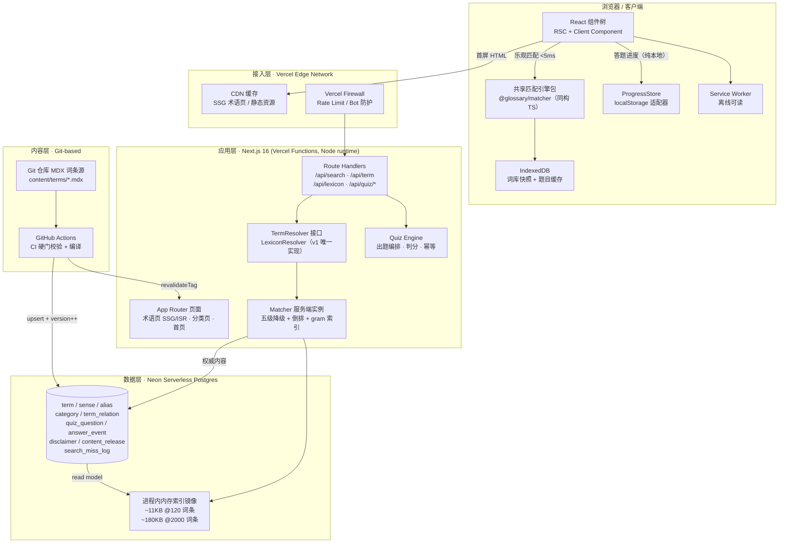

# 股票黑话解释器 · 项目交付方案

> 汇编人：高屋建（首席交付架构师）｜版本：v1.0｜日期：2026-10-20
> 本文档是**主交付物**，由全栈架构交付专家团 8 位成员的产出汇编而成。
> 各成员原始产出（可直接作为开发依据）：
>
> | 文档 | 作者 | 行数 | 用途 |
> |---|---|---|---|
> | `股票黑话解释器-产品需求与范围定义.md` | 许可研（场景产品策略师） | 880 | 需求、用户故事、内容规范、50 条验收标准 |
> | `architecture-design.md` | 梁承宇（系统架构师） | 1530 | 总体架构、技术选型、核心机制、演进路线 |
> | `frontend-design.md` | 颜可心（前端体验工程师） | 1875 | 15 页面线框、15 组件 Props、Token、状态管理 |
> | `backend-implementation.md` | 程不宕（后端服务工程师） | 2152 | 7 个 API 契约、检索实现、降级矩阵、安全 |
> | `data-model.md` | 储海量（数据建模工程师） | — | ER 模型、DDL、索引、编译管线 |
> | `agent-content-pipeline-design.md` | 安智体（智能体应用工程师） | 2084 | 自动出题流水线、内容质量门禁、v2 LLM 兜底 |
> | `devops-delivery.md` | 陆上线（部署运维工程师） | — | 环境、CI/CD、监控告警、上线检查单 |
> | `qa-acceptance.md` | 凌无缺（测试验收工程师） | — | 测试策略、用例、发布门禁 |
>
> **本文与原始文档冲突时，以本文的「主理人裁决」章节为准。**

---

## 1. 项目定义与成功标准

### 1.1 一句话定义

> **给"听不懂金融黑话"的人一个可信、可查、可练的黑话翻译器：输入一个词，立刻得到"人话解释 + 生活化举例 + 风险提示"，并通过闯关式小测验把"看懂了"变成"记住了"。**

### 1.2 产品定位边界（三条"不做"）

| 限定词 | 含义 | 排除项 |
|---|---|---|
| **翻译器** | 只做"理解"，不做"决策" | 不输出任何买卖建议、不接行情、不推荐标的 |
| **可信** | 内容人工 100% 审核、可溯源、版本可追溯 | 不做 UGC、不做 AI 实时生成解释（MVP） |
| **可查** | 1 次点击内命中，不要求用户知道分类或正确拼写 | 不要求先选分类/难度 |
| **可练** | 必须有主动回忆机制（测验 + 错题本） | 不是"知识展示页" |

### 1.3 目标用户

| 画像 | 核心动机 | 频次 | 产品含义 |
|---|---|---|---|
| **P1 刚工作职场人**（权重最高） | 开会/群聊不露怯、能接话 | 每周 4~7 天，单次 3~8 分钟 | 零门槛入口；释义先给一句话结论；支持口语反查；提供"怎么接话"式举例 |
| **P2 大/中小学生** | 好奇 + 财商作业 | 每周 2~4 天，单次 5~15 分钟 | 每词必有 L1 儿童层释义；不得出现具体标的与操作建议；不做账号/社交/激励物质化 |
| **P3 中产/理财家庭** | 看懂财经新闻与产品说明、防骗 | 每周 3~5 天，晚间 20~30 分钟 | 风险提示紧跟释义；易混词对照；明确"这不代表什么" |
| **P4 进阶新手** | 系统补齐术语体系 | 每周 2~3 天，单次 10~20 分钟 | 三层释义全展开；一词多义切换；专业口径 |

### 1.4 成功标准

**北极星指标：周活跃学习者（WAL）** = 自然周内**完成 ≥1 次测验作答**的去重用户数。
> 选它的理由：只看"查询"会奖励划水式浏览；只看"停留时长"无法区分"读懂了"和"卡住了"。必须发生一次**作答行为**才计入。

> **假设前提 A**：MVP 于 T0 上线；观察窗口 T0+8 周；期初日新增自然用户 300~600（5~8 个垂直社群种子渠道）；无付费投放；词库一次到位 120 条；不做 SEO 主场运营。若流量假设变化，目标值需等比例重算。

| 层级 | 指标 | 目标值（建议区间） |
|---|---|---|
| **北极星** | 周活跃学习者 WAL | 第 8 周 **≥ 1,500**（1,200~2,000） |
| 主目标 1 | 术语查询成功率 | ≥ 88%（85~92%） |
| 主目标 2 | 查询→测验转化率 | ≥ 18%（15~25%） |
| 主目标 3 | 闯关完课率（第 1 关） | ≥ 30%（25~40%） |
| 主目标 4 | 错题二次答对率 | ≥ 65%（55~75%） |
| 质量 | 首次答题正确率 | **落在 55%~70%**（过低=题太难，过高=题太浅） |
| 质量 | 无结果率 | ≤ 12%（8~15%，超出说明词库缺口） |
| 内容 | 词条覆盖率 / 审核完成率 | = 100%（**不允许抽样**） |
| 体验 | 首次可交互（LCP p75，4G） | ≤ 2.0s |
| 体验 | 搜索到结果呈现 p95 | ≤ 400ms |
| 合规 | 风险提示覆盖率（涉投资判断词条） | = 100% |

**反向指标（Guardrail，防止"为指标牺牲正确性"）**

| 反向指标 | 阈值 | 触发动作 |
|---|---|---|
| 词条页 bounce < 3s | ≤ 35% | 重写内容而非改 UI |
| 单会话内重复搜索同一词 | ≤ 25% | 检查多义项是否未展开 |
| 中途退出测验 | ≤ 20% | 检查题目难度错配 |
| 举报/投诉量 | **0 容忍** | 立即内容复核 + 免责文案复查 |
| 释义含"买/卖/建议/目标价" | **= 0 条** | 违反即下架该词条（上线前置校验） |

---

## 2. 需求范围

### 2.1 MVP（Must have，9 项）

| # | 功能项 | 范围定义 | 关键验收要点 |
|---|---|---|---|
| M1 | **术语库内容资产** | 120 条术语 / 约 145 个义项 / 12 个一级分类 / 3 个难度层；**人工 100% 审核** | 字段完整率 100%；每条含 L1 人话层 + ≥1 个具体举例；多义词义项独立可切 |
| M2 | **站内搜索** | 术语/全称/别名/口语说法/拼音首字母/错别字容错 | 输入 "MA" 3 键内出结果；列表项无需进详情即可判断含义；0 命中给 ≥3 个相近词 |
| M3 | **词条详情卡** | 三层释义（L1必展开 / L2 / L3）+ 举例 + 易混词 + 相关术语 + 版本信息 | **首屏三件套无需任何展开**：人话一句话（≤40字）+ ≥1 举例 + 风险提示条；相关词 ≤4 且各有独立解释 |
| M4 | **风险提示与免责声明体系** | 词条内嵌风险提示 + 全站页脚免责 + 关键页明示"三不做" | 释义中禁用词命中数 = 0；免责文案在首页/详情页/测验页三处可见 |
| M5 | **选择题测验** | 4 种题型（T1正向识词/T2反向识词/T3语境应用/T4一词多义辨析）；单题反馈含答案依据；难度自适应 | 作答后立即反馈对错+依据；首次正确率落在 55%~70%；连错 2 题自动降档 |
| M6 | **闯关关卡** | 10 关 × 8 题，"难度阶梯 × 分类轮换"编排；通关解锁；进度可见 | 完成第 1 关解锁第 2 关；进度显示"1/10 关"；关卡内断点续做 |
| M7 | **错题本** | 答错自动入库；支持重做；答对标记"已掌握" | 答错→标"待复习"；重做正确→标"已掌握"且移出默认列表；二次答对率可统计 |
| M8 | **定位与免责首屏** | 首次进入展示三条定位说明 + 风险提示 | 首次访问可见；不遮挡主搜索框；**全站不得出现任何行情数字/标的/推荐** |
| M9 | **可访问性与移动端适配** | 移动优先（375~430px）、字号三档、键盘可达、对比度达标、深色模式 | 核心流程全键盘可达；点击目标 ≥44×44px；默认字号 ≥16px |

### 2.2 V2（Should have，8 项）

| # | 功能项 | 为什么是 Should 而非 Must |
|---|---|---|
| S-1 | **整句黑话识别**（粘贴一段话→高亮已收录术语） | 依赖检索质量，**误报直接损伤信任**；MVP 用"逐词查"已覆盖 80% 场景。V2 上线约束：只高亮已收录术语，绝不猜测 |
| S-2 | **易混词对照区** | 内容成本高（每组需人工写区分句），但 P3/P4 价值高 |
| S-3 | 难度自选与题目筛选 | MVP 用自适应默认档兜底 |
| S-4 | 每日一练（5 题） | 留存钩子，需先验证闯关本身有粘性 |
| S-5 | 今日一词（随机推送） | 需内容覆盖度支撑"随机不撞车" |
| S-6 | 词条目录页（分类/难度浏览） | 检索已覆盖主要找词路径 |
| S-7 | 测后理解度自评问卷 | 1 题轻问卷；**MVP 先预留埋点** |
| S-8 | "我已掌握"手动标记 + 数据导出 | 错题本已提供隐式掌握信号 |

### 2.3 明确不做（Won't have，11 项）

| # | 不做项 | 理由 | 再评估触发条件 |
|---|---|---|---|
| W1 | **实时行情 / 自选股 / 持仓** | ① 违背"纯内容工具"定位；② **出现涨跌数字会让用户把术语与买卖信号绑定**，与免责声明体系直接冲突（这是合规设计，不只是省成本）；③ 需牌照与数据源合规成本 | **不设触发条件**。架构仅预留接口，产品不暴露入口 |
| W2 | **账号体系 / 社交登录** | 无社交裂变诉求时账号只是成本；学习行为可由 localStorage 承载；未成年人场景下账号引入个人信息合规负担 | 日活 > 5,000 且跨设备需求被验证 |
| W3 | **分享海报** | 无账号无关系链时缺传播路径；海报易把术语卡裁成"金句"，**脱离风险提示语境后合规风险上升** | 自然流量稳定后作为增长实验 |
| W4 | **站内用户反馈入口** | 见「裁决六」：V1 只做静态引导文案 | **纠错量超出人工巡检能力时立刻提回 Must**（本清单唯一"假设不成立需回头"的条目） |
| W5 | **AI 实时生成解释** | 实时生成会带来不可控表述风险（模型可能说出带投资建议的话），与 M4 冲突；120 条词库不需要模型覆盖 | 词库 > 2,000 条且提问式需求成 Top1 搜索词 |
| W6 | 个性化推荐算法 | 冷启动无数据；规则版"错题优先"已够用 | 累积 ≥ 10,000 次作答事件 |
| W7 | **积分 / 徽章 / 排行榜 / 连续打卡** | 需账号支撑；**连续打卡对 P2 学生尤其不适宜**（断签焦虑 + 易被解读为诱导机制）；核心留存应来自内容本身 | 账号体系落地后。通关徽章做简化版（纯本地，随 M6） |
| W8 | 社区 / 提问 / UGC 词条 | 审核成本与合规风险高；引入未成年人 UGC 风险 | 不设触发条件 |
| W9 | 多语言 / 港美股本地化 | 种子素材以 A股+美股混合为主 | 词库达 200 条后按市场切分 |
| W10 | 付费内容 / 订阅 | 内容量不足；与"普惠科普"定位冲突 | 不设触发条件 |
| W11 | 原生 App / 小程序 | Web 已满足"随时查词"；小程序另需审核与资质 | W2+W3 落地且 Web 复访率稳定 |

### 2.4 MVP 范围一句话总结

> **第一版只回答三个问题：这个词什么意思？举个例子？它不代表什么？** 再加一个动作：**你记住了吗？**（测验 + 错题本）。其余一切（行情、社交、个性化、AI、游戏化）都建立在这四件事被验证有效之后。

### 2.5 术语库内容规范（核心资产标准）

术语库是本项目**唯一的核心资产**。功能可迭代，词条一旦被用户依赖就极难替换。

**词条字段结构**（20 个字段，⚠️ 为一票否决项）

| 字段 | 必填 | 写法要求 |
|---|---|---|
| `term` / `full_name` | ✅ / 缩写类必填 | 标准形态 ≤20 字符；缩写须展开全称+中文译名 |
| `aliases` / `search_alias` | ✅ | 别名/口语说法；检索增强含**拼音首字母、常见错拼、口语完整短语** |
| `category_l1` / `category_l2` | ✅ | **两层枚举**（12 个一级类，每类 2~6 个子类） |
| `difficulty` | ✅ | L1/L2/L3（见下方判据） |
| `senses` | ✅ | **一词多义每个含义是独立义项**，含语境标签、释义、举例、频率 |
| `plain_explain` | ✅ | **≤40 字**；⚠️ **零黑话原则**：不得出现任何其他未解释的金融术语 |
| `advanced_explain` / `pro_explain` | 建议 / L3必填 | 60~150 字 / 100~250 字（含精确口径、适用边界、常见误用） |
| `example` | ✅ | **≥1 个（L1 词条 ≥2 个）**，30~80 字，必须含具体场景 + 至少 1 个含具体数字或时间 |
| `example_style` | ✅ | 生活类比 / 职场社交 / 家庭财务 / 商业实务 |
| `confusion` / `related` | 建议 | 易混词 0~3 组（每组一句可辨差异 ≤40字）/ 相关词 0~4 个 |
| `not_meaning` | ✅ | **"这不代表什么"**，30~60 字。⚠️ 涉投资判断词条必填 |
| `risk_note` | ✅ | 风险提示 30~60 字。⚠️ 涉投资判断词条必填，缺失不得发布 |
| `regulatory_flags` | ✅ | 是否"易被误读为投资建议"类词条 |
| `source` / `reviewer` / `reviewed_at` / `version` / `status` | ✅ | 权威出处（内部留痕不展示）/ 审核人 / 审核日期 / 版本号 / 状态 |

**难度分级判据**

| 档 | 判据 | 示例 |
|---|---|---|
| **L1** | 零金融前置知识，生活语言可直接映射 | GDP、CPI、PE、ETF、牛市/熊市、止损 |
| **L2** | 需 1 个金融基础概念作前置 | MA（需先懂 K线）、PMI、ROE（需先懂净资产）、Beta |
| **L3** | 需 2+ 前置概念 / 涉及口径与计算 / 机构专业语境 | Sharpe、ROIC、EV/EBITDA、IC、VaR、久期 |

**⚠️ 两个独立维度不要混为一谈**：`difficulty`（术语本身多难，词条级一个字段）≠ **层级**（人话/进阶/专业，同一术语的 3 个文本字段）。

**内容硬性规范（⚠️ 一票否决项）**
- **禁止祈使句式操作引导**："你应该买""建议关注""值得入手"
- **禁止具体标的名称与价格目标**
- **禁止收益承诺与概率暗示**："稳赚""大概率涨""必涨"
- **人话层零黑话**：反例 *"MA 就是移动平均线，用来平滑价格"*（"移动平均线"对小学生仍是黑话）；正例 *"把最近几天股价平均一下连成一条线，用来盖住忽高忽低的波动"*
- **举例必须回答**："这句话是在什么情境下会被谁说出来？"，禁止"在股市中"类空泛表述
- **准确优先于易懂**：宁可标 L2 也不为缩短字数牺牲准确性

**一词多义处理**（内容准确性最大风险来源）
- MVP 必做 3 个高价值多义词：**`MA`、`Bull/Bear`、`Short`**
- 默认义项 = 最高频场景，但**必须显性提示"该词有 N 个意思"**，不得静默默认
- 义项切换用 Tab，标签名用**用户能懂的说法**（"技术分析里的 MA"），**禁止"义项 1/2/3"**
- 检索层也要多义：结果列表显示"MA · 3 个意思"

**三级审核（⚠️ 100% 全检，不允许抽样）**

| 级别 | 审核人 | 核查项 | 时限 |
|---|---|---|---|
| 一级 · 撰写自检 | 内容作者 | 字段完整性、字数上限、举例具体性、语气、无祈使句 | 提交前 |
| 二级 · 专业复核 | 金融专业背景审核人 | 释义准确性、口径正确、易混词区分、"这不代表什么"是否到位、来源可溯 | 提交后 3 个工作日内 |
| 三级 · 合规终审 | 合规/风控角色 | 风险提示覆盖、免责文案版本、无投资建议、无标的推荐、无收益承诺 | 发布前 |

**词库覆盖度规划（首版 120 条）**

| 一级分类 | 条数 | 难度分布 L1/L2/L3 |
|---|---|---|
| 宏观经济（GDP/CPI/PPI/PCE/NFP/M2/LPR/DXY） | 12 | 6/5/1 |
| 宏观政策与央行（Fed/FOMC/QE/QT/Hawkish/Recession/Bubble） | 14 | 7/6/1 |
| 技术指标（MA/EMA/MACD/RSI/KDJ/BOLL/ATR/OBV/VWAP/金叉死叉） | 11 | 2/8/1 |
| 估值与财务（PE/PB/PS/PEG/EPS/ROE/ROA/ROIC/EBITDA/EV/FCF/D-E/TTM/CAGR/TAM） | 17 | 2/11/4 |
| 基金与产品（ETF/指数基金/S&P500/Nasdaq/Dow/恒生/AUM/NAV/REIT/ADR/A股H股） | 12 | 6/6/0 |
| 交易与风险（P&L/ROI/Drawdown/MDD/Sharpe/Beta/Alpha/IC/VaR/OTC/Bid-Ask/T+0-T+1/IPO/SPAC） | 15 | 3/8/4 |
| 财报与公司（Earnings/Beat-Miss/Guidance/Moat/Blue chip/Penny stock/Dividend/Buyback） | 11 | 4/6/1 |
| 机构与资金（Hedge fund/Smart money/Whale/Retail/Short squeeze/Liquidity/Leverage/Margin call） | 12 | 2/7/3 |
| 市场情绪（Bull/Bear/Risk-on-off/FOMO/FUD/Panic selling/Euphoria） | 10 | 5/5/0 |
| 走势形态（Rally/Pullback/Correction/Crash/Sideways/Breakout/Dead cat bounce/阻力支撑/ATH） | 11 | 3/8/0 |
| 买卖操作（Long/Short/Buy the dip/止盈止损/HODL/Bag holder/Diamond hands/Averaging down/Rebalance） | 12 | 4/7/1 |
| **常见误用与澄清**（P/E低=便宜、追涨杀跌、K线=预测、主力=庄家） | 3+ | 3/0/0 |
| **合计** | **120**（约 145 义项） | 约 47/71/16 |

**覆盖度硬约束**：每条术语必须给出 ≥1 个"这不代表什么" + ≥1 个具体举例；每个一级分类至少 1 条 L1 词条；**多义词优先排 P0**（错了影响面最大）。

### 2.6 测验与闯关设计

**4 种题型（全部选择题）**

| 题型 | 题干形式 | 主要考察 | 难度映射 |
|---|---|---|---|
| **T1 正向识词** | 给术语，选白话意思 | 记忆 | L1→L3 |
| **T2 反向识词** | 给白话描述，选术语 | 记忆（反向） | L1→L3 |
| **T3 语境应用** | 给真实语境话，判断该词在此处的含义 | 理解/迁移 | L2→L3 |
| **T4 一词多义辨析** | 同一缩写在两个语境中，选正确配对 | 精准性 | L3（仅多义词） |

- 题量目标 **≥ 360 题**（120 词条 × 2 + 24 道 T3 + 20 道 T4）
- 干扰项优先级：同分类易混词 > 同分类同难度词 > 跨分类近音词；**禁止荒谬选项**；长度须与正确答案相当（防"选最长"技巧）
- 每题必配 **1 句答案依据**（答对答错都展示）
- **T2 的描述不得出现术语名**（否则是送分题）
- **T3 只考"这个词指什么"，不考"接下来该做什么"**（合规红线）

**难度分档与自适应**

| 档 | 对应术语难度 | 题目占比 | 首次出现 |
|---|---|---|---|
| 入门档 | L1 | 50% | 闯关第 1~2 关 |
| 进阶档 | L2 | 35% | 第 3~6 关 |
| 挑战档 | L3 | 15% | 第 7~10 关 |

**自适应规则**：连续 **2 题错 → 降一档**；连续 **3 题对且上一关已过 → 升一档**。**调整后必须明确提示"已为你调低难度"，不静默**。

**10 关编排（难度阶梯 × 分类轮换）**

| 关卡 | 主题分类 | 难度构成 |
|---|---|---|
| 1 入门关：先认识这些 | 宏观经济 | **8 题全 L1** |
| 2 入门关：钱的温度 | 宏观政策 | **8 题全 L1** |
| 3 看盘第一步 | 技术指标 | 5×L1 + 2×L2 + 1×L3 |
| 4 价格贵不贵 | 估值财务 | 5×L1 + 2×L2 + 1×L3 |
| 5 买什么和怎么买 | 基金产品 | 5×L1 + 2×L2 + 1×L3 |
| 6 会亏钱才是关键 | 交易风险 | 5×L1 + 2×L2 + 1×L3 |
| 7 听财报 | 财报公司 | 5×L1 + 2×L2 + 1×L3 |
| 8 谁在买 | 机构资金 | 5×L1 + 2×L2 + 1×L3 |
| 9 情绪与节奏 | 市场情绪 | 4×L1 + 3×L2 + 1×L3 |
| 10 实战综合 | 走势 + 买卖操作混合 | 4×L1 + 3×L2 + 1×L3 |

**编排约束**：① 前 2 关**必须全 L1**（保证任何用户 5 分钟内起步，不劝退）；② 第 3 关起每关至少 1 道 T3 语境题；③ 每关至少 1 个"这不代表什么"型干扰项（如"PE 低 = 便宜"）；④ **错题优先补位**；⑤ 断点续做；⑥ 跳关不允许；⑦ 高频词多见、低频词少见（刻意设计的重复）。

**激励体系取舍**：积分/连续打卡/排行榜**一律不做**；通关徽章做简化版（纯本地）。替代激励：进度可视化（"已学 47/120 词"）、错题清零感（"已掌握 N / 共 M"）、即时反馈质量、连对反馈（纯荣誉徽标）。

---

## 3. 系统架构与技术选型

### 3.1 架构总览



**三条核心链路**
- **链路 A 术语查询**（主力路径）：用户输入 → 浏览器本地 matcher 乐观匹配（0 网络）→ 并行 `/api/search` → 服务端 `TermResolver` → 命中后读 Postgres 取完整内容 → 返回卡片数据
- **链路 C 答题**：客户端从 localStorage 读进度 → `/api/quiz/next`（**答案不下发**）→ 用户作答 → `/api/quiz/answer`（服务端查 answer_key 判分）→ 客户端更新连对/错题本
- **链路 D 内容发布**（低频写）：运营改 MDX → PR → **CI 硬门校验** → Code Review → 合并 → CI 编译 upsert → `content_release.version++` → `revalidateTag` → 索引 SWR 双缓冲热更新 → 分钟级生效

### 3.2 技术选型表

| 维度 | 结论 | 一句话理由 | 被否决的备选 |
|---|---|---|---|
| 架构风格 | **Next.js 全栈单体（App Router）+ BaaS** | 读多写少、团队 2~4 人、单机可承载；微服务是负债 | 前后端分离（无外部 API 消费方，CORS/鉴权/两套CI 纯成本）；微服务（只有一个业务域）；纯 Serverless Edge（索引需常驻内存） |
| 前端框架 | **Next.js 16 + App Router + React 19** | RSC（SEO 直出）+ Server Actions（交互）两件套，唯一低成本同时满足 | Pages Router（官方已定位 legacy）；Astro（需从零搭 React 集成） |
| 样式 | **Tailwind CSS v4 + CSS Variables Token** | 需一处调全站字号/对比度（三档字号+儿童友好硬需求） | CSS Modules（与"统一 token"天然对立） |
| UI 组件库 | **shadcn/ui + Radix Primitives** | 源码拷贝零运行时膨胀；**Radix 的焦点管理/键盘导航/aria 是 WCAG AA 免费底座** | **Ant Design**（B 端后台气质与"友好卡片"定位冲突；定制主题与三档字号强冲突；包体积与 LCP 目标相悖） |
| **检索引擎** | **应用层内存词典 + Aho-Corasick 自动机** | 词库 2000 条本质是「**词典查找**」不是「信息检索」；0 网络往返，1KB 文本扫描 <1ms | **Meilisearch/Typesense**（能力错配：模糊能力在此是**负资产**——搜"市盈率"返回一堆近义词=失败；且不返回 span 偏移，高亮仍要应用层重做）；**纯 Postgres FTS**（中文默认按单字切碎）；**PG+zhparser**（托管 BaaS 装不上 C 扩展）；**客户端 Fuse.js**（需下发全量词库冲击 LCP，搜索页无法 SSR） |
| 数据库 | **Neon Serverless Postgres** | 纯 PG 不锁死扩展路径；**branching 直接映射内容审核发布流**；scale-to-zero 契合突发流量 | **Supabase**（Auth/Storage/Realtime 全闲置，纯负担；Free 档 1 周不活跃自动暂停）；**Cloudflare D0**（SQLite 无 pg_trgm/pgvector，方言锁定风险高，"便宜"不足以成为决策理由——DB 月费仅占总成本 3~5%） |
| ORM / 校验 | **Drizzle ORM + Zod** | 需 `similarity()`/GIN/**部分唯一索引**等裸 SQL 能力；Serverless 友好无引擎进程 | Prisma（上述能力都要 `$queryRaw` 逃逸，优势用不上）；TypeORM/Sequelize（隐式 SQL 难表达本项目索引形态） |
| 部署 | **Vercel Pro** | Next.js 一等公民 + ISR + **每 PR 一个预览环境（内容审核受益）** | Cloudflare Pages（需 `@opennextjs/cloudflare` 适配层，排查路径长）；自建（与"免运维"决策冲突）。⚠️ **Hobby 计划禁止商用，必须 Pro** |
| 缓存 | **CDN + ISR + 进程内内存；v1 不引入 Redis** | 无账号即无 session 存储需求；索引 180KB 每实例各持一份完全可接受 | **Redis**（多一个服务/一份钱/一个故障点，换不到任何可观测收益）。重新引入触发条件：账号跨设备同步 / 排行榜 / 分布式限流 / 索引 >50MB |
| 后端形态 | **Route Handlers + Server Actions，不部署独立 Node 服务** | 同一产物一次部署；类型直接共享 | 独立 Node 服务（无外部消费方）；tRPC/GraphQL（唯一消费者是自家前端，引入网关是净成本） |
| 内容真源 | **Git 仓库内 MDX**，Postgres 是编译产物 | 嵌套内容（多义项+别名+举例+题目）用 Markdown 表达自然；**Git 免费送 review/版本/回滚/blame** | 数据库后台编辑（需自建嵌套表单+版本+冲突解决+审核状态机 = 一个 CMS 产品的工作量）；纯静态 MDX 站（失去筛选/图谱/动态推荐能力）；Wiki/Notion 同步（双向同步冲突+无版本审查） |
| 状态管理 | **不引第三方库**：Context + useReducer + useSyncExternalStore | 状态形状简单、层级浅；JS 预算 90KB gzip 很紧 | Zustand/Redux/Jotai（收益不足）；React Query（已有 RSC+ISR 缓存） |
| 整句识别算法 | **Aho-Corasick 自动机 + 自写裁决层**（V2 实现，v1 建好同构包） | 复杂度 O(n+m) **与词条数解耦**；原生产出 span 偏移 | **合并正则**（1000 词条扫描 2.5s，10000 词条 41s，**词库一增长功能就崩**，且有回溯风险）；**中文分词器 jieba**（词库是封闭集合，AC 最长匹配+边界检查等价，多一个依赖多一份体积） |

### 3.3 核心机制设计

#### 3.3.1 术语检索引擎（五级降级）

**输入归一化管线**（产出**两个值**：`norm_key` 匹配用 / `display` 展示用，**永远不用 norm_key 渲染给用户**）

```
raw → ① NFKC 全半角归一 → ② 去零宽字符/方向控制符（防同形字绕过）
    → ③ ASCII 大小写折叠 → ④ 空白折叠 + 中英间空格规整
    → ⑤ 装饰标点处理（保留术语内部 . -）→ ⑥ 长度截断 ≤200 字符（归一化前判断，防零宽绕过）
```

**五级匹配流水线**

| 层 | 机制 | 复杂度 | 权重 |
|---|---|---|---|
| **L0 精确** | `Map<norm_key, termId[]>` | O(1) | EXACT_PRIMARY 100 / EXACT_ALIAS_CN 95 / EXACT_ALIAS_EN 92 / EXACT_PINYIN_ABBR 90 |
| **L1 前缀** | Trie 前缀查找（≥2 字符才参与） | O(L) | PREFIX 78 |
| **L2 别名/拼音** | 同 L0 表，别名类型特化 + 首字母前缀（≤4 位） | O(1) | COLLOQUIAL 90 / MISSPELL 80 |
| **L3 模糊** | 二元 gram 倒排召回 Top-20 → 编辑距离校验（≤4字符允许距离1，否则2） | O(k) | FUZZY_GRAM 45 − d×8 |
| **L3.5 PG 兜底** | `pg_trgm similarity ≥ 0.3`，**仅英文长词触发**（`/^[a-z0-9 .\-']{4,}$/`） | 一次网络往返 | PG_TRGM 35 |

**排序必须是全序**：`score desc → popularity desc → slug.localeCompare asc`。最后一行兜底必须有——否则同分同热度时响应不稳定，客户端反复重渲染，埋点 rank 归属漂移。

**中文/英文边界检查（V2 整句识别用，v1 建好结构）**
- 中文边界判定用 `[\u4e00-\u9fff\u3400-\u4dbf]`，**不含标点**。所以「市盈率（PE）」中「PE」右邻是 `）` → 判定独立词，正确命中；「市盈率」中「市」右邻是「盈」→ 丢弃，正确
- 英文边界：左右相邻仍是字母数字 → 丢弃（防「OPEN」命中「PE」）

**别名是数据问题不是算法问题**。「市盈率→PE」「死猫反弹→dead cat bounce」「plr→市盈率」全部落在同一张 `alias` 表，7 种类型：`primary` / `cn_alias` / `en_alias` / `pinyin_abbr` / `pinyin_full` / `colloquial` / `misspell`。
- **拼音不做运行时汉字→拼音转换**（需引入拼音库、多音字与金融专有读音无法覆盖）→ 改为**词条作者在 front-matter 直接提供**，一次性录入、永久准确、零运行时成本
- `pinyin_abbr` 上限 4 位（再长会与英文缩写大面积冲突，如 `pe` 既是市盈率也是 private equity）
- **`misspell` 只走精确层，不进模糊层**（否则模糊层会把它和正确近邻词混淆）
- `norm_key` **全局 UNIQUE**（DB 约束 + CI 校验双防线）

**一词多义消歧（三级降级）**
1. **sense 级专属别名直连消解**（最可靠，confidence=1.0，无需打分）
2. **上下文关键词加权打分**：`score(sense) = Σ weight(命中关键词) + adjacency_bonus(关键词在命中词 ±10 字符内) × 1.5 + (isPrimary ? 0.5 : 0)`；最高分与次高分差 < 0.3 判**低置信**
3. **低置信兜底**：返回主义项 + 响应携带可切换义项（**不打断用户、不弹窗**）

> 单词查询时无上下文 → adjacencyBonus 恒 0，退化为"纯关键词+主义项偏置"。**这个退化符合预期不是缺陷**——单词查询时用户本来就要默认含义。

#### 3.3.2 测验引擎

**题目生成：自动 70% + 人工 30%**，自动题必须经人工抽检 ≥20%（早期 100%）方可上线。
- **生成器是纯函数**：输入=已发布词条集合，输出=题目集合。词条改了→题目自动重生成。这让"题目质量"从"人工维护的资产"变成"可重放的产物"，是成本结构能成立的地基
- **抽检不合格 → 回退生成规则，不逐题修**（逐题修会把内容成本变成无底洞）
- T1/T2 的**题干可派生但干扰项必须人工挑选** → 提供 `/api/admin/derive-questions` 生成候选干扰项供内容作者点选，「派生」≠「自动上线」

**出题九步**（每关 8 题）
1. 关卡配置 Zod 校验（**模块加载时校验，配置非法→启动即失败**，不留到运行时）
2. **有效难度上限** `effectiveCap = difficultyCap ?? min(3, level.targetDifficulty+1)`；前 2 关 `{current:8, previous:0, next:0}` → **全 L1 硬约束**；第 3~10 关 `{5,2,1}`；D=3 时 next 无 L4 → 重分配 `{6,2,0}`；D=1 时 previous 无 L0 → `{8,0,1}`
3. 题池构建（过滤 `difficulty ≤ effectiveCap`；剔除 `excludeQuestionIds`）
4. 槽位编排（`count<8` 时同比例缩放，桶顺序「上一→当前→下一」，**保证任何 count 下都优先给巩固题**）
5. **错题优先补位**（仅 mode=level）：`budget = floor(count × 0.25)`（8 题最多 2 题）。**限定 25% 的理由**：不设上限的话，积累大量 L1 错题的用户做第 3 关会被错题占满 L1 槽位，关卡编排形同失效。**review 模式无预算上限**
6. 题池耗尽：`allowRepeat=false` → **409 QUIZ_POOL_EXHAUSTED**（返回不足 8 题会破坏"第 X/8 题"体验与断点续做语义）
7. **选项乱序**：`answer_key` 存**选项 id**（`o3`）而非位置 → 洗牌不改答案。**若存位置，洗牌就必然改答案**
8. 组装 payload **用字段白名单逐个构造**（不做"先取全量再删除"——黑名单式删除迟早漏字段）
9. 埋点 + 难度分布自检

**判分与幂等（v1 无 Redis 方案）**

被否决的方案：完全不做幂等（C15 指标失真，★阻塞项）｜只用进程内 LRU（**多实例必然漏检**，Vercel 同部署多实例并行处理）｜**引入 Upstash/Vercel KV**（与"v1 无 Redis"冲突，而它换来的只是一个唯一索引能做的事）｜客户端本地去重（脚本可绕过）

**采纳：两级去重**
- **Level 1 内存 LRU**：key=`clientRequestId`，value=响应快照，TTL 10min，上限 5000
- **Level 2 Postgres 唯一约束**：`INSERT INTO answer_event (client_request_id,...) ON CONFLICT DO NOTHING RETURNING id` → 有行=首次；无行=已存在 → 比对 payload，一致则重放，不一致则 409

**为什么成立**：① `answer_event` 表**本来就要写**（它是作答事件唯一存储）→ **幂等与埋点是同一次写入**，零新增基础设施；② 写入量微不足道（日活 1000 × 转化 18% × 8 题 ≈ 1440 条/天）；③ **DB 写失败时仍把判分结果返回给用户**（判分只依赖读）——**判分优先，埋点尽力**，用户学习流程不能被指标采集拖累。

**服务端不做权威计分**：本产品无排行榜、无奖励、无付费、无社交排名 → 用户作弊的唯一收益是"自己骗自己看一个高分"，业务价值为零。为零收益场景做服务端权威计分 = 增加接口复杂度+延迟+故障点。**这是有意识的"够用即止"决策**，v2 引入排行榜时推翻。

**唯一保留的防线**：`answer_key` 仅在服务端（**零成本、零延迟、效果最好**，挡住 99% 的"看源码"式作弊）。

#### 3.3.3 内容生产流水线

**核心判断：本项目的智能体形态不是"自主 Agent"，而是「确定性流水线 + 3 道人工门 + 1 个可选 LLM 环节」。**

| 论据 | 内容 | 对架构的含义 |
|---|---|---|
| 质量是二值的 | 一条词条错了就是错了，AI"大概对"没有价值 | 关键环节**不能**交给概率模型；必须用确定性校验器（CI）做硬门 |
| 成本结构倒挂 | 基础设施 ¥290/月，内容占 v1 总投入 99%+ | 该投的是**降低内容边际成本**的工程，不是"更聪明的生成模型" |
| 幻觉不可消除 | 金融术语的幻觉比通用问答更危险（用户会把"查到的"当"权威定义"） | **把 LLM 放在"生成候选"位置，把人放在"发布"位置**，且 LLM 产出必须走同一条发布管线 |

> **一句话总结**：本项目里"AI 该用在哪"的答案是**用在"批量产候选草稿"和"填重复劳动"，不用在"做发布决策"**。所有一票否决项（零黑话、禁用词、祈使句、标的）必须由可复现的规则判定，因为它们需要的是"可审计的放行结论"，不是"大概率没问题"。

**内容发布链路**：种子词库/结构化表格 → 批量导入 CLI → MDX 草稿 → 撰写自检 → pre-commit 快速反馈 → **CI 硬门（不可绕过）** → 题目编译（纯函数）→ 自动弃权检查 → 提 PR → **人工门1 二级专业复核** → **人工门2 三级合规终审** → 合并 main → CI 编译 upsert → 抽检 ≥20% → 发布。抽检不合格 → **回退生成规则**（不逐题修）。

**词库版本与缓存一致性**

| 概念 | 载体 | 作用 |
|---|---|---|
| `content_release.version` | DB | 单调递增的词库发布批次号 |
| `content_release.checksum` | DB | 全量词库内容哈希 |
| `term.content_version` | DB | 单条词条版本号 |
| `ETag` | HTTP 头 | `/api/lexicon` 响应的 checksum，浏览器/CDN 缓存键 |

**索引热更新（SWR 双缓冲）**：检测 version 变化 → 后台构建新 Matcher 实例 → 构建成功后**原子替换全局引用**（single-flight 保护防并发重复构建）→ 保留旧实例让在途请求安全完成 → 释放。
> **为什么必须双缓冲**：直接原地更新会让正在进行的扫描请求看到半新半旧状态（AC 自动机节点在扫描中途被替换 → 结果不可预期）。双缓冲保证任意时刻的请求都看到**一个自洽的完整版本**。

#### 3.3.4 五个"现在多花一点成本做对"的预留点

| # | 事项 | v1 增量成本 | 避免的 v2 重构 |
|---|---|---|---|
| 1 | **`TermResolver` 接口 + "未命中"是一等状态** | 约半天 | v2 接 LLM 时要重写搜索结果页、状态机、错误处理 |
| 2 | **`ProgressStore` 接口** | 约 3 小时 | v2 加账号时进度相关代码全改 |
| 3 | **匹配引擎同构共享包**（前后端同一份代码） | 约半天（需严格避免 Node API 依赖） | v2 若两套实现，行为漂移，高亮与结果不一致的 bug 极难排查 |
| 4 | **`term`/`sense`/`alias` 三层分离 + `norm_key` 唯一** | 内容作者多写几行 front-matter | v2 做多义消歧与向量检索时必须重构表结构 + 全量数据迁移 |
| 5 | **免责声明入 `disclaimer` 表 + `content_release` 版本化** | 多一张表 + 一个发布步骤 | 法务每改一次文案就要发一次版（运营灾难） |

`TermResolver` 三条设计铁律：① **未命中必须是返回值的一个变体（`status:'miss'`），不是 null、不是异常**（null 无法区分"没找到"与"出错了"；异常会被通用错误处理吞掉）；② **接口不得假设"零 I/O"**（否则 v2 LLM 实现接入时打穿所有调用方）；③ **候选解析与内容读取分离**（`resolveCandidates` / `hydrate`，v2 的 LLM 能生成解释但**不能凭空生成 termId**，两者必须能独立降级）。

---

## 4. 数据库设计摘要

> 完整 DDL 见 `data-model.md`。

### 4.1 实体清单

| 表 | 职责 | 关键约束意图 |
|---|---|---|
| `term` | **术语主体**：一个黑话概念的锚点 | `slug` 唯一且 URL 安全；`status` 生命周期；`difficulty` 1-3 驱动闯关分层与出题不超纲 |
| `sense` | **义项**：一个术语的**一种含义** | `term_id + sense_key` 唯一；每个 term 至少一个 `is_primary=true` |
| `alias` | **别名/缩写/拼音/口语/错别字** | `norm_key` **全局唯一**（核心防线）；`sense_id` 可空 → 区分"词条级通用别名"与"义项专属别名"；**partial unique index 只对 primary 类型唯一** |
| `category` | **两层分类枚举** | `category_l1`（12 类）+ `category_l2`（每类 2~6 子类），用 PG enum 或 CHECK 约束 |
| `tag` | 标签（多对多） | 承载交叉维度（行业、场景、情绪色彩） |
| `term_relation` | **自关联多对多**相关词/易混词/前置知识 | 有向 + 类型化（related/contrast/prereq）；`source != target`；`(source,target,relation_type)` 唯一 |
| `quiz_question` | 题目与选项 | **`answer_key` 永不下发客户端**；`source` 区分自动/人工；自动题需过抽检 |
| `quiz_level` / `quiz_level_question` | 关卡定义与编排 | **放 DB 静态表**（防客户端篡改 + 运营可调整不发版） |
| `answer_event` | 作答事件（**兼作幂等键载体**） | `client_request_id` UUID 唯一约束；**不含任何用户标识**；**保留期 90 天自动清理** |
| `search_miss_log` | 词库缺口池 | **只存归一化 query + 聚合计数 + 时间戳，不关联任何用户标识**；**k-匿名门槛 count>=3 才进运营视图** |
| `disclaimer` | 免责声明文案（可动态配置） | `code` 唯一；`version` 单调递增；`effective_from` → **法务改文案不发版** |
| `content_release` | 词库发布批次 | `version` 单调递增 + `checksum` → 前端缓存与索引热更新的依据 |
| `term_version` | 词条内容快照 | 支持"回滚到上一版"与"改动 diff 审计" |
| `blacklist_word` / `jargon_dict` | 禁用词表 / 零黑话扫描词典 | CI 校验的数据源，可运营维护 |

### 4.2 存储分工

| 存储 | 承载 | 选型 |
|---|---|---|
| **Postgres（Neon）** | 术语、义项、别名、分类、相关词、题目、免责、发布版本、作答事件、缺口池 | Neon Serverless Postgres |
| **进程内存** | 词库索引（AC 自动机 + 倒排 + gram）、热词缓存、匹配器单例 | 进程内存 + SWR 双缓冲；**~11KB @120 词条 / ~180KB @2000 词条** |
| **浏览器 localStorage** | 闯关进度、错题本、掌握标记、连对、设置 | 经 `ProgressStore` 抽象 |
| **浏览器 IndexedDB** | 词库快照（lexicon）、已下发题目缓存 | 离线可读 |
| **CDN / Vercel 缓存** | SSG 术语页、词库 JSON、热门查询结果 | Vercel Edge + ISR |
| **Redis** | — | **v1 不引入** |

### 4.3 关键设计特征

1. **读多写极少**：内容变更 ≈ 周级；查询流量 ≈ 万级/天 → 一切围绕「让读路径不碰 DB」设计
2. **权威源单一**：Postgres 是唯一权威；内存索引与客户端 lexicon 都是**可重建的派生数据**，带 checksum 校验
3. **版本化一切可缓存物**：`content_release.version` + `checksum` 贯穿「发布 → 索引热更新 → CDN 失效 → 客户端缓存」全链路
4. **无 PII**：v1 不设计任何用户表 → 未来加账号时数据模型是**增量**而非重构
5. **⚠️ 不建没用的表**（铁律）：`term_symbol`（行情关联）、`feedback`、向量表 —— v1 **一律不建**，只在文档说明 v2 预留

### 4.4 索引设计原则

每个索引必须服务一个明确的查询场景，禁止无理由索引。核心覆盖：`alias.norm_key` 精确查找（含 partial unique index）｜词条按 `category_l1/l2` + `difficulty` 查询（闯关出题）｜`term_relation` 双向查询｜题目按难度/词条查询｜`answer_event` 按 `content_version` 聚合｜`pg_trgm` GIN（**仅对英文建**——中文 2 字词 trgm 退化会引入噪声）。

---

## 5. 前后端与内容实现要点

### 5.1 前端要点

**信息架构**：15 个路由（4 SSG + 1 ISR + 10 动态/交互页）。**「一个搜索框」为唯一全局入口**，其余能力全挂其下（产品 S1：不许先选分类/难度）。

| 关键页面 | 渲染策略 | SEO |
|---|---|---|
| 首页 `/` | SSG+ISR | index |
| 搜索结果页 `/s` | **SSR 60s** + 头部 50 词 SSG | 默认 `noindex`；**例外**：唯一精确命中时输出 canonical 指向详情页 + 服务端渲染完整卡片 |
| **术语详情页 `/terms/[slug]`** ★核心 | **SSG** + ISR 1h | index，Schema.org `DefinedTerm` |
| 分类页 `/categories`、`/categories/[slug]` | SSG+ISR | `CollectionPage` / `ItemList` |
| 关卡选择 `/levels`、答题 `/quiz/[levelId]`、结果页、错题本 `/mistakes` | 动态 CSR | noindex |
| 关于 `/about`、免责 `/disclaimer`、给家长看的说明 `/for-parents`、设置 `/settings` | SSG / 静态壳 | index（设置页 noindex） |
| 异常：`/not-found`、`/offline`、限流 429 内联 | 静态 | noindex |

**三条不可违反的前端铁律**
1. 详情页首屏三件套（人话一句话 ≤40字 / ≥1 个具体举例 / 风险提示条）**不得需要任何展开操作**。实现方式：三者是同一张卡片的前三块，**不放进任何 `<details>`/Collapse**；只有 L2/L3 是折叠。三件套缺失时**不渲染该词条**（内容门禁 + 前端防御检查 + 埋点告警）
2. 全文禁用 `dangerouslySetInnerHTML`（ESLint `react/no-danger: error` 且 **CI 硬拦**），高亮用 React 文本节点 + `<mark>` 分段
3. **"未命中"是一等状态**（友好空态 + ≥3 相近词 + "该词尚未收录"），**不是 404、不是白屏**

**15 个自建业务组件**：`TermCard`（3 个 variant：detail/compact/result-item）、`HighlightedText`（★安全高亮）、`ExampleBlock`、`NotMeaningBlock`（★信任基石）、`RiskNoteBanner`、`RelatedTerms`（★非纯链接列表，每条带独立解释，前端硬截断 4 + 埋点）、`ConfusionBlock`、`ReciteBlock`（"一句话讲给别人听"，P1 社交场景核心诉求）、`QuizOption`、`LevelProgress`、`ScoreBoard`、`DisclaimerBanner`（**前端不硬编码免责文案**，按 code+version 渲染服务端下发文本）、`SearchBox`、`SearchSuggestion`、`SearchResultItem` + 3 个原子徽章。

**设计 Token**：32 组，双主题（浅色/深色）全量标注对比度实测值（正文 ≥4.5:1、大字 ≥3:1、控件边界 ≥3:1），**CI 用脚本遍历 token 组合校验，低于阈值 fail build**。
- **三档字号**：`html[data-font-scale]` 三档改基准字号（全站 rem 同步放大）；**基准 16px**，术语正文 1.25rem；容器用 `min-h-*`/`clamp()` 不用固定 px 高，保证三档不破版
- **色盲友好**：语义色**永远与状态图标 + 文字标签成对**（✓/✗/⏳；难度徽章 `L1 入门 ●` / `L2 进阶 ◐` / `L3 挑战 ◑`）；高亮用黄底 + 2px 下边框（不仅靠底色）
- **移动优先**：base <480px / sm ≥480 / md ≥768 / lg ≥1024（双栏）/ xl ≥1280 / 2xl ≥1536。移动端底部 3 键 Tab Bar；桌面端做"阅读增强"而非"功能增强"

**性能预算**：HTML ≤30KB / CSS ≤12KB / **JS ≤90KB** / 字体 ≤40KB / 图片 ≤60KB（gzip），总计 ≤230KB。
首屏 JS 拆解：React19+Next 运行时 ~45KB + matcher L0 3KB + Radix(Tabs/Accordion/Toast) 12KB + 首屏业务组件 15KB + 页面逻辑 8KB = **~83KB ≤ 90KB ✓**
**懒加载**：`RelatedTerms`/`ConfusionBlock`（IntersectionObserver 距视口 200px）、`QuizBlock`（`next/dynamic ssr:false`）、整句识别模块（独立 chunk 动态 import）、matcher L1~L3 层（L0 覆盖 90% 搜索，进主 chunk）。**图标自建 SVG sprite，不引图标库字体**；字体 `next/font` 自托管 + `swap` + 中文子集化。

**`ProgressStore` 实现要点**

| 问题 | 实现 |
|---|---|
| 键与版本 | `glossary:progress:v1`；`schemaVersion` 不匹配 → **丢弃旧数据重置**（内容工具进度丢失代价极低）+ 埋点 |
| 写入节流 | `requestIdleCallback` 合并；连击高频更新不每次落盘（题末 + 页面隐藏时落盘） |
| 配额 | `QuotaExceededError` → 裁剪 `learnedTermIds`（保留最近 200）→ 重试一次 → 仍失败则 `degraded=true` + 提示一次 |
| 隐私模式 | `probe()` 写探针 key 并读回，失败 → 切 `MemoryProgressStore`（同接口），UI 轻提示"本次会话结束后会丢失" |
| 多标签页 | 写入带 `updatedAt`(ms)，读时新者胜；`storage` 事件 → 重载快照 → 通知订阅者（`useSyncExternalStore`） |
| 匿名设备标识 | 首次访问生成 UUID v4 存 `deviceId`；**不与任何外部身份打通、不上报** |
| 一键清空 | `removeItem` + 清 IndexedDB 学习 store + Toast + **提供 5s "撤销"**（内存快照） |

**乐观 UI 落点**：搜索联想 ✅（本地 matcher）｜整句高亮 ✅（客户端 AC，V2）｜选项选中 ✅｜**判分对错 ❌ 不猜答案**（答案不在客户端，只乐观"已提交"态，服务端返回后定色；超时→"待校验"不回滚）｜错题写入 ✅（纯本地）｜难度升降 ✅（立即生效+提示）｜词库快照 ✅（离线优先）

### 5.2 后端要点

**7 个对外 API + 2 个内部 Server Action**

| 端点 | 契约级别 | 限流 | 缓存 |
|---|---|---|---|
| `GET /api/search` | 对外 | ≤60 req/min/IP | **CDN 不使用**（`private, no-store`）；热查询走 `unstable_cache` 300s（**进程内 LFU 计数，访问 ≥3 次才进写入路径**）；候选 LRU 60s；**负缓存 15s**（防对不存在词反复探测打穿 DB） |
| `GET /api/term/[slug]` | 对外 | ≤120/min | **收益最高**：`unstable_cache` 3600s + `s-maxage=3600, swr=86400`；**反向失效**（X 被 Y 引用为 related → 发布时按 `term_relation` 反查一并 revalidate） |
| `GET /api/lexicon` | 对外 | **≤10/min/IP**（载荷大，最值得防的爬取目标） | `ETag: "lex-{version}-{checksum}"`；**决策：`grams` 默认不下发**（客户端做模糊匹配是负资产；120条→2000条时 entries 约 28KB→380KB gzip，grams 会再带来 150%~300% 体积） |
| `GET /api/quiz/next` | 对外 | ≤30/min | 关卡题池 600s；**复习模式不缓存**（key 含用户 termIds，键空间无界且是隐私面） |
| `POST /api/quiz/answer` | 对外（**唯一写接口**） | ≤30/min | 无（幂等 LRU 10min） |
| `GET /api/og/term/[slug]` | 对外 | — | `max-age=86400, s-maxage=604800, immutable`；**词条不存在返回 200 + 兜底图，不返回 404 JSON**（社交爬虫会把 404 图片缓存成永久坏图） |
| `GET /api/health` | 对外 | **⚠️ 需在 Firewall 豁免**（否则探针假警报） | `no-store`；**degraded 故意返回 200 而非 503**（Neon 短暂抖动不应让平台摘流量——此时术语页 SSG 完全正常，摘流量反而伤害可用性） |
| `submitAnswerAction` / `reportSearchMissAction` | **内部实现，无稳定契约、无版本化，外部不得使用** | — | — |

**`/api/quiz/answer` 为什么必须 Route Handler（不是 Server Action）**：① **幂等键活在 HTTP 语义里**（Server Action 的 action ID 是内部 RPC 标识，把它当幂等键等于把内部实现细节当契约）；② 需要精确 HTTP 状态码（409/404/503 要能被调用方按状态码分支）；③ 需要独立可观测链路（唯一有写入语义的接口，必须能被 Firewall 的 `/api/quiz/*` 规则精确匹配）；④ 可能有外部消费方。
> Server Action `submitAnswerAction` 仅作**无 JS 环境的渐进增强回退**，内部调用**完全相同的 `answerService.submit()`** → 幂等与判分逻辑只有一份实现。

**为什么 answer 必须服务端（不是防作弊）**：这是**保证释义与判分的一致性** —— `answer_key` 与 `explanation` 必须来自同一条记录的同一次读取，否则出现"判对但解析对不上"的可见故障。

**统一错误响应体**（关键设计：`retryable` + `retryAfterMs` 让前端降级分支由 `code`/`retryable` 决定，**不需要匹配 message 文案** → message 可随时改而不破坏客户端）
```ts
{ error: { code, message, requestId, retryable, retryAfterMs?, fields? } }
```
错误码 v1 冻结（只增不改）：400 十个 / 403 INVALID_ORIGIN / 404 四个 / 405 / 409 DUPLICATE_SUBMIT + QUIZ_POOL_EXHAUSTED / 429 / 500 / 503 DB_UNAVAILABLE + CONTENT_UNAVAILABLE + INDEX_NOT_READY / 504。
> **`CONTENT_UNAVAILABLE` 是「部分降级」而非错误页** —— 检索命中但释义取不到，前端正常渲染卡片 + "释义加载中"。

**缓存击穿四道防线**：① **单飞**（`Map<key,Promise>`，`finally` 中**无条件删除**——reject 也要删，否则实例 OOM；Map 上限 1000）；② **stale-while-revalidate**（`freshUntil=3000s` 内直接返回；超期立即返回旧值 + 后台异步刷新**不 await**）；③ **TTL 抖动**（`base × (0.9 + random×0.2)`，防批量发布时 2000 个 tag 同时失效集体回源）；④ **负缓存 + 熔断**（连续失败 ≥5 次 → 熔断 30s → 半开放 1 个探测）。
> ⚠️ **熔断粒度关键决策：熔断 `hydrate`，绝不熔断检索** —— 检索在 DB 挂时**完全可用**（这正是"Neon 挂了网站还能查词"的技术基础）。熔错粒度 = 把还能用的功能一起干掉。

**未命中建议：三层级联，配额固定**（F6 ★阻塞项要求 ≥3 条）

| 层 | 来源 | 配额 | 覆盖的未命中原因 |
|---|---|---|---|
| Layer1 | 编辑距离最近（gram 倒排 Top-20 → 距离 ≤1/≤2） | 2 | 打错了（错别字） |
| Layer2 | 同分类热门 | 2 | 知道领域记不清说法 |
| Layer3 | 全站热门兜底 | 1 | 完全没头绪 |

**为什么分层**：① 不命中原因是**多峰的**，单一策略必然在一类上表现很差——纯编辑距离让「搜 QQQ」返回乱码近邻（**比不给建议更伤信任**），纯热门让「打去库存」返回无关词；② 每条建议带 `source` + `reason` → **建议列表本身就是词库缺口探针**（`edit_distance` 占比高=词库缺错拼别名；`popular` 占比高=覆盖不足）；③ **不返回模型编造的"你是不是想找…"**，所有 suggestion 必须是**库内真实存在的词条**（信任底线）。
> **否决：返回"热门搜索榜"** —— 会让搜索框变成"随便看看"，与断点 A 目标背道而驰。

**降级矩阵（16 场景）关键三条容易做错的决策**
1. **熔断 `hydrate` 不熔断检索**（DB 挂时检索完全可用）
2. **DB 写失败仍返回判分结果**（判分只依赖读，埋点尽力）
3. **checksum 不一致用旧索引 + 旧内容而非新索引**（**自洽优先**——混用会返回已不存在的 termId）

**安全实现要点**
- **XSS 服务端防御**：`/api/search` 响应**不含 `query.display`，只有 `query.normKey`**。三条理由：① 客户端不需要（原始输入就在客户端手里）；② 消灭反射型 XSS 载体；③ **消除缓存错配风险**——若回显输入并做 CDN 缓存，热门 query 的缓存条目会把发起者的原始输入返回给其他用户
- **CSRF 三重校验**（任一不过 → 403 INVALID_ORIGIN）：`Content-Type: application/json` + `Sec-Fetch-Site ∈ {same-origin, same-site}` + `Origin` 白名单。**否决自造 CSRF token + 双提交 Cookie**（本项目明确零 Cookie，双提交 Cookie 前提是有 Cookie）
- **ReDoS 防护**：归一化管线所有正则必须线性安全无嵌套量词，加单测"200 字符 adversarial 输入 normalize <1ms"
- **CSP**：`script-src 'self' 'nonce-{RANDOM}' 'strict-dynamic' https:` + `style-src 'unsafe-inline'`（**保留**——Tailwind v4 运行时注入 + Radix inline style 依赖它，且 style-src 不执行脚本；XSS 实际执行入口是 script-src）+ `frame-ancestors 'none'`
- **API 端点不下发 CSP**（CSP 是文档级防护，JSON 无脚本执行上下文）——**给 JSON 加 CSP 是常见的无意义开销**
- **SQL 注入预防性规则**：v1 对外 API **不存在 `sort`/`order` 参数**（写入代码评审清单）
- **限流诚实说明**：Vercel Firewall 为主（跨实例），进程内令牌桶为辅。**进程内在多实例下精度下降（实际限额 ≈ 配置值 × 实例数），只能兜底不能作主防线**。**不搞验证码**（伤害真实用户与 SEO）

**埋点：一个必须诚实面对的技术约束**
> **零 Cookie 零账号下，服务端无法计算任何"去重用户数"**。因此 UV/WAL 类指标需专门方案（见裁决八）；服务端 `answer_event` 表**只用于内容质量分析**。
> **并且明确写出这条禁令**：**绝不为了算 UV 而自建"匿名设备标识 + 行为明细表"** —— 那等于在服务端重建用户画像，**直接违反产品 L6 与架构 §4.5 的合规红线**。这是"看起来很自然但绝对不能做"的诱惑，写出来避免后续实现误入。

**必须客户端埋点的两条**（服务端做不到，因为进度在 localStorage + 零 Cookie）：`level_complete`（服务端无法判定"完成"）、`wrongbook_retry`（错题本在 localStorage）。

**词库缺口池**：`norm_key + category_guess + occurrence_count + first/last_seen`，**k-匿名门槛 `count >= 3` 才进运营视图**（避免只有一个人搜过的私密词被运营看到），输入过滤只保留 `^[a-z0-9 .\-]{2,32}$` 或 `^[\u4e00-\u9fff]{2,8}$`，其余丢弃（防姓名/手机号片段入库）。

### 5.3 内容实现要点（自动出题流水线）

**智能化边界（哪些用模型、哪些用规则）**

| 环节 | 用模型/规则 | 理由 |
|---|---|---|
| 词条释义撰写（L1/L2/L3） | **人工**（LLM 可生成候选草稿） | 零黑话 + 口径准确是不可妥协的一票否决项 |
| 生活化举例 | **人工为主**，族内可复用槽位 | 需"具体场景+具体数字"，是创作判断 |
| `not_meaning` / `risk_note` | **人工**（按分类模板 + 词条级补充） | 必须"具体到该词条"，模板化会变空话 |
| **零黑话扫描** | **规则**（AC 自动机 + 上下文窗口判定） | 判定是可枚举的字符串问题，**模型判定不可复现、不可解释、不可作为 CI 硬门** |
| **禁用词扫描** | **规则**（词形 + 词性 + 语境三层判定） | 必须给出"为什么豁免"的可审计结论 |
| T1/T2 题目生成 | **规则**（字段派生 + 干扰项决策树） | 派生关系确定、可复现、可重生成 |
| 干扰项选取 | **规则**（决策树 + 4 道自动弃权检查） | 排除法可解 → 学习效果虚高 |
| T3 语境题 / T4 多义辨析 | **人工为主**（生成可给初稿） | 需真实语境直觉，自动生成易出"看似通顺但语境错误"的题 |
| 抽检 | **人工**（规则只做预筛与分层抽样） | 抽检判断的是"像不像好题"，不可自动化 |

**干扰项选取决策树 + 4 道自动弃权检查**（自动题的质量关键）：优先取 `relation_type='contrast'` 的易混词（区分度最高）→ 不足则同 category + 同 difficulty 随机采样 → 排除语义距离过近的 → **长度平衡**（防"选最长"技巧）。4 道弃权检查：送分题检测（题干出现术语名）/ 歧义检测 / 荒谬选项检测 / 长度失衡检测 → 不合格则**丢弃该题并记录原因**。

**零黑话扫描的实现**：自建黑话词典（覆盖种子词库 100+ 术语）+ AC 自动机扫描 `plain_explain`，命中后做**上下文窗口判定**（区分"这个金融词在这里确实是黑话（违规）"vs"已经在括号里解释过了（合规）"）。

**禁用词豁免机制**："买方"这类名词性描述需人工豁免 → 用 `banned-word-exemptions.yaml` 维护白名单（词形 + 词性 + 语境三层判定），豁免必须**可审计**（记录为什么豁免）。

**内容生产效率工具**（架构师强调"降低内容成本的投入回报最高"）：批量导入 CLI（从 xlsx/csv 生成 MDX）、**族模板注册表**（`families.yaml`，如 PE/PB/PS 结构相同可复用槽位）、相似词条复用。⚠️ **但要防"复制粘贴导致内容雷同"** —— CI 需做雷同检测。

**v2 LLM 兜底（v1 不实现）**：触发条件仅 `isMiss=true`；**Prompt 层强约束**（不能回答"我该不该买"、不能给标的建议、不能编造数据）+ **输出层合规校验**（复用禁用词扫描 + 数字/标的检测 + 拒答检测）；**幻觉控制**（限定解释范围、要求标注不确定、给用户明确"AI 生成"标识、与词库内容严格区分展示）；**结果回填词库**（LLM 生成且经审核的解释沉淀为正式词条 → 未命中率持续下降 → 调用量自然衰减，架构师称之为"最优雅的成本闭环"）。

---

## 6. 里程碑与排期

> **⚠️ 假设前提（【待确认】Q1/Q2）**：本排期基于以下人力假设，若实际团队规模不同需等比例调整。
> - 前端 1 人（全职）｜后端 1 人（全职，可与前端同一人）｜内容作者 1~2 人｜专业审核 1 人（金融背景，兼职）｜合规审核 1 人（兼职）｜测试 1 人（兼职，可由开发兼任自动化部分）
> - **总人力假设：3~4 人**（其中内容侧 2~3 人为兼职）
> - 工期以**工作日**计，不含法定节假日
> - **内容生产是关键路径**（见下方分析），不是开发

### 6.1 里程碑总览

| 阶段 | 里程碑 | 工期 | 关键产出 | 依赖 |
|---|---|---|---|---|
| **M0** | 需求与架构冻结 | 3 天 | 本方案 + 8 份成员文档评审通过；**18 项产品待确认 + 12 项后端待确认闭环** | — |
| **M1** | 工程地基 | 5 天 | Monorepo 骨架（`apps/web` + `packages/{matcher,db,content,quiz,ui,contracts}`）；Neon 建库 + DDL 迁移；CI 骨架（lint/test/content-validate）；Vercel 项目 + 预览环境 | M0 |
| **M2** | 内容管线打通 | 5 天 | MDX schema（Zod）；批量导入 CLI；**CI 硬门校验全部规则**（零黑话扫描/禁用词/字数/引用完整性/免责存在）；编译 upsert 脚本（幂等）；`content_release` 版本机制 | M1 |
| **M3** | 检索引擎 | 6 天 | `@glossary/matcher` 同构包（归一化 + 五级降级 + gram 倒排 + Trie）；内存索引加载与 SWR 双缓冲；`/api/search` + `/api/term/[slug]`；未命中三层级联建议 | M2 |
| **M4** | 前端核心页 | 8 天 | 首页 / 搜索结果页 / **术语详情页（首屏三件套）** / 分类页；设计 Token（双主题 + 三档字号）；15 个业务组件；`ProgressStore`；SEO（SSG + Schema.org + sitemap + OG 图） | M3 |
| **M5** | 测验与闯关 | 8 天 | 自动出题生成器（纯函数）+ 干扰项决策树 + 4 道弃权检查；`/api/quiz/next` + `/api/quiz/answer`（含两级幂等）；关卡编排；答题页 + 结果页 + **错题本**；难度自适应；断点续做 | M3、M4 |
| **M6** | 内容生产（**关键路径，与 M1~M5 并行**） | **20 天** | **120 条术语 / 145 义项撰写 + 三级审核 100% 全检**；≥360 道题（自动 70% + 人工 30%）+ 抽检 ≥20%；易混词对照；免责声明文案（法务定稿） | M2（需 CI 校验就位） |
| **M7** | 非功能性与合规 | 5 天 | 离线可读（SW + IndexedDB）；弱网闯关不丢进度；无障碍（键盘全链路/对比度/读屏/色盲/200%缩放）；性能预算 CI 门禁；安全响应头；限流；**隐私审计** | M4、M5 |
| **M8** | 测试与验收 | 6 天 | 单元/组件/集成/E2E 自动化；**50 条验收标准逐条走查**；内容质量验收 C1~C16；性能与可访问性验收；安全与合规验收；**发布门禁全绿** | M5、M6、M7 |
| **M9** | 上线 | 2 天 | Go-Live Checklist 逐项确认；灰度首批；监控告警就位；回滚路径演练 | M8 |
| **合计** | — | **约 48 个工作日（≈ 10 周）** | — | 关键路径见 6.2 |

### 6.2 关键路径分析

```
M0(3) → M1(5) → M2(5) → M3(6) → M5(8) → M7(5) → M8(6) → M9(2)  = 40 天
                        ↘ M4(8) ↗
M2(5) → M6 内容生产(20，并行) ────────────────────────↗
```

**两条关键路径**：
1. **工程路径**（40 天）：M0→M1→M2→M3→M5→M7→M8→M9。M4（前端核心页）与 M3 部分并行，不在最长路径上
2. **内容路径**（25 天）：M2 完成后即可启动 M6，**20 天内容生产 + 5 天缓冲**

**⚠️ 内容生产是真正的风险点，不是开发**：
- 120 条术语 × 平均 25~40 分钟撰写 ≈ 50~80 人时；三级审核 100% 全检 ≈ 25~42 人时；题目编写（人工 30%）≈ 25 人时；抽检 ≈ 12 人时。**合计约 112~159 人时 ≈ 14~20 人日**
- **若审核人力不足（【待确认】Q2），必须下调词条量或改为分批上线**（产品 Q9：80 条也能上线，但无结果率会偏高，需同步上调容忍度至 15%）
- **缓解措施**：M2 的 CI 硬门校验必须**早于**内容批量生产就位，让作者第一次提交就能拿到可执行的错误信息，而不是写完 120 条才发现全部不合规

### 6.3 排期风险与应对

| 风险 | 影响 | 应对 |
|---|---|---|
| **内容生产滞后** | 直接推迟上线（关键路径） | M2 尽早完成 CI 校验；族模板复用降低边际成本；**准备"80 条首批上线"的降级方案** |
| **合规审查周期不可控**（【待确认】Q4） | 外部依赖卡住上线 | **把合规终审嵌入内容流程**（串行改并行），不要在内容做完后排队等法务；免责文案版本化管理便于一次性确认后复用 |
| **法务对 WAL 盐化伪标识的判定** | 可能要求改埋点方案 | 提前提交法务（见裁决八）；备选方案是**放弃 WAL 改用 PV 级指标**（需产品重新定义北极星） |
| **首屏 JS 预算 90KB 超支** | LCP 不达标 → CI 门禁红 | M4 阶段就做 bundle 分析；matcher L1~L3 动态加载；不引图标库字体 |
| **Neon 冷启动影响搜索 p95** | 性能验收 P2 不达标 | M3 阶段实测；必要时改 Neon Launch（已选）+ 预热；**ISR 把绝大多数请求挡在 DB 之外** |

---

## 7. 部署上线方案

> 完整方案见 `devops-delivery.md`。

### 7.1 环境与基础设施

| 项 | 方案 |
|---|---|
| 应用托管 | **Vercel Pro**（$20/席位/月 ≈ ¥144）。⚠️ **Hobby 计划明确禁止商用，正式上线必须 Pro —— 这是合规检查项，不是成本项** |
| 数据库 | **Neon Launch**（$19/月 ≈ ¥137，10GB 存储 + 300 CU-hrs）。选 Launch 而非 Free 是为避开 5 分钟缩容的冷启动（要稳定 TTFB） |
| 词库索引 | 进程内存（~11KB @120 条 / ~180KB @2000 条），**¥0** |
| 缓存 | CDN + ISR + 进程内内存，**v1 无 Redis**，**¥0** |
| 限流 | **Vercel Firewall Rate Limit**（Pro 套餐内含 100 万次/月），**¥0** |
| DNS + CDN | Cloudflare Free，**¥0** |
| 分析 | **Vercel Web Analytics 免 Cookie 版**（符合隐私最小化），**¥0** |
| 域名 | `.com` 约 ¥8/月（摊） |
| **基础设施小计** | **≈ ¥290~400/月**（约 $40） |

**⚠️ 区域约束**：Neon 数据库区域**必须与 Vercel 函数区域一致**，否则跨区延迟直接打穿搜索 p95 ≤250ms 的目标。

### 7.2 CI/CD 流水线

**内容发布链路（核心，可靠性价值 > 应用宕机）**

```
运营改 MDX → 提 PR
  → GitHub Actions: content-validate（CI 硬门，不可绕过）
      ① Zod schema 校验（字段完整性 / 字数上限）
      ② 零黑话扫描（AC 自动机 + 上下文窗口判定）
      ③ 禁用词扫描（含"买方"类名词性豁免，豁免必须可审计）
      ④ 别名全局唯一性
      ⑤ sense 完整性 / related & confusion 引用存在性
      ⑥ 免责声明存在性
      ⑦ 举例具体性（禁"在股市中"空泛表述）
      ⑧ 雷同检测（防族模板复用导致内容复制粘贴）
      ⚠️ 合规校验必须硬拦（不是 warning）
  → 人工 Code Review（二级专业复核：术语准确性 + 语气 + 合规）
  → 三级合规终审（风险提示覆盖 / 免责版本 / 无投资建议 / 无标的 / 无收益承诺）
  → 合并 main
  → CI 编译 upsert → Neon（幂等，重复执行不产生脏数据）
  → content_release.version++ / checksum 重算
  → revalidateTag('lexicon') + revalidateTag('term:{slug}') + revalidateTag('category:{id}')
  → 词库索引 SWR 双缓冲热更新（构建新实例 → 原子切换 → 释放旧实例）
  → 线上生效（分钟级）
  → 抽检（自动题 ≥20%）→ 不合格则回退生成规则（不逐题修）
```

**⚠️ 发布顺序（关键）**：**先发内容，再发应用**。理由：免责文案与正文必须同版本（`disclaimer.version` 与 `content_release.version` 一致），若先发应用可能出现"新版正文 + 旧版免责"的**合规事故**（比宕机严重）。

**应用发布链路**：main 合并 → Vercel 自动部署 → 预览环境（每 PR 一个 URL，内容审核受益）→ 冒烟测试 → 生产。

**回滚三方案**

| 方案 | 适用场景 | 时效 |
|---|---|---|
| **Vercel 一键回滚** | 应用代码问题 | 秒级 |
| **`content_release.version` 回退 + `revalidateTag`** | 内容错误 | 分钟级 |
| **Git revert** | 需要保留审计痕迹的内容回退 | 分钟级（走完整 CI） |

### 7.3 监控与告警

**监控分层**：Vercel Web Analytics（免 Cookie，PV/UV/CWV）｜Vercel Observability（函数日志/错误率/冷启动/响应时间）｜Neon（查询延迟/连接数/存储/计算时长）｜GitHub Actions（内容编译成功率）。

**告警阈值（后端已定 13 条 + 运维侧补充）**

| 事件 | 阈值 | 级别 |
|---|---|---|
| search P95 | > 400ms 持续 5min | Warn |
| search 5xx | > 1% 持续 5min | **Page** |
| `INDEX_NOT_READY` | ≥ 1 次 | **Page** |
| **索引与 DB checksum 不一致** | > 30min | **Page**（发布管线故障） |
| DB P95 | > 800ms | Warn |
| `DB_UNAVAILABLE` | ≥ 3 次/5min | **Page** |
| 无结果率 | > 12% 持续 1h | Warn（**内容侧**，触发补词排期） |
| `RATE_LIMITED` 占比 | > 10% | Warn（疑似爬虫或限流过紧） |
| `idempotentReplay=true` | > 3% | Warn（客户端重试逻辑有问题） |
| 首次正确率 | 连续 2 天越界（55%~70%） | Warn（**内容侧**，题目难度需调） |
| WAL | 第 4 周 < 60% 目标 | Warn（增长侧） |
| `/api/health` 非 ok | 连续 3 次 | **Page** |
| **Vercel 函数调用 / ISR 读取** | **逼近 100 万次/月额度** | Warn（**最可能先撞的成本线**） |
| Neon 连接数 / auto-suspend | 接近上限 / 频繁休眠 | Warn |
| CI 内容编译失败 | ≥ 1 次 | **Page**（阻塞内容发布） |
| SSL 证书到期 | < 14 天 | Warn |

### 7.4 上线检查单（Go-Live Checklist 摘要）

**阻塞项（不通过不上线）**
- [ ] Vercel 计划为 **Pro**（非 Hobby，Hobby 禁商用）
- [ ] Neon 区域与 Vercel 函数区域**一致**
- [ ] 环境变量全部就位（生产/预览/开发三套隔离）
- [ ] **免责声明在首页、详情页、测验结果页三处可见**，且使用法务确认的唯一版本号
- [ ] **免责文案版本一致性验证**（同一响应内正文与免责同版本）
- [ ] **全站无任何行情数字、标的推荐、收益率承诺**
- [ ] 释义文本禁用词命中数 = 0
- [ ] **隐私审计**：无 Cookie、无第三方追踪脚本、DB schema 无任何 user/device/token 类标识字段
- [ ] `answer_event` 90 天滚动清理任务已配置并验证执行
- [ ] 限流规则生效，且 **`/api/health` 在 Firewall 豁免**
- [ ] `/api/health`、监控告警全部接入并验证触发
- [ ] 回滚路径已演练（应用回滚 + 内容回滚各一次）
- [ ] 50 条验收标准中**全部 ★ 阻塞项通过**
- [ ] 内容 100% 全检完成（120 条 / 145 义项 / ≥360 题）
- [ ] **⚠️ 法务确认**：日轮换盐化伪标识用于 WAL 聚合去重是否满足 L6

**非阻塞但需确认**
- [ ] 域名与 SSL、OG 图预览、`robots.txt`（放行 `/terms/`，屏蔽 `/api/`、`/quiz/`）、`sitemap.xml` 按分类分片
- [ ] CSP 与安全响应头（`nosniff` / `Referrer-Policy` / `X-Frame-Options: DENY` / `Permissions-Policy` / HSTS）
- [ ] Analytics 埋点校验（WAL 口径可计算）
- [ ] ICP 备案【待确认 Q8】

### 7.5 成本汇总

| 阶段 | 一次性 | 月度 | 备注 |
|---|---|---|---|
| **v1 上线（120 条）** | **¥12,000 ~ ¥35,000**（内容，约 65~125 人时） | **¥290 ~ ¥400**（基础设施） | 内容占 v1 总投入 **99%+** |
| **v1 稳态运营** | — | **¥940 ~ ¥3,100**（基础设施 + 内容运营 ¥650~2,700） | 基础设施占比 < 30% |
| **v2（含 LLM 兜底）** | — | **¥390 ~ ¥2,200**（+ LLM ¥100~1,800） | 行情数据商用授权需单独询价，**通常远高于本项目全部基础设施成本** |

**给决策者的成本结构洞察**：本项目的成本曲线由**内容生产的边际成本**决定，而非技术选型。基础设施月成本 ¥290 只占 v1 总投入约 1%。**架构上所有决策都应服务于「让内容生产与维护更便宜、让内容质量更可控」**——这正是选择 Git-based 内容管线（CI 校验替代部分人工审校）、自动出题（覆盖度）、内存词典（零检索成本）的根本原因。若对成本敏感，**优先讨论的应该是内容生产流水线，不是技术栈**。

**⚠️ 审核成本随词库非线性上升，这是 v1 唯一值得提前规划的运营曲线**：120 条全检仅 25~42 人时（可行），**2000 条变 500+ 人时（不可行）**。演进触发条件：**词库 > 500 条 → 改分层审核**（核心字段全检 / 扩展字段抽检 30%），且 `packages/content` 的 schema 需提前支持字段的必检/可检分级。

---

## 8. 测试与验收清单

> 完整方案见 `qa-acceptance.md`。产品侧已定义 **50 条验收标准**，测试方案必须逐条覆盖，不得删改。

### 8.1 验收标准汇总（50 条，★ = 发布阻塞项）

**9.1 功能验收 F1~F17**（F1~F14 为★）

| ID | 验收条目 | Then（判定标准） |
|---|---|---|
| F1 ★ | 术语精确命中 | 输入 "MACD" → 结果首项为 MACD，**列表项直接显示一句话人话释义**，无需进详情 |
| F2 ★ | 口语说法反查 | 输入 "打去库存" → 命中"去库存"词条 |
| F3 ★ | 拼音首字母检索 | 输入 "gdp" 或 "jdp"（错拼）→ 仍命中 GDP（大小写不敏感 + 错拼容错） |
| F4 ★ | 一词多义切换 | 打开 MA → 首屏出现"该词有 N 个意思"提示与义项 Tab；默认最高频义项；切换后释义/举例/语境标签同步更换 |
| F5 ★ | 结果列表多义提示 | 搜索 "MA" → 结果项显示"MA · 3 个意思" |
| F6 ★ | 无结果兜底 | 输入未收录词 → **不出现空白页**；给 ≥3 个相近词建议 + "该词尚未收录" |
| F7 ★ | 详情首屏三件套 | 首屏可见：人话一句话（≤40字）、≥1 个具体举例、风险提示条；**无需任何展开操作** |
| F8 ★ | 三层释义折叠 | L1 默认展开，L2/L3 折叠，标题为"进阶一点的说法""专业口径" |
| F9 ★ | 相关术语限制 | ≤4 个，**每个都有一句独立解释**（不是纯链接列表） |
| F10 ★ | 测验反馈 | 立即显示对错；答错显示正确答案 + 依据 + 举例；**答错题自动写入错题本并提示** |
| F11 ★ | 错题掌握标记 | 重做并答对 → 标"已掌握"且从默认复习列表移除（仍可在"已掌握"分组查看） |
| F12 ★ | 闯关解锁 | 完成第 1 关 8 题 → 第 2 关解锁；进度显示"1/10 关"；展示本关知识点小结 |
| F13 ★ | 难度自适应 | 连续答错 2 题 → 自动降档并提示"已为你调低难度" |
| F14 ★ | 关卡内断点续做 | 第 1 关已答 3 题时退出 → 重新进入从第 4 题继续，不重置 |
| F15 | 易混词区分 | 易混词对照区展示，每组含一句可辨差异（≤40字） |
| F16 | 每日一练（Should） | 5 题中至少 3 题来自错题本 |
| F17 | 难度自选（Should） | 选 L3 → 题目术语难度为 L3 的占比 ≥90% |

**9.2 内容质量验收 C1~C16**（C1~C11 为★）

| ID | 判定标准 |
|---|---|
| C1 ★ | 术语 ≥120 条，义项 ≥145 个，12 个一级分类均有词条，难度分布 **L1≥40 / L2≥50 / L3≥10** |
| C2 ★ | 必填字段缺失即阻断提交并指明缺失项；已发布词条完整率 = **100%** |
| C3 ★ | `plain_explain` ≤ 40 字（英文 ≤3 句），超限不得发布 |
| C4 ★ | **人话层零黑话**：不含未解释金融术语；抽检 20 条全部通过（判定标准：**小学生可读**） |
| C5 ★ | 至少 1 个举例（L1 词条 ≥2 个）；每例含具体场景类型，至少 1 个含具体数字或时间；无"在股市中"类空泛表述 |
| C6 ★ | 涉投资判断词条 **100%** 存在 `not_meaning` 且非空（30~60字） |
| C7 ★ | `regulatory_flags=yes` 的词条 **100%** 含 `risk_note`；缺失不得发布 |
| C8 ★ | **禁用词零命中**："买/卖/建议/目标价/稳赚/必涨/值得入手/加仓/满仓"命中数 = 0（"买方"类名词性描述需人工判定豁免） |
| C9 ★ | L1 层与全站举例**不出现具体股票/基金名称与价格目标** |
| C10 ★ | **必须经二级专业复核 + 三级合规终审**，缺任一不可发布；审核人与日期留痕 |
| C11 ★ | 多义词每个义项均有独立释义 + 举例 + 语境标签 + 频率标记；**无合并拼接** |
| C12 | 记录版本号与更新日期；修订后版本号递增 |
| C13 | 估值/财务/技术三类每类至少 4 组易混词对照 |
| C14 | 题目 ≥360；**100% 配有 1 句答案依据**；干扰项均来自真实术语（无荒谬项） |
| C15 | **首次答题正确率落在 55%~70%**；超出则复盘题目难度分布 |
| C16 | **理解度抽样**：5 名目标用户（非团队成员）看 10 个词条人话层释义，**≥4/5 人能用自己的话正确复述含义** |

**9.3 性能与稳定性 P1~P7**：LCP p75 ≤2.0s（4G 中端安卓）｜搜索到结果 p95 ≤400ms｜详情首屏 p95 ≤500ms｜答题反馈 p95 ≤300ms｜**P5 离线可读**（断网展示缓存内容 + "当前离线"提示，不白屏）｜**P6 异常兜底**（友好提示 + 重试入口，不出现技术错误码堆栈）｜**P7 弱网可用**（3G 限速完成 8 题闯关，无中断丢失进度）

**9.4 可访问性 A1~A8**（A1~A4 为★）：**A1** 375~430px 无横向滚动/截断，点击目标 ≥44×44px｜**A2** 仅用 Tab/Enter/方向键完成核心全链路，焦点可见｜**A3** 字号三档 100/115/130% 不破版，**默认档不得小于 16px**｜**A4** 对比度正文 ≥4.5:1、大字 ≥3:1｜A5 深色模式全站可读｜A6 读屏（VoiceOver/TalkBack）关键元素有可读标签｜A7 **色盲友好**（不依赖颜色单独传达信息，配文字或图标）｜A8 提示语非技术化且提供下一步操作

**9.5 合规与安全 L1~L8**（L1~L4 为★）：**L1** 免责在首屏或首屏下方可见，不折叠隐藏｜**L2** 风险提示位于释义卡片内（**不需滚到底部**）｜**L3** 全站不出现实时/历史价格、涨跌幅、标的推荐、收益率承诺｜**L4** 免责文案使用法务确认的唯一版本号，版本变更需同步更新三处页面｜L5 首次访问明确三条"不做什么"｜**L6 数据最小化**：不采集手机号/邮箱/真实姓名/身份证/精确位置；无账号体系；匿名标识不可回溯个人｜L7 一键清除本地学习数据且不可恢复｜**L8 未成年人边界**：无诱导消费、无 UGC、无社交、无推送营销、无现金激励；措辞不出现"你应该"式指导

### 8.2 测试策略要点

**测试金字塔（内容型产品的特殊比例）**：本项目**内容质量测试的权重高于常规 Web 项目**。理由是内容错误会持续影响用户且被搜索引擎收录放大，比应用宕机更严重。

| 层 | 工具 | 重点 |
|---|---|---|
| 单元测试 | Vitest | **匹配引擎（最高优先级）**：五级降级每级正反用例、中文/英文边界检查、归一化管线、`misspell` 不进模糊层、ReDoS 防护；消歧三级降级；出题九步；判分幂等两种语义；**选项乱序后判分仍正确**（answer_key 存 id 不存位置） |
| 组件测试 | Testing Library + Vitest | 首屏三件套、三层折叠默认状态、义项 Tab、**HighlightedText XSS 防护**、风险提示条、免责在卡片内、QuizOption 三重编码、错题本双状态与回捞 |
| 集成测试 | API 层 | 7 个 API + **全部错误码逐条触发**；**答案不下发断言**；未命中是一等状态（HTTP 200）；`CONTENT_UNAVAILABLE` 是部分降级不是错误页；`/api/health` degraded 返回 200；OG 图 404 返回兜底图；**降级矩阵 16 场景逐条验证** |
| E2E | Playwright | 5 条核心用户旅程；F1~F14 全部★项；**弱网离线（P5/P7）**；跨浏览器 Chromium/WebKit/Firefox + 移动 viewport |
| **内容质量** | CI 规则 + 人工 | **零黑话扫描**、禁用词扫描（含豁免机制）、字数上限、举例具体性、覆盖率、**100% 全检三级审核**、自动题抽检 ≥20%、**理解度抽样 C16** |
| 性能 | Lighthouse CI + k6 + size-limit | P1~P4；**性能预算 CI 门禁**（超支即红）；Core Web Vitals；**Neon 冷启动对搜索 p95 的影响** |
| 可访问性 | axe-core + eslint-plugin-jsx-a11y + 手工 | A1~A8；纯键盘全链路；读屏；200% 缩放；色盲模拟；**儿童友好专项（12 岁能否读懂人话层）** |
| 安全合规 | 手工 + 自动 | **XSS 专项（最高优先级）**：高亮回显/搜索词回显/错误信息回显/MDX 渲染；CSRF 三重校验；安全响应头；**免责版本一致性专项测试**；**零个人数据采集审计** |

**发布门禁（Release Gate）**：分**阻塞项 / 高风险项 / 可延后项**。阻塞项包括全部 ★ 验收条目、CI 硬门全绿、性能预算达标、隐私审计通过、**法务确认免责文案与 WAL 盐化方案**。

**缺陷分级（4 级）**：P0 阻塞发布（合规违规/内容错误/首屏三件套缺失/答案泄露）｜P1 高风险（核心流程不可用/性能严重超标）｜P2 一般（非核心功能缺陷/体验问题）｜P3 轻微（文案/视觉细节）

---

## 9. 风险清单与应对

> 按「风险 / 概率 / 影响 / 应对」四列呈现。每条风险都必须有**具体机制**，不能只写"加强审核"。

### 9.1 产品与内容风险

| # | 风险 | 概率 | 影响 | 应对机制 |
|---|---|---|---|---|
| **R1** | **内容准确性**（释义错误、口径过时、漏掉关键限定条件） | 中高 | **高** | ① 人话层**零黑话 + 零主观判断**（只做"是什么"的事实陈述）；② **"这不代表什么"强制必填**（涉投资判断词条 100%）；③ 一词多义独立建模 + MVP 优先做 MA/Bull-Bear/Short 三个高歧义词；④ **三级审核 + 100% 全检，禁止抽样**；⑤ 发布前禁用词与黑话扫描（CI 硬门）；⑥ 版本号 + 更新日期可见；⑦ 政策类词条标注适用时点；⑧ 上线后第 2 周、第 6 周各抽检 20%。**残余风险**：Phase 0 排除站内反馈入口，纠错依赖线下收集，**发现时延可能达数日** → 见裁决六 |
| **R2** | **用户把术语当作交易规则**（查完"均线"认为"站上均线就买"；查完"低市盈率"认为"低 PE 就是便宜"） | **高** | **高** | 这是本产品**最核心的价值伦理风险**。一旦发生，产品从"科普工具"异化为"荐股工具"，合规风险与信任崩塌同时发生。① **例句写法硬性规范**：举例只描述"别人在说什么语境"，**禁止出现"所以该怎么做"**（这是内容规范里最重要的一条）；② "这不代表什么"对估值/技术指标/走势形态/买卖操作四类**全部 100% 必填**且内容需具体；③ **不引入行情**（一旦出现涨跌数字，用户会把术语与涨跌自动绑定成买卖信号，定位即刻漂移——**Phase 0 不接行情的决策在产品价值层面同样成立，不只是省成本**）；④ 禁用词门禁（CI 硬拦）；⑤ **测试题不出现"据此应如何操作"的题**（T3 只考"这个词指什么"）；⑥ 相关术语只连**概念**，不连**标的**；⑦ 首页三条定位声明持续可见。**残余风险**：用户在产品外自行推论不可控。目标不是阻止用户推论，而是**确保产品内没有任何一步在教他推论** |
| **R3** | **儿童/未成年人使用边界** | 中高 | **高** | ① **无账号体系**（不采集身份信息、不做年龄验证，天然规避个人信息合规高风险区）；② L1 层内容不含具体标的/价格/收益率数值（C9 全站门禁）；③ L1 层措辞不使用"你应该/建议/值得"式指导（L8）；④ **不做激励物质化**（无积分兑奖、无排行榜、**无连续打卡**——断签焦虑不适宜未成年人）；⑤ 不做推送与营销（无账号即无推送通道）；⑥ 不做 UGC 与社交；⑦ 学习数据本地化 + 一键清除；⑧ 提供一页"给家长看的说明"（降低家长顾虑而非设置技术性访问限制） |
| **R4** | **用户期望"全词典"**（搜不到即流失且不信任产品） | 中高 | 中 | ① **无结果页必须给 ≥3 个相近词**（F6★）；② 搜索支持口语说法/拼音首字母/错拼（**降低无结果率最有效的手段**）；③ **无结果不猜测**（只返回库内真实存在的相近词）；④ 后台维护**词库缺口池**（`search_miss_log`，按频次排期补词）——V2 内容迭代最可靠的输入源；⑤ 首版目标无结果率 ≤12%，超出即触发补词排期 |
| **R7** | **学习效果虚高**（答对了但没真懂，T1 可靠排除法蒙对，产品沦为"答题小游戏"） | 中 | **高** | ① **T2 反向识词 + T3 语境应用必须占 ≥50%**（避免只靠 T1 混过）；② 每题**必带答案依据与举例**（把"蒙对"也变成一次学习）；③ **干扰项必须真实**（来自易混词，让排除法失效）；④ 监控"首次正确率 + 错题二次答对率"**双指标**（只看正确率会掩盖理解虚高）；⑤ V2 上线"测后理解度自评"交叉验证（MVP 先留埋点） |
| **R6** | **冷启动无流量**（无投放、无自然搜索量、无分享裂变） | **高** | **高** | ① 搜索流量只做站内，**不押注 SEO/外部搜索**（词库体量与竞争都不支持）；② 增长主路径定为**社群种子 + 人工邀请**（5~8 个垂直社群：财商/职场/学生家长群）——这是**运营动作而非产品功能**，需确认运营资源；③ **内容即媒介**（P1"接话不露怯"与 P3"防骗"是天然社交传播点，但产品侧不提供海报）；④ MVP 优先把留存做实，用 WAL 而非 PV 作核心口径；⑤ **若 8 周 WAL 不足目标的 60%，优先做的不是加功能，而是补内容与提质**（内容深度不足是留存最常见杀手） |

### 9.2 技术风险

| # | 风险 | 概率 | 影响 | 应对机制 |
|---|---|---|---|---|
| T1 | **中文 AC 边界误判**（子串误命中，如"市盈率"命中"市"） | 中 | 中 | 强制词边界检查（中文用 `[\u4e00-\u9fff\u3400-\u4dbf]` **不含标点**）+ 最长匹配优先 + **大量中文单字词条单测**（最容易出 bug 的地方） |
| T2 | **多义词消歧准确率不足** | 中 | 中 | 低置信时展示多义项切换（**不硬猜**）+ 主义项优先 + 上下文关键词加权。单词查询时 adjacencyBonus 恒 0 是**符合预期的退化**不是缺陷 |
| T3 | **别名冲突**（同一 norm_key 指向两词） | 中 | 中 | DB UNIQUE 约束 + CI 校验双防线；**共享词必须建模为一个 term 的多个 sense**（内容作者要拆成两个 term 时 CI 报冲突并提示"是否应合并为多义项"） |
| T4 | **词库发布导致索引与 DB 不一致** | 低 | 中 | checksum 校验 + SWR 双缓冲 + 原子切换 + **自洽优先（用旧索引+旧内容，绝不混用**——混用会返回已不存在的 termId）；不一致 >30min 触发 **Page 级告警** |
| T5 | **CI 构建超时**（词库扩展到 2000 页） | 中 | 中 | **决策前置**：120 页规模无压力（≤3min）；扩展到 2000 页时改**热门页 SSG + 长尾 ISR 按需生成** |
| T6 | **首屏 JS 预算 90KB 超支** → LCP 不达标 | 中 | 中 | M4 阶段就做 bundle 分析；matcher L1~L3 动态加载（L0 覆盖 90% 搜索）；**图标自建 SVG sprite 不引图标库字体**；字体子集化；`size-limit` CI 门禁 |
| T7 | **Neon scale-to-zero 冷启动**影响搜索 p95 | 中 | 中 | 选 Launch 而非 Free（避开 5 分钟缩容）；**ISR 把绝大多数请求挡在 DB 之外**；M3 阶段实测；搜索走内存索引 **0 次 DB 往返** |
| T8 | **CSP nonce 可能导致整站放弃静态优化**（Next 16 敏感点） | 中 | **高** | nonce 只加在文档响应，`/api/**` 与静态资源不加；术语页 SSG 产出需**实测确认 TTFB 未退化**，若退化改为"仅非 SSG 页面启用 nonce"【需实测】 |
| T9 | **`idempotentReplay` 被前端误用为新作答** | 中 | 中 | 契约文档写清：**`idempotentReplay=true` 时不重复写错题本、不推进关卡进度**；单测覆盖 |
| T10 | **单飞 Promise 泄漏**（缓存击穿防护的 `Map<key,Promise>`） | 低 | 中 | `finally` 中**无条件删除**（reject 也要删，否则实例 OOM）；Map 上限 1000 |
| T11 | **正则 ReDoS** | 低 | 高 | 归一化管线所有正则必须**线性安全无嵌套量词**；代码评审清单 + 性能单测"200 字符 adversarial 输入 normalize <1ms" |
| T12 | **`revalidateTag` 粒度过粗**（全局 tag 导致全站回源） | 中 | 中 | tag 保守：词条级/分类级/关卡级，**不做全局 tag**；监控 revalidate 后回源 QPS |
| T13 | **DDL/迁移误操作生产库** | 低 | **高** | **Neon 分支做 staging**；迁移走 `content_release` 同样的批次机制；生产库开启时间点恢复（PITR） |
| T14 | **Vercel Hobby 误用于生产** | 低 | **高（违规下架）** | **上线检查清单强制确认 Pro 计划**；成本监控告警 |
| T15 | **Vercel 函数调用/ISR 读取逼近 100 万次/月额度** | 中 | 中 | 架构师标注**这是最可能先撞的成本线**。超出部分按 $0.60/百万次（函数）与 $0.40/百万次（ISR）计，约 **+$50~150/月**；**SSG + CDN 把绝大多数流量挡在函数之外**是根本手段 |

### 9.3 进度、成本与合规风险

| # | 风险 | 概率 | 影响 | 应对机制 |
|---|---|---|---|---|
| **P1** | **内容生产滞后**（关键路径） | **中高** | **高** | ① M2 的 **CI 硬门校验必须早于内容批量生产就位**（让作者第一次提交就拿到可执行错误信息，而不是写完 120 条才发现全部不合规）；② 族模板复用降低边际成本；③ **准备"80 条首批上线"的降级方案**（无结果率容忍度同步上调至 15%）；④ 审核人力是【待确认】Q2 的核心 —— **它直接决定 120 条能否一次到位与三级审核能否 100% 全检** |
| **P2** | **合规审查周期不可控**（法务外部依赖） | 中 | **高** | ① **MVP 内容不涉及具体标的与收益，风险面较窄**，法务审查重点集中在免责声明与风险提示模板（2 处文案 + 1 套模板），而非 120 条内容；② **提前把"合规终审"作为三级审核的一环嵌入内容流程**，不要在内容做完之后再排队等法务（**串行改并行**）；③ 免责文案版本化管理，便于法务一次性确认后复用；④ 若审查周期过长，**可发布"无风险提示的纯认知类词条"**（如"GDP 是什么""指数基金是什么"）作为**灰度首批**——此方案需法务确认后执行 |
| **P3** | **法务对 WAL 盐化伪标识的判定不确定** | 中 | 中 | 见裁决八：提前提交法务确认；备选方案是**放弃 WAL 改用 PV 级指标**（需产品重新定义北极星）。**这是法务判断不是技术判断** |
| **P4** | **审核成本随词库非线性上升** | 高（长期） | 中 | 120 条全检 25~42 人时（可行），**2000 条变 500+ 人时（不可行）**。演进触发条件：**词库 > 500 条 → 改分层审核**（核心字段全检 / 扩展字段抽检 30%），`packages/content` 的 schema 需**提前支持字段的必检/可检分级** |
| **P5** | **ICP 备案与部署区域**（【待确认】Q8） | 中 | **高** | 影响上线时间与部署区域。**需在 M0 阶段确认**：面向中国大陆用户是否需要 ICP 备案；Vercel/Neon 的海外区域是否可接受；是否需考虑数据出境 |
| **P6** | **产品命名与品牌调性未定**（【待确认】Q18） | 低 | 低 | 影响首页定位声明措辞、免责文案中的产品自称、SEO 词。**默认假设**：沿用"股票黑话解释器"作为工具名，首页文案避免"教你炒股/投资入门"类表述 |

### 9.4 风险总览（按优先级）

| 优先级 | 风险 | 核心应对 |
|---|---|---|
| 🔴 **P0** | R2 用户把术语当交易规则 | 举例写法规范 + 禁用词门禁 + **不引行情** + 定位声明 + 题目不考"该怎么做" |
| 🔴 **P0** | R1 内容准确性 | 三级审核 100% 全检 + 零黑话规范 + "这不代表什么" |
| 🔴 **P0** | R3 儿童使用边界 | 无账号 + 无标的 + 无物质激励 + 无 UGC + 数据可清除 |
| 🔴 **P0** | P5 ICP 备案与部署区域 | **M0 阶段必须确认**（外部依赖，影响上线时间） |
| 🟠 **P1** | P1 内容生产滞后（关键路径） | CI 校验早于内容生产 + 80 条降级方案 + 确认审核人力 |
| 🟠 **P1** | P2 合规审查周期 | 合规终审嵌入内容流程（串行改并行）+ 灰度首批方案 |
| 🟠 **P1** | R6 冷启动无流量 | 社群种子（运营动作）+ 以 WAL 为核心口径 + 优先补内容 |
| 🟠 **P1** | T8 CSP nonce 影响 SSG | **需实测**，退化则改为仅非 SSG 页面启用 nonce |
| 🟡 **P2** | R7 学习效果虚高 | 题型配比（T2+T3 ≥50%）+ 依据必带 + 干扰项真实 + 双指标监控 |
| 🟡 **P2** | T15 Vercel 额度撞线 | SSG+CDN 挡流量 + 额度告警 |
| 🟡 **P2** | P4 审核成本非线性上升 | 词库 >500 条改分层审核（schema 提前支持字段分级） |

---

## 10. 决策与权衡说明（主理人裁决）

> 本章记录**所有被否决的方案及原因**，以及团队产出冲突时的裁决。这是本方案最重要的部分之一——它让后续维护者知道"为什么不是另一种做法"。

### 10.1 主理人裁决（8 项）

| # | 议题 | 冲突双方 | 裁决结论 | 理由 |
|---|---|---|---|---|
| **一** | **整句黑话识别的优先级** | 架构师 v1.0 列为 MVP 核心能力（含 AC 自动机完整实现）vs 产品侧列为 Should | **降为 V2**，MVP 只做单术语查询 | 已核实产品定稿：该功能 RICE 仅 600.0，Confidence 0.5，理由「**误报会直接损伤信任**，MVP 用逐词查已能覆盖 80% 场景」。⚠️ 但**同构共享包 `@glossary/matcher` 必须在 v1 就建好**（单术语查询的模糊匹配、gram 倒排、拼音首字母都要复用这套索引结构），V2 加整句识别时只需加"输入形态判定 + AC 扫描 + span 裁决"三步，**不重构** |
| **二** | **分类体系** | 架构师主张「单层主分类 + 多对多标签」（`parent_id` 预留两层）vs 产品侧定两层枚举 | **两层枚举**（12 个一级 + 每类 2~6 个二级），架构师 `parent_id` 方案**作废** | 闯关关卡以分类为组织单位，两层能同时支撑"按分类闯关"和"按难度闯关"两条主线。架构师已在 v1.1 变更记录中写明这是错误假设，避免后人误引 |
| **三** | **错题本优先级** | 产品侧倾向 Should vs 主理人判断 | **升为 MVP Must** | 错题本是「查询→测验→掌握」闭环的**收口环节**。MVP 若缺失，测验功能只是"一次性答题"，北极星指标 WAL 成立但**用户无沉淀，留存会断**。实现成本低（纯 localStorage） |
| **四** | **激励体系** | — | **积分/连续打卡/排行榜一律不做**；通关徽章做简化版（纯本地，随 M6） | 产品侧已逐条论证：积分需账号支撑（清缓存即归零，反而制造挫败）；**连续打卡对 P2 学生尤其不适宜**（断签焦虑 + 易被解读为诱导机制）；排行榜引入未成年人社交竞争风险。**技术后果：服务端不做任何权威计分**（无排行榜→作弊收益为零→不投入防护），这简化了后端 |
| **五** | **词库规模口径** | 架构师 v1.0 按 500 条估算 vs 产品定稿 120 条 | **双口径：120 条/145 义项（实际首版）+ 2000 条（扩展上限）** | 架构师 v1.0 **高估内容成本约 2.5 倍**。这个差异本身是信息：**首版词库越小，越该把钱投内容质量而非技术基建**。两口径下索引都能完全常驻单进程内存（11KB / 180KB），**不存在"词库长大就要换引擎"的隐患** |
| **六** | **反馈入口缺口** | 架构师指出：产品把「无结果率 ≤12%」定为主目标，却排除了站内反馈入口（W4），**两者之间有缺口** —— 缺口池只能记录"搜了什么"，记录不了"用户其实想知道什么"，这类用户静默流失 | **V1 只做静态引导文案；V2 补 `/api/feedback` + 审核队列** | 架构师的分析成立，我不接受"完全不做反馈"的现状。**但也不接受在 V1 加完整反馈入口**：W4 否决的核心顾虑是"反馈会变成未审核内容外泄通道"，这个顾虑在 V1 无审核机制时完全成立；MVP 无账号、无 UGC 审核、无内容审核流，贸然开口子性价比极低。**V1 方案**：未命中兜底页加纯静态、零后端引导文案（「还没收录这个词？我们会陆续补充」+ 引导至内容团队邮箱/社群），**不新增接口、不建表、不写任何用户内容到数据库**，作用是"心理兜底 + 降低静默流失"。**V2 方案**：`POST /api/feedback`，⚠️ **必须配审核队列与状态机**（待处理/已采纳/已拒绝），否则就是 W4 顾虑的未设防版本 |
| **七** | **`quiz_mistake` 表与 `syncToken` 同步机制** | 架构师 v1.1 设计了 `syncToken`（32字节随机串）+ 服务端 `quiz_mistake` 表 + `/api/quiz/sync`，让错题本跨设备同步 vs 后端明确拒绝任何服务端用户级标识 | **取消 `syncToken` 与 `quiz_mistake` 表，错题本回归纯 localStorage** | 五条理由：① **产品验收从未要求跨设备**（M7/F11 全是单设备行为，产品 Q13 默认假设已明确"接受换设备即失去学习记录"）；② MVP 无账号，用户无此预期，属**范围蔓延**；③ **它把产品 L7「清空学习记录且不可恢复」从一行 `removeItem` 变成「清本地+调DELETE+轮换token+处理失败」四步链路，任一环节失败即违反 L7 —— 用复杂度换来了合规风险**；④ 架构师声称的两个用途都有更简单替代（错题优先补位=客户端传 termIds；错题二次答对率=PV级聚合，**根本不需用户标识**）；⑤ 后端已证明无状态出题路径可行。**⚠️ 关键洞察：「错题二次答对率」是 PV 级指标（每次重做是一个样本），不是 UV 级指标** —— 架构师把它当成需要用户级 join 的指标，这是误判 |
| **八** | **WAL 与 C15 的计算口径** | 后端指出「零 Cookie 零账号下服务端无法计算任何去重用户数」，与产品北极星 WAL（**去重**用户数）直接冲突；架构师提出「日轮换盐化伪标识」，后端强烈反对（"那等于在服务端重建用户画像"） | **分开处理：C15 纯 PV 聚合；WAL 用日轮换盐化 + 三条硬约束 + 法务确认** | 见下方 10.2 详述 |

### 10.2 裁决八详述（WAL 与 C15）

**8.1 C15「首次答题正确率 55%~70%」（★发布阻塞项）→ 纯 PV 聚合，零用户标识**

这是后端的待确认③。裁决：**不需要采集任何匿名标识，也不需要修改验收口径。**

方案：客户端判断 `isFirstAttempt`（它有完整 localStorage 状态，判断比服务端准确），随 `/api/quiz/answer` 上报；`answer_event` 新增 `is_first_attempt` 与 `is_retry` 两个布尔字段。
- **C15 = `count(is_first_attempt=true AND is_correct) / count(is_first_attempt=true)`**
- **错题二次答对率（主目标4）= `count(is_retry=true AND is_correct) / count(is_retry=true)`**

**为什么成立**：C15 是「所有题目首次作答正确率**均值**」，分母是**作答次数**不是**用户数**，是 PV 级指标。后端把它当成需要用户身份的问题，是因为默认"首次"要服务端判断——但**客户端判断更准确**。

**⚠️ 已知口径偏差（必须在测试报告与数据看板中显式标注）**：C15 的实际口径是**"单设备首次"而非"全局首次"**，偏差方向是**高估**首次正确率（跨设备重复作答被计为首次）。需评估这个偏差是否会让 C15 落在 55%~70% 区间外而误判题目难度。

**8.2 WAL「周活跃学习者」（北极星，UV 级）→ 日轮换盐化伪标识 + 三条硬约束**

WAL 定义是「自然周内完成 ≥1 次测验作答的**去重用户数**」，UV 级指标**技术上必须有某种标识才能去重**。Vercel Web Analytics 免 Cookie 版只给页面级 uniques，**无法基于自定义事件 `quiz_answer_submit` 做去重** → 纯客户端分析算不出 WAL。

**采纳架构师方案**：客户端生成 `deviceId`（随机 UUID，仅存 localStorage）→ 上报前做**日轮换盐化**（`hash(deviceId + dateSalt)` → 当日伪标识）→ 服务端按当日伪标识去重计数 → **跨日不可关联**。

**三条不可谈判的硬约束**：
1. **伪标识只用于当日去重计数，绝不落任何明细表**。服务端只保留 `daily_active_counter(date, pseudo_id_hash, event_count)` 类**聚合表**，`pseudo_id_hash` 计数完成后不保留原值（或按周滚动删除）。**禁止建任何 `user_event` / `user_behavior` 类明细表**
2. **服务端不存储 deviceId → 伪标识的映射**，salt **每日轮换**且不可逆推；跨日不可关联
3. **上报字段白名单制**：只允许枚举/数值/布尔；**禁止原始 query 文本、禁止任何自由文本、禁止 IP/UA/Referer 落库**（`x-forwarded-for` 仅在限流中间件内存计数，**绝不落日志**）

**为什么接受这个方案而不是采纳后端的反对意见**：日轮换盐化的设计目的恰恰是**防止**重建用户画像（跨日不可关联 = 无法追踪一个人的长期行为）。后端的反对意见「那等于在服务端重建用户画像」在这个具体设计下**不成立**——它只能回答"今天有多少人答过题"，回答不了"这个人这周做了什么"。**这正是 WAL 需要的全部信息，不多也不少。**

**⚠️ 必须提交法务确认（上线阻塞项）**：「服务端保存日轮换盐化伪标识用于聚合去重计数、不含任何可回溯个人的信息、跨日不可关联」是否满足产品 L6「匿名标识不可回溯个人」。**我倾向于满足，但这是法务判断不是技术判断**，必须走合规审查。

**同时明确写出的禁令**：**绝不为了算 UV 而自建"匿名设备标识 + 行为明细表"** —— 那等于在服务端重建用户画像，**直接违反产品 L6 与架构 §4.5 的合规红线**。这是"看起来很自然但绝对不能做"的诱惑，写出来避免后续实现误入。

### 10.3 后端对架构的一处有意偏离（已批准）

| 议题 | 架构原设计 | 后端实现 | 裁决 |
|---|---|---|---|
| `/api/quiz/answer` 重复提交语义 | 一律返回 409 | **同 key 同 payload → 200 + 重放首次结果**（标准幂等键语义）；同 key 不同 payload → 409 | **批准偏离** |

**理由**：网络超时后客户端重试是**正常且期望的行为**，返回 409 会让用户看到"提交失败"，是**真实的体验故障**。409 仍保留架构要求的"拦截 key 复用/攻击"语义。这也是弱网重试队列（P7 验收项）能正确工作的前提。

### 10.4 被否决方案汇总表

| 方案 | 否决理由 | 何时值得重新考虑 |
|---|---|---|
| **纯 Postgres 中文全文检索** | 默认 `simple` 分词器把「市盈率」按单字切碎，召回噪声大、排序失真；且无法产出 span 偏移，整句高亮做不了 | **不重新考虑**。Postgres 定位是权威存储而非检索引擎 |
| **Postgres + zhparser/pg_jieba** | 需编译安装 C 扩展，**Neon/Supabase 等托管 BaaS 均不提供**；自建 PG 违背"免运维"决策 | 需处理**开放文本**（用户上传研报做术语标注）且自建 PG 时 |
| **Meilisearch** | ① **能力错配**：它是文档检索引擎，我们是词典查找，**模糊能力在此是负资产**（搜「市盈率」返回一堆近义词 = 失败）；② 不返回字符 span，高亮仍需应用层重做；③ 索引同步管线引入"新词搜不到"的不一致窗口；④ 月费 ~$30 起 + 额外服务运维 | 词库 > 5 万条，或需正文段落级检索、多字段加权排序、faceting |
| **Typesense** | 内存全量索引对"小而精术语库"无收益；**CJK 分词弱于 Meilisearch**（本项目核心是中文）；GPLv3 对商业闭源不友好 | 需开箱即用 HA 且能接受英文为主语料 |
| **Elasticsearch/OpenSearch** | 运维成本（JVM + 集群调优）与本项目规模完全不成比例 | 不值得考虑 |
| **客户端 Fuse.js 作主检索** | 需下发全量词库（2000 词 ≈150KB gzip）冲击 LCP 预算；搜索结果页无法 SSR → 丢失长尾 SEO 落地页；模糊结果不可解释 | 作为**可选 fuzzy 层**保留在 matcher 包内，词库 >5 万条或需离线时启用 |
| **独立 Node 后端服务** | 无外部 API 消费方、无多团队、无独立扩缩容需求；却要额外承担 CORS/鉴权/版本化/两套 CI/两套监控 | 需被非 Next.js 客户端（移动端/小程序/开放 API）消费时 |
| **tRPC / GraphQL** | 唯一消费者是自家前端，引入网关与客户端生成物是净成本 | 对外开放 API 且客户端类型化需求强烈时（届时仍建议 REST + OpenAPI） |
| **Cloudflare D0（SQLite）** | 无 `pg_trgm`/`pgvector`/JSONB 高级特性；SQLite 方言 + D1 特有特性（边缘副本最终一致）在数据量与查询复杂度上升时形成迁移债；**DB 月费仅占总成本 3~5%，"便宜"不足以成为决策理由** | 纯静态内容 + 无检索需求 + 极度边缘化部署时 |
| **Supabase 作主数据库** | Auth/Storage/Realtime **全部闲置**（明确不做账号体系）；Free 档 1 周不活跃自动暂停、恢复慢；固定 $25/月买不到用得上的能力。其 Studio 面板价值可用「Git 内容真源 + v2 的 Admin→PR 工具」替代 | 引入账号体系、实时协作编辑内容、或需 Storage 时（一等公民） |
| **Prisma 作主 ORM** | 检索层依赖 `pg_trgm` 的 `similarity()`、自定义 `tsvector`、**部分唯一索引**，这些都要 `$queryRaw` 逃逸，Prisma 优势用不上；Serverless 冷启动有历史包袱 | 团队 Prisma 熟练度显著更高时（迁移被限制在 `packages/db` 单包内） |
| **Ant Design 作 UI 底座** | 视觉语言与「面向小白的友好卡片」定位冲突（B 端后台感），**改造成本 > 重写**；定制主题与「大字号+高对比+儿童友好」强冲突；包体积与 LCP 目标相悖。**唯一优势是中文生态** | 需开箱即用的复杂企业组件（表格/穿梭框/树选择）时，可**局部**引入而非底座 |
| **CSS Modules 作主样式方案** | 与「统一设计 token（一处调全站字号/对比度）」天然对立 | 局部特殊效果（复杂动画/渐变遮罩）可混用 |
| **Next.js Pages Router / Astro** | Pages Router 官方已定位 legacy；Astro 需从零搭 React 集成 | 不 / 内容为主几乎无交互的纯文档站 |
| **微服务拆分** | 只有一个业务域，拆了只增加分布式复杂度 | 出现第二个独立业务域（如行情服务有独立 SLA 与扩缩容需求） |
| **Redis（v1 引入）** | 无账号→无 session 存储需求；索引 180KB 每实例各持一份完全可接受；引入即多一个服务/一份钱/一个故障点 | 账号进度跨设备同步 / 排行榜 / 分布式限流 / 索引 >50MB |
| **合并正则做整句识别** | 复杂度 O(n·m) 且与词条数强耦合：1000 词条扫描 **2.5s**、10000 词条 **41s**，**词库一增长功能就崩**；还有回溯风险 | 词条 <50 且完全静态时（仅为省事，不推荐） |
| **引入中文分词器（jieba）** | 词库是**封闭集合**，AC 的「最长匹配+边界检查」效果等价；引入通用分词器 = 多一个依赖 + 多一份体积 + 多一处版本维护 | 需处理**开放文本**（用户自由输入长段而非词库覆盖的表达）时 |
| **纯静态 MDX 站（不落 DB）** | 失去按分类/难度/标签筛选、相关词图谱查询、动态推荐能力；2000+ 页构建时间不可控；v2 的 LLM 兜底无处落地 | 词库长期 <200 条且无任何动态需求时 |
| **数据库后台编辑内容（v1 自建）** | 需自建嵌套表单 + 版本 + 冲突解决 + 审核状态机 = **一个 CMS 产品的工作量**；词条量小、频率低，CI 校验与 Git review 已是更优解 | 运营非技术化且高频改内容时，改为「Admin UI → 自动提 PR」（保留 Git 校验与版本） |
| **服务端权威计分 / 设备指纹防作弊（v1）** | 无排行榜、无奖励、无付费 → **作弊收益为零**，做了也不产生业务价值；只保留「答案不下发客户端 + 服务端判分 + 幂等键」这一层零成本防线 | 引入排行榜 / 付费 / 社交分享排行时 |
| **引入 Upstash/Vercel KV 做幂等** | 与"v1 无 Redis"冲突；**而它换来的只是一个唯一索引能做的事** —— 为单行唯一约束引入外部服务 + 月费 + 连接池故障点，收益比极低 | 需要跨实例共享的复杂状态时 |
| **`quiz_mistake` 表 + `syncToken` 跨设备同步** | 见裁决七：产品未要求、用户无预期、**把 L7 从一行代码变成四步链路（合规风险）**、两个声称的用途都有更简单替代 | 账号体系落地后（`sync_token` 平滑替换为 `user_id`） |
| **连续答对 2 次才算"已掌握"** | F11 是**发布阻塞验收项**（"重做并答对 → 标记已掌握"），为满足工程侧推测性顾虑而修改阻塞级验收标准是本末倒置；且会显著拉长清空错题本的路径，与"错题清零感"的激励设计意图冲突。**改用「`mastered` + `inDefaultList` 双布尔分离 + 可回捞」化解顾虑** | 不重新考虑。学习效果保障应来自**题目质量与解析质量**，而非在掌握判定上加倍阈值 |
| **返回"热门搜索榜"作为无结果兜底** | 会让搜索框变成"随便看看"，与断点 A 目标背道而驰；120 条词库的热门榜对长尾用户毫无帮助 | 不 |
| **模型编造的"你是不是想找…"** | 产品 R4 明确"无结果不猜测"；所有 suggestion 必须是**库内真实存在的词条**（信任底线） | 不 |
| **自造 CSRF token + 双提交 Cookie** | 本项目明确**零 Cookie**，双提交 Cookie 的前提是有 Cookie | 引入账号体系后 |
| **给 JSON API 端点下发 CSP** | CSP 是文档级防护，JSON 无脚本执行上下文 —— **给 JSON 加 CSP 是常见的无意义开销** | 不 |
| **拼音运行时汉字→拼音转换** | 需引入拼音库（体积/成本），且中文多音字与金融专有读音无法覆盖 → 改为**词条作者在 front-matter 直接提供拼音别名**，一次性录入、永久准确、零运行时成本 | 不 |
| **`/api/lexicon` 默认下发 grams** | 客户端需要的是精确+别名+前缀+高亮，`entries` 已够；**gram 服务模糊层，而客户端做模糊匹配是负资产**；grams 会带来 150%~300% 额外体积且与词库同步膨胀 | 需客户端离线模糊匹配时（显式 `include=entries+grams`） |
| **`/api/health` degraded 返回 503** | Neon 短暂抖动不应让平台摘流量 —— 此时术语页（SSG/ISR）**完全正常**，摘流量反而伤害可用性 | 不 |
| **`/api/og` 词条不存在返回 404 JSON** | 社交爬虫会把 404 图片**缓存成永久坏图**；兜底图可正常分享且不泄露 slug 存在性 | 不 |
| **题池耗尽时返回不足 8 题** | 会破坏"第 X/8 题"体验与断点续做语义 → 改为抛 **409 QUIZ_POOL_EXHAUSTED** + 触发内容缺口告警 | 不 |

### 10.5 五个"现在多花一点成本做对"的点（v2 重构防线）

| # | 事项 | v1 增量成本 | 避免的 v2 重构 |
|---|---|---|---|
| 1 | **`TermResolver` 接口 + "未命中"是一等状态** | 约半天 | v2 接 LLM 时要重写搜索结果页、状态机、错误处理 |
| 2 | **`ProgressStore` 接口** | 约 3 小时 | v2 加账号时进度相关代码全改 |
| 3 | **匹配引擎同构共享包** | 约半天 | v2 若两套实现，行为漂移，高亮与结果不一致的 bug 极难排查 |
| 4 | **`term`/`sense`/`alias` 三层分离 + `norm_key` 唯一** | 内容作者多写几行 front-matter | v2 做多义消歧与向量检索时必须重构表结构 + 全量数据迁移 |
| 5 | **免责声明入 `disclaimer` 表 + `content_release` 版本化** | 多一张表 + 一个发布步骤 | 法务每改一次文案就要发一次版（运营灾难） |

**合计约 1.5 人日**，换取 v2 接 LLM/账号/行情时免于大规模重构。

### 10.6 演进触发条件（何时动架构）

| 触发条件 | 演进动作 | 成本估计 |
|---|---|---|
| **词库 > 5 万条** 或需正文段落级全文检索 | 引入 Meilisearch/Typesense 作**召回层**，保留内存词典做精排与高亮；`TermResolver` 内部替换实现，**调用方零改动** | ¥200~400/月 + 2~3 人日 |
| **词库 > 500 条** | **改分层审核**（核心字段全检 / 扩展字段抽检 30%）；`packages/content` schema 提前支持字段必检/可检分级 | 内容运营流程调整 |
| **需要账号体系** | 加 `user`/`user_progress` 表；`ProgressStore` 换 `ApiProgressStore`；引入 Redis 缓存 session 与排行榜 | ¥300~600/月 + 5~8 人日 |
| **引入排行榜/连击榜** | 服务端权威计分 + Redis ZSet 原子排行；`/api/quiz/answer` 改为写事务 | ¥300~600/月 + 8~12 人日（需处理幂等与刷分） |
| **QPS > 50 且 DB 成瓶颈** | 读路径全面缓存化；Neon read replica；检索层彻底脱离 DB | ¥500+/月 + 5 人日 |
| **实时性要求出现**（自选股、盘中提示） | **此时才考虑拆出独立 Node 服务**；或迁 Cloudflare Workers + Durable Objects | 15~25 人日（架构级改动） |
| **纠错量超出人工巡检能力** | **W4（站内反馈入口）从 Won't 提回 Must** + 审核队列与状态机 | 3~5 人日 |
| **DAU > 5 万** | 全链路容量规划与压测；多区域；引入 APM（Sentry/OTel） | 15 人日 + ¥2000+/月 |
| **多语言** | 术语加 `locale` 维度或建 `term_translation` 表；路由加 `/{locale}` 前缀 | 10~15 人日 |

---

## 11. 【待确认】清单

> **P0 = 阻塞 MVP 开发启动**；**P1 = 阻塞内容批量生产**；**P2 = 可并行推进**

### 11.1 产品与业务侧（需业务方回答）

| # | 待确认问题 | 为什么必须问 | 优先级 | 未确认时的默认假设 |
|---|---|---|---|---|
| Q1 | **上线时间要求**（期望上线日期 / 是否有硬性节点，如课程、展会、招生季） | 决定内容产量节奏、是否需灰度分批、以及全部成功标准目标值的时间基准 | **P0** | 假设 T0 上线，观察窗口 8 周；本方案排期约 10 周 |
| Q2 | **团队规模与构成**（产品/前端/后端/内容写作/审核/合规各几人、可投入工时） | 决定 120 条词条能否一次到位、审核能否 100% 全检。**若审核人力不足，需下调词条量或改分批上线** | **P0** | 假设 3~4 人（前端1、后端1可同一人、内容1~2、专业审核1兼职、合规1兼职） |
| Q3 | **预算**（是否可支付外部专业审核/法务咨询/内容外包） | 决定二级专业复核是否需外采、题库是否外包；也决定社群推广是否有资源 | **P0** | 假设审核由内部承担、外部法务仅做免责声明一次性确认；内容一次性 ¥1.2万~3.5万 |
| Q4 | **合规审查周期与流程**（免责声明由谁定稿、需几轮、能否接受"无风险提示纯认知类词条"作灰度首批） | **直接决定上线日期**；决定 P2 风险的灰度方案是否可用 | **P0** | 假设法务 1 轮、1 周内定稿；灰度方案未获确认，默认不做 |
| Q5 | **免责声明是否需署名主体**（个人/工作室/公司）？"不构成投资建议"的正式表述版本？ | 影响全站三处免责文案、页脚、对外主体资质表述 | **P0** | 假设以"本词条仅用于理解，不构成投资建议"为标准表述，不署名具体主体 |
| Q16 | **成功标准目标值**（WAL 1,500、无结果率 12%、转化 18%）是否与业务预期一致？ | 目标值需与业务方对赌，否则验收无意义 | **P0** | 假设按第 1.4 节区间执行 |
| **Q-new** | **⚠️ 法务确认：日轮换盐化伪标识用于 WAL 聚合去重是否满足 L6「匿名标识不可回溯个人」** | 裁决八的核心依赖。**这是法务判断不是技术判断** | **P0** | 假设满足；若不满足则需放弃 WAL 改用 PV 级指标（产品需重新定义北极星） |
| **Q8** | **ICP 备案与部署区域**：面向中国大陆用户是否需 ICP 备案？Vercel/Neon 海外区域是否可接受？是否需考虑数据出境？ | **影响上线时间与部署区域**，外部依赖 | **P0** | 假设无需备案（工具类内容站），部署海外区域 |
| Q6 | **目标用户优先级**：P1 职场人 / P2 学生 / P3 中产，是否有主次？ | 决定 L1/L2 内容配比、举例风格配比、首版主推渠道 | P1 | 假设 P1+P3 为主（各约 40%），P2 为 25%，P4 辅助 |
| Q7 | **未成年人使用是否被允许/期望**？是否需要"给家长看的说明"页？ | 决定 L1 层严格程度、是否需家长说明页 | P1 | 假设允许但不做家长模式；提供一页"给家长看的说明"（成本 <1 人日） |
| Q9 | **词条总数是否接受 120 条**？是否需按"首版 80 条 + 4 周内补至 120"分批上线？ | 若人力紧张，80 条也能上线，但**无结果率会偏高**（词库密度不足） | P1 | 假设一次到位 120 条；若 Q2 显示人力不足，改分批并上调无结果率容忍度至 15% |
| Q10 | **一词多义优先做哪几个**？（建议 MA、Bull/Bear、Short） | 一词多义是内容准确性最大来源，但全量做会大幅增加审核量 | P1 | 假设按建议的 3 个优先 |
| Q15 | **内容纠错渠道由谁承接、多久巡检一次**？（Phase 0 排除站内反馈） | R1 的残余风险依赖线下纠错能力 | P1 | 假设内容团队在社群/邮箱收集，每两周巡检一次 |
| Q13 | **是否接受"换设备即失去学习记录"**？ | 裁决七的直接后果。若不可接受则 W2（账号体系）必须提前 | P1 | 假设接受，并提供"清空记录"入口 |
| Q11 | 关卡数与题量是否接受 10 关 × 8 题（覆盖 120 词条需重复）？ | 影响关卡编排与"高频词多练"的重复策略是否被认可 | P1 | 假设接受重复编排 |
| Q12 | 关卡徽章（纯本地、无积分）是否纳入 MVP？ | 成本 <1 人日，但涉及"要不要做游戏化"的方向判断 | P2 | 假设纳入（随闯关一起做），不另立积分体系 |
| Q14 | 是否需"导出词条卡为图片"给用户自行分享？ | 若允许用户自行截图分享，产品无法控制传播形态（脱离风险提示语境） | P2 | 假设不提供导出；用户自行截图属不可控范围，不为其背书 |
| Q17 | V2 是否考虑微信小程序（便于分享与家长场景）？ | 影响 V2 排期与 W2/W3 的评估时点 | P2 | 假设 V2 暂不评估 |
| Q18 | **产品命名与品牌调性**（是否沿用"股票黑话解释器"，还是更中性的名称） | 影响首页定位声明措辞、免责文案中的产品自称、SEO 词 | P2 | 假设沿用"股票黑话解释器"，首页文案避免"教你炒股/投资入门"类表述 |

### 11.2 技术侧（需相关成员确认）

| # | 待确认 | 影响 | 建议确认方 | 默认假设 |
|---|---|---|---|---|
| T-Q1 | **日活预期**（本方案按 1,000~3,000 DAU 估算） | 成本估算、性能目标、Vercel 额度撞线时点 | 产品/运营 | 日活 3,000（由"日新增 300~600、第 8 周 WAL ≥1,500"推算），月查询 72 万次 |
| T-Q2 | **移动端占比实际值** | 布局重心、字号默认值 | 产品 | 移动优先；移动端默认字号档 2（115%），桌面端档 1 |
| T-Q3 | **搜索结果页是否可索引** | 与详情页内容重复，索引有重复内容风险 | 产品/SEO | 仅"唯一精确命中"可索引 + canonical 指向详情页 |
| T-Q4 | **`term.pronunciation` 字段是否进 v1** | 详情页音标展示（产品 7.4 提到 P2 需要） | 产品/数据 | 字段不存在则不渲染该行 |
| T-Q5 | **Next 16 `unstable_cache` 需配 `cacheLife` profile 的具体值** | 缓存行为 | 前端/架构 | 术语页 3600s、热门查询 300s、关卡题池 600s |
| T-Q6 | **CSP nonce 是否影响 SSG TTFB** | ⚠️ Next 16 敏感点，影响高 | 前端/架构 | nonce 只加文档响应；**需实测确认术语页 SSG TTFB 未退化**，若退化改为仅非 SSG 页面启用 |
| T-Q7 | **`termIds ≤50` / `excludeQuestionIds ≤20` 是否满足错题本规模** | 长会话断点续做 | 产品/后端 | 产品未定义错题本容量上限；若不够则 `/api/quiz/next` 需改 POST |
| T-Q8 | **`mode=daily`（每日一练）是否进 v1** | 产品 Should 项 | 产品 | 不进 v1 |
| T-Q9 | **`answer_event` 90 天保留期是否够内容分析** | 题目质量调优需要多长历史 | 产品/数据 | 90 天 |
| T-Q10 | **是否需要"完整离线包"**（SW 全量预缓存） | PWA 策略 | 产品/前端 | 只缓存最近 10 个词条页 + 词库快照（**不做全量预缓存**，避免首访即下载 120 页） |
| T-Q11 | **深色模式是否首版上** | Token 工作量 | 产品/前端 | 做（token 已按双主题设计，增量成本小） |
| T-Q12 | **第三方分析工具选型** | 隐私合规与 bundle | 产品/运维 | Vercel Web Analytics（免 Cookie） |

---

## 12. 交付清单与下一步

### 12.1 本次交付的 9 份文档

| # | 文档 | 行数 | 可直接用于 |
|---|---|---|---|
| 1 | **`项目交付方案.md`（本文）** | — | 项目立项、评审、对外汇报 |
| 2 | `股票黑话解释器-产品需求与范围定义.md` | 880 | 需求文档、内容运营手册、验收依据 |
| 3 | `architecture-design.md` | 1530 | 技术评审、开发基线（含 12+ 条 ADR） |
| 4 | `frontend-design.md` | 1875 | 前端开发（15 页面线框 + 15 组件 Props + Token 数值表） |
| 5 | `backend-implementation.md` | 2152 | 后端开发（7 个 API 契约可照写代码 + 降级矩阵 + 安全实现） |
| 6 | `data-model.md` | — | 建库建表（完整 DDL + 索引 + Zod schema） |
| 7 | `agent-content-pipeline-design.md` | 2084 | 内容生产（自动出题规则 + 5 个 YAML 配置 + CI 校验规则） |
| 8 | `devops-delivery.md` | — | 部署上线（CI/CD + 监控告警 + Go-Live Checklist） |
| 9 | `qa-acceptance.md` | — | 测试验收（50 条验收标准逐条测试方案 + 发布门禁） |

**附带的可执行配置**（`content-rules/` 目录）：`quiz/generator.config.yaml`（出题配置）、`lexicon/families.yaml`（族模板注册表）、`lexicon/banned-words.yaml`（禁用词表）、`lexicon/jargon-dict.layer-b.yaml`（零黑话扫描词典）、`lexicon/misconceptions.yaml`（常见误用清单）

### 12.2 建议的下一步（按优先级）

1. **立即（本周）**：闭环 **7 项 P0 待确认**（Q1 上线时间、Q2 团队规模、Q3 预算、Q4 合规周期、Q5 免责署名、Q16 目标值对赌、**Q-new 法务确认 WAL 盐化方案**、**Q8 ICP 备案与部署区域**）。**其中 Q-new 与 Q8 是外部依赖，越早启动越好**
2. **M0 阶段（3 天）**：组织 8 份文档的联合评审，重点是**架构 §2.4「不用搜索引擎」这条最反直觉的决策**（它决定了后续所有实现）与**裁决七、八的隐私设计**
3. **M1~M2（10 天）**：搭工程地基 + **优先把 CI 硬门校验做出来**。⚠️ 这是排期的关键洞察：**CI 校验必须早于内容批量生产就位**，否则内容作者写完 120 条才发现全部不合规，返工成本极高
4. **M6 并行启动**：内容生产是**真正的关键路径**（20 天），不是开发。建议 M2 一完成就启动，与 M3~M5 并行
5. **准备降级方案**：若审核人力不足（Q2），提前确认"80 条首批上线 + 无结果率容忍度上调至 15%"的降级路径

### 12.3 三句话总结

> **1. 这个产品的成败取决于内容质量，不取决于技术。** 基础设施 ¥290/月，内容一次性 ¥1.2万~3.5万，内容占总投入 99%+。任何"用技术手段省内容成本"的投入回报都远高于技术优化——这也是选择 Git-based 内容管线、自动出题、内存词典的根本原因。
>
> **2. 最大的风险不是做不出来，而是做出来之后用户拿它当荐股工具。** R2（用户把术语当交易规则）是概率"高"、影响"高"的唯一风险。应对它靠的不是免责声明，而是**内容规范里的每一条硬性约束**：举例只描述"别人在说什么语境"禁止出现"所以该怎么做"、"这不代表什么"对四类词条 100% 必填、题目不考"接下来该做什么"、**不引入行情**（一旦出现涨跌数字，用户会把术语与买卖信号自动绑定，产品定位即刻漂移）。
>
> **3. 架构上最反直觉的一条决策值得反复确认：不用搜索引擎。** 词库只有 120~2000 条，本质是「**词典查找**」不是「信息检索」。搜索引擎的模糊能力在这里是**负资产**（搜"市盈率"返回一堆近义词 = 失败），而且它不返回 span 偏移，整句高亮仍要应用层重做。改用应用层内存词典（~11KB，0 网络往返，1KB 文本扫描 <1ms），Postgres 退回"权威内容存储 + 约束保证"的定位。**这不是省钱，是能力匹配。**

---

**文档结束。**
本方案由全栈架构交付专家团 8 位成员协作产出，主理人高屋建汇编并做出 8 项裁决。
所有数字均标注了假设前提；所有【待确认】项已在第 11 章集中列出。
本方案不构成投资建议。
